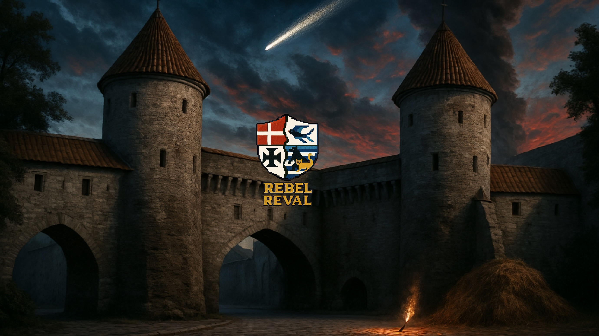
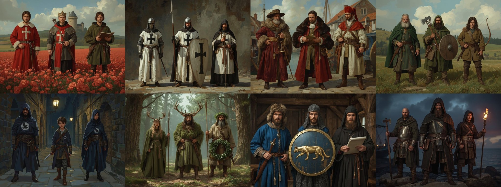
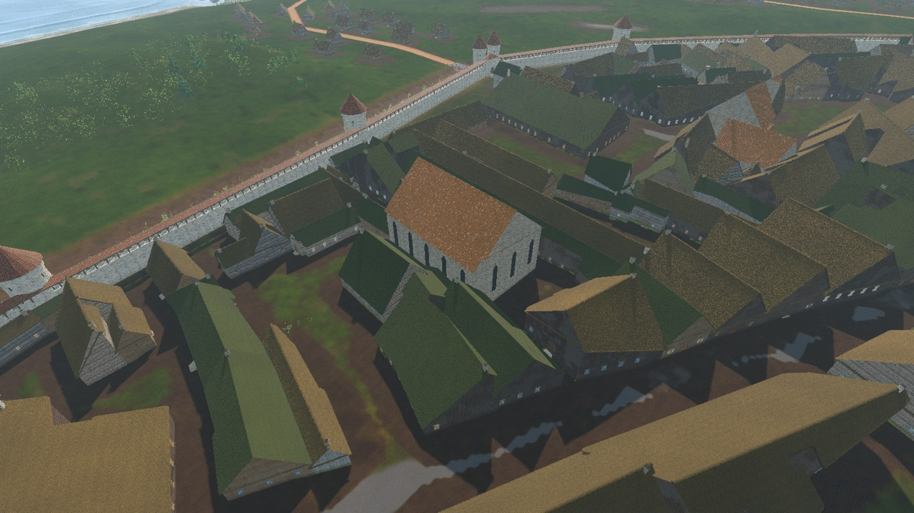
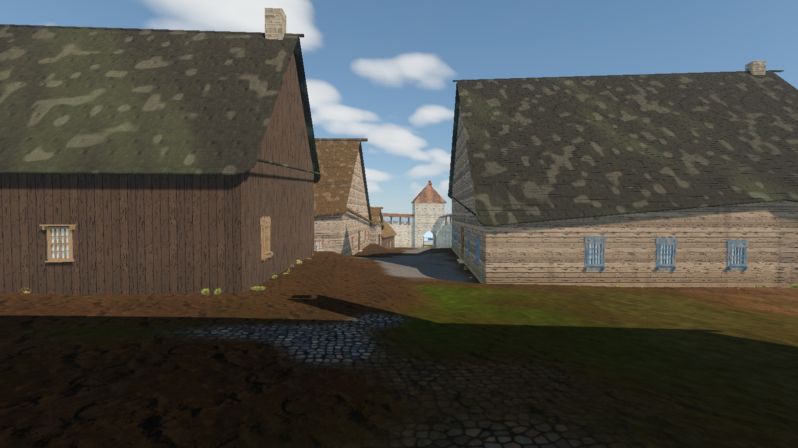
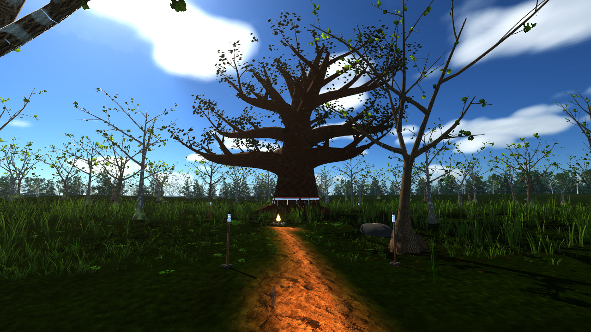
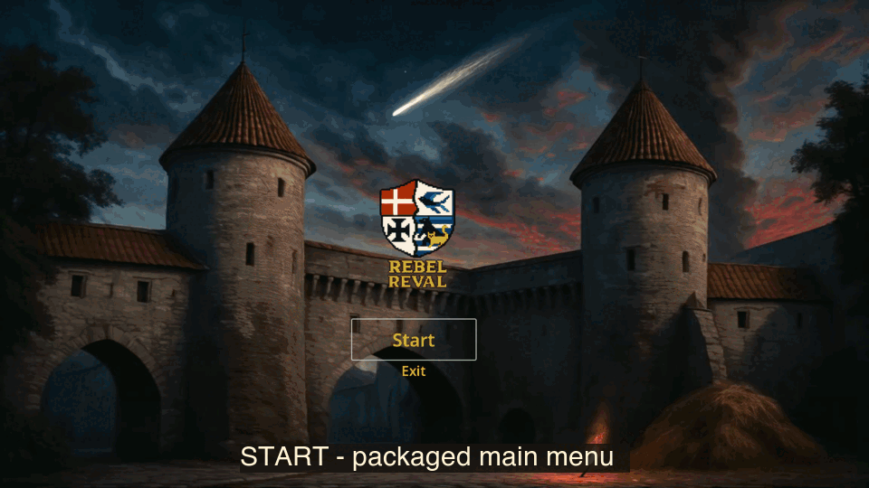

# Reval Rebel



**Reval Rebel** is an open-world adventure RPG set in Reval (present-day Tallinn). The player is a 15-year-old clairvoyant orphan who becomes a healer's apprentice in 1342, a year before the St. George's Night Uprising of 1343. Sick and wounded people come to the Holy Spirit almshouse; to cure them he has to find what is wrong in their families and mend it, because illness of the body and of the soul go together. Plague and war are on their way, and every household he heals or breaks moves them closer or further away.

The game has two layers: a physical, realistic world in the spirit of The Witcher 3, RDR2 and Kingdom Come: Deliverance 2, and a spirit world in the spirit of Persona 5 and the Witcher 3 detective mode. The hero is clairvoyant and can fight in either world; some creatures exist only in the spirit world. Morality is grey and no faction is "right". Christian motifs (churches, services) and pagan elements coexist.

The core of the game is adventure, exploration, quests and character progression (GTA / Witcher 3 / RDR style). The history cannot be prevented; who survives it and what the hero becomes is the game.

> Reval Rebel is in pre-production with an early playable Godot prototype. Use the project task board (`tasks` tool) for executable work, [`docs/SETUP.md`](./docs/SETUP.md) to run it, and [`docs/MAP_AUTHORING.md`](./docs/MAP_AUTHORING.md) for the production compact/chunked map workflow ([ADR 0009](./docs/adr/0009-map-blueprint-authoring-architecture.md), [ADR 0010](./docs/adr/0010-large-map-runtime-chunking.md)). The protagonist and combat frame are being redirected by [ADR 0033](./docs/adr/0033-teen-protagonist-and-spirit-dialogue-combat.md): a 15-year-old clairvoyant orphan apprentice, with Kalev as master smith, magic and most combat in a spirit world driven by dialogue ([`SPIRIT_DIALOGUE.md`](./docs/SYSTEMS/SPIRIT_DIALOGUE.md), planned). Text below that still describes Kalev as the protagonist or hammer and night combat as the combat spine describes the current prototype until the ADR's tasks land. [ADR 0052](./docs/adr/0052-healer-apprentice-and-family-cure-loop.md) then made him a healer's apprentice instead of a weapon-smith's: Kalev is smith and folk healer, Brother Tidemann of St Catherine's friary teaches him the Church's medicine, and the household-cure loop ([`HOUSEHOLD_CURE.md`](./docs/SYSTEMS/HOUSEHOLD_CURE.md), planned) replaces commissions as the core loop. The scope was widened to a three-act faction RPG by [ADR 0008](./docs/adr/0008-three-act-campaign-and-faction-scope.md) and legacy design systems (magic, NATURAL/psyche, Living City, expanded cast) were returned to the plan by [ADR 0017](./docs/adr/0017-legacy-design-reintroduction.md); the playable MVP still ships first.

## The heart of the game

> Can you help many people and stay clean when no side is in the right?

- **Main quest (political).** Either help the Teutons and Danes subjugate the pagans, or help the pagan Estonians defeat the conquerors. Victory needs one side plus neutral groups, in the manner of Skyrim's faction quests.
- **Global spiritual goal.** Progress the hero by opening all chakras. Grey morality makes this extremely hard: it requires helping a great many people.
- **The doctor of souls.** The hero cures the sick by mending their households, after the medieval image of *Christus medicus*. The same knowledge can poison, divide and sell secrets: a full dark path for players who want it, built from remembered choices, not a karma meter ([ADR 0052](./docs/adr/0052-healer-apprentice-and-family-cure-loop.md)).
- **Two worlds.** Physical realism plus a spirit world for investigation and combat; see [ADR 0033](./docs/adr/0033-teen-protagonist-and-spirit-dialogue-combat.md) and [`SPIRIT_DIALOGUE.md`](./docs/SYSTEMS/SPIRIT_DIALOGUE.md).
- **History holds its course; people don't have to.** Attested events - the signal fires, the siege of Reval, Kanavere Bog, Sõjamäe, the killing of the Four Kings at Paide, the 1346 sale of Estonia - happen on schedule. The player steers the human cost inside them. Consequences surface in named characters, changed districts, faction ledger standing and Living City pressure meters (Hope / Fear, [ADR 0017](./docs/adr/0017-legacy-design-reintroduction.md)), not in a single good/evil score.

> Design note: older text below that frames the forge as the central lever, commissions as the core loop, remembered forged objects, or "you fight with what you forged" is superseded by [ADR 0052](./docs/adr/0052-healer-apprentice-and-family-cure-loop.md) and kept only where it still describes the current prototype. Kalev's forge remains the hero's home, where he sleeps and learns iron charms; the almshouse is where the patients come.

## How it plays

The game runs on a day/night rhythm inside authored story phases:

1. **By day**, take in patients at the almshouse, read their symptoms, and follow the cause into their households: grief, debt, a feud, a secret. Move through the districts talking to people whose allegiances are in motion.
2. **In the household**, watch the family's quarrels as spirit duels and fight the decisive one. Mend the household and the remedy holds; or break it, sell what you learned, or give a false cure. Every outcome is remembered per household (planned, [ADR 0052](./docs/adr/0052-healer-apprentice-and-family-cure-loop.md)). The current prototype still runs forge commissions here.
3. **By night**, face the consequences in compact authored missions — sabotage, theft, escort, defense, escape — with combat and non-combat routes.
4. **In the aftermath**, watch people, places, faction standing, patrols, and supplies react.
5. **At Hingepuu**, tend Kalev's inner world: NATURAL aspects, psyche states, and reflection - the soul-tree is both narrative weight and progression ([ADR 0017](./docs/adr/0017-legacy-design-reintroduction.md)).

**Factions keep a ledger; the city keeps pressure meters.** Each active faction tracks standing with Kalev through explicit remembered events - works delivered, flaws discovered, favors, betrayals. Living City Hope / Fear meters capture broader rebel morale and civic order. Standing and meters together open and close quests, prices, routes, and protection. There is no join-a-team menu; allegiance emerges from play until St. George's Night forces one decision that cannot stay ambiguous.

Time advances through authored phases, not a simulated clock. Dialogue is written and deterministic. Stealth comes from patrol avoidance and authored alternate routes, not a stealth simulation.

## Factions

Every faction believes it is in the right, and none is a clean moral team. Roster entries follow the confidence labels in [`docs/CANON.md`](./docs/CANON.md). Flag emojis follow the roster vocabulary in [`characters/README.md`](./characters/README.md) and map to in-game cloth charges via [`FactionHeraldry`](./scripts/map/faction_heraldry.gd) (`faction=` map keys).

| Flag | Faction | Wants | Shadow |
|---|---|---|---|
| 🇩🇰 | **The Danish Crown** (`danish_crown`) | Keep its distant, indebted rule of Estonia | Taxes its subjects into ruin to fund a fading claim |
| ✠ | **The Livonian Order** (`livonian_order`) | A pious land under one faith and one law | Order becomes fanaticism; massacre becomes policy |
| 🇪🇺 | **The Hanseatic guilds** (`hanseatic`) | Trade above all; a profitable, quiet Reval | Lives and traditions priced like cargo |
| ✊ | **The Harju Kings** (`harju_kings`) | Freedom; the rural heart of the uprising | Liberation slides into indiscriminate slaughter |
| 🐦 | **The Black Cloaks** (`black_cloaks`) | Liberation from inside the walls - smiths, artisans, the underclass | Terror is a tool that doesn't stay aimed |
| 🍀 | **The Cult of Metsik** (`cult_metsik`) | The old ways, the sacred groves, the old gods | Would burn the new world whole to regrow the old |
| 🐻🐆 | **Pskov & Novgorod emissaries** (`pskov_novgorod`) | Opportunity in the chaos; a weakened Order | Any ally is sellable at the right price |
| 🏴‍☠️ | **The Vitalienbrüder** (`vitalienbruder`) | Plunder; chaos is the business model | No flag, no loyalty, no restraint |

Concept art for the eight launch factions (costume lineups, reference only): [`docs/concept/factions/`](./docs/concept/factions/README.md).



Remaining historical powers - the bishoprics, Lithuania, the Golden Horde, the Blackheads as a distinct body, and other legacy roster entries - start as background canon and are candidates for act-gated playable lines through [ADR 0017](./docs/adr/0017-legacy-design-reintroduction.md) / P7 cast-faction reconciliation.

## The campaign

| | Act 1 — The Simmering City | Act 2 — The Fire of Rebellion | Act 3 — The Iron Harvest |
|---|---|---|---|
| **When** | Spring 1343, to the night of April 23 | April–May 1343 | 1344–1346 |
| **Where** | Lower Town, market & civic quarter, north quarter | Reval under siege; Harju village, rebel camp, sacred grove, Pärnu, the battlefields | The occupied forge; Padise, Paide, Saaremaa (Pöide) |
| **Focus** | Patients, households, investigation, allegiance | Night missions, the siege, forged objects returning | Coerced work, quiet resistance, what remains |
| **Climax** | St. George's Night at Viru Gate — Open, Seal, or Break | The Four Kings at Paide | The sale of Estonia, 1346 |

The story begins at dusk in the Holy Spirit almshouse, when a wounded watchman is carried in with a broken spearhead in his side. The spearhead bears Kalev's mark. The matron sends for the smith who can speak to iron; Kalev comes, charms the iron out, sees that the orphan boy [Apprentice](./docs/CHARACTERS/apprentice.md) knew where it hurt before anyone touched the man, and takes him in. Kalev's apprentice Mart is missing, rejected iron has disappeared, and the forge ledger can implicate more than one person ([ADR 0033](./docs/adr/0033-teen-protagonist-and-spirit-dialogue-combat.md), [ADR 0052](./docs/adr/0052-healer-apprentice-and-family-cure-loop.md)). Act 1's five day/night cycles and eight quests build to St. George's Night, where the Open/Seal/Break decision at Viru Gate is no longer the end of the story — it is the shape of the war Kalev must live through. Acts 2 and 3 replay his choices back at him: objects he forged resurface in siege encounters, people he saved or sold reappear on both sides, and the endings are families of outcomes for Kalev, the forge, the people, and the land.

Target length is 15–20 hours across the three acts, with replay value in branches and consequences, not procedural runs.

**The vertical slice is the MVP.** It covers the prologue and **A Bitter Brew** in four reusable spaces, and must prove that one forging choice changes a night encounter, the following phase, and at least two character reactions before any act-scale production begins.

## Characters


Concept art for the seven core characters (reference only): [`docs/CHARACTERS/img/`](./docs/CHARACTERS/img/README.md).

The vertical-slice MVP centers on seven core characters: [Kalev](./docs/CHARACTERS/kalev.md), [Mart](./docs/CHARACTERS/mart.md), [Aita](./docs/CHARACTERS/aita.md), [Kaja](./docs/CHARACTERS/kaja.md), [Captain Henning](./docs/CHARACTERS/henning.md), [Jürgen Witte](./docs/CHARACTERS/jurgen.md), and [Ellen Luik](./docs/CHARACTERS/ellen.md). The wider [legacy roster](./characters/README.md) returns to the production plan under [ADR 0017](./docs/adr/0017-legacy-design-reintroduction.md): named faction figures are promoted into [`docs/CHARACTERS/`](./docs/CHARACTERS/README.md) briefs and built as new shared-rig models. Legacy prototype pixel art is inspiration only.

Kalev is a fixed protagonist with no amnesia; NATURAL aspect allocation and psyche play deepen him without a separate custom hero. There is no party control - allies act in authored missions, not under player command.

## World and tone

Reval is a Danish-ruled, German-elite city with overlapping legal, religious, and linguistic communities, surrounded by a countryside on the edge of revolt. Reval and its near hinterland are one seamless world: the walled Lower Town with its streets, churches, and the forge, and the meadows, woods, villages, and groves just outside the walls. Distant locations - monastery, castles, islands, battlefields - are reached by an explicit journey, and many already exist in the repository as contract-tested map prototypes awaiting activation.

Rural violence, the siege, and the reprisals stay historically anchored; an uprising inside Reval's walls is treated as alternate history at the act boundary. Folklore and magic return as playable systems under [ADR 0017](./docs/adr/0017-legacy-design-reintroduction.md): pagan combinatorial elements, Christian divine rites, and NATURAL/Hingepuu progression, all labelled `folklore` or `invented` where they leave attested history. The slice may still ship ambiguous belief quests (for example Root and Ember) before literal magic branches land. Named people, events, institutions, buildings, and beliefs are marked as `attested`, `plausible composite`, `folklore`, or `invented` in [`docs/CANON.md`](./docs/CANON.md).

## Visual direction

The game presents historically grounded 1343 Reval through a highly detailed, color-saturated fantasy/anime period-drama finish: painterly PBR materials, expressive silhouettes, colorful shadows, and HDR-range cinematic lighting with controlled bloom. Historical evidence still governs architecture, clothing, tools, fauna, and material culture; stylization governs color, shape emphasis, effects, and emotional staging. Gameplay logic (collision, navigation, interaction) remains on a deterministic orthogonal plane across third-person, first-person, and top-down camera modes.

Production characters use one shared rig and animation library with tiered mesh, texture, and shader fidelity. The technical foundation lives in [`docs/adr/0007-ai-generated-isometric-presentation.md`](./docs/adr/0007-ai-generated-isometric-presentation.md); the current visual decision is realistic and historically accurate, with humans built on a MakeHuman CC0 base ([`docs/adr/0022-realistic-human-characters.md`](./docs/adr/0022-realistic-human-characters.md), superseding the fantasy/anime finish of ADR 0018), with binding palette, detail, light, and readability rules in [`docs/ART_BIBLE.md`](./docs/ART_BIBLE.md).

## Built by AI agents

This game is produced end to end by AI agents — code, content, art, music curation, and documentation — with a human maintainer acting as product owner and reviewer. That is a design constraint, and the architecture serves it:

- **Maps are data.** `MapBlueprint` is the compact human/AI source, compiled deterministically to the existing contract-tested `MapDefinition`; see the [map-authoring guide](./docs/MAP_AUTHORING.md) and [ADR 0009](./docs/adr/0009-map-blueprint-authoring-architecture.md).
- **Quests are data.** Dialogue, quests, items, and characters are schema-validated JSON packages; the quest-content pipeline (P4) turns "add a quest" into an agent task with generated branch-traversal tests. Content volume in Acts 2–3 depends on this, not on hand-wiring scenes.
- **Art is generated under contract.** Materials and textures come from the style-lock kit with provenance rows in [`assets/SOURCES.csv`](./assets/SOURCES.csv); characters are rig variants, not bespoke animation sets.
- **Dialogue is authored offline.** Agents write and validate it at development time; there is no runtime LLM, generated quest, or free-text NPC chat in the shipped game ([ADR 0003](./docs/adr/0003-authored-offline-dialogue-and-prohibit-runtime-llm.md)).
- **Every task is verifiable.** Work enters the project task board (`tasks` tool) as `ID | deps | deliverable | verify` and closes only against its verification line, per the task contract in [`AGENTS.md`](./AGENTS.md).
- **Every feature is documented.** A task that implements or changes a feature updates its documentation in the same change: what it does, how to use it, where it lives, the IDs and saved state it touches, and how to verify it. A feature without docs is not done, and every page stays reachable from the [documentation hub](./docs/README.md) ([`AGENTS.md` → Feature documentation](./agents/skills/feature-docs/SKILL.md#feature-documentation-mandatory)).

The spring 1343 fortification snapshot uses a conservative four-position completed Lower Town tower registry rather than the later 1355/1373 or fifteenth-century circuit. Named placement, construction candidates, excluded later towers, and the future one-map-per-tower mini-dungeon plan are documented in [`docs/reports/reval_fortifications_1343.md`](./docs/reports/reval_fortifications_1343.md).

## Scope

The three-act campaign includes:

- Kalev as fixed protagonist; the forge as hub; the commission → investigation → modification → consequence → reflection loop;
- eight launch factions with ledger-based standing, Living City Hope/Fear pressure, and quest lines; seven slice-core characters plus an expanding cast promoted from the legacy roster;
- Reval districts (Lower Town, market/civic, north quarter) and authored world locations activated from existing prototypes;
- seamless movement through Reval, its nearby hinterland, and into buildings without loading screens ([ADR 0019](./docs/adr/0019-seamless-contiguous-location-streaming.md), [ADR 0027](./docs/adr/0027-reval-hinterland-streaming-group.md), [ADR 0028](./docs/adr/0028-seamless-building-interiors.md)); distant regions such as Saaremaa keep an explicit journey with loading;
- night-mission templates (sabotage, theft, escort, defense) with combat and non-combat routes;
- hammer combat, self-forged gear, forge techniques, and dual-school magic (pagan combinatorial elements and Christian divine rites) wired through NATURAL aspects and Hingepuu psyche play;
- authored dialogue, explicit consequence state, folklore/magic with confidence labels, and act-spanning forged-object recall;
- ending families for Kalev, the forge, the people, and the land.

It does **not** include:

- a seamless Estonia-wide open world, or playable campaigns in Riga, Dorpat, or other cities;
- runtime LLM dialogue, generated quests, or procedural runs;
- party control, army or fleet battle simulation, or survival simulation;
- a universal good/evil morality score detached from faction ledger and city-pressure systems;
- restoring legacy pixel sprites or superseded NATURAL HUD art as production runtime assets;
- the non-canon 1351 plague epilogue.

Tower-capture strategy, naval/castle-building mini-games, and other fringe legacy loops stay out until a dedicated ADR accepts them. Sprawl crafting trees, randomized loot, and blacksmith rhythm minigames remain excluded unless P7 mini-game reconciliation explicitly reinstates a named variant.

Campaign breadth is governed by [ADR 0008](./docs/adr/0008-three-act-campaign-and-faction-scope.md) as amended by [ADR 0017](./docs/adr/0017-legacy-design-reintroduction.md). The working inventory is [`docs/LEGACY_REINTRODUCTION.md`](./docs/LEGACY_REINTRODUCTION.md). A further major addition must replace comparable scope, be recorded in an ADR, and receive a verifiable the project task board (`tasks` tool) entry before implementation.

## Development status

The repository currently has:

- a Godot 4.7 project with a main menu, player movement, scene transitions, the converted Lower Town slice rendering through the 3D orthographic view layer, and the persistent quick-access menu;
- **D-003 complete:** walkable eastern slice with the Kalev rig, Mart conversation, anvil spearhead pickup into the bag UI, and session re-entry that keeps placement/ownership in `GameState`;
- **D-004 complete:** macOS `rr` export produces a runnable `build/rr.dmg` / `Reval Rebel.app`, the move-talk-pickup loop is proven without debug presets, and the frame walkthrough is linked below;
- a seamless 1343 Reval city preview ([ADR 0031](./docs/adr/0031-continuous-reval-city-plan.md)) with historically sourced street plan, walls and towers, landmark churches, Kalev's smithy with forge bay and living quarters, living vegetation with seasons and moss, weather, sea, and a walkable hinterland with regional sites such as the sacred grove;
- inactive contract-tested outdoor map prototypes (market/civic, north, south, Toompea, and others) awaiting act-gated activation;
- documented headless import and playable-room smoke checks, a hardened Godot test harness, schemas and Python validation for authored content, map-pipeline gates, and CI for the engine pin, content, tests, imports, and export smoke.

Vertical-slice systems beyond the demo loop (full combat room, enemies, night consequence, faction ledger) remain incomplete. Delivery order is strict: **playable demo → vertical-slice MVP → Act 1 → Act 2 → Act 3**, and the next work is deliberately ordered in the project task board (`tasks` tool); legacy documents do not silently expand that scope.

### The world today

The playable world is now a seamless 1343 Reval: a walled Lower Town of timber and limestone houses, its key churches built from the historical record, Kalev's smithy as the hub, and a hinterland of meadows, woods, and sacred groves outside the walls. Captures from October 2026:

| | |
|---|---|
|  |  |
| **St Olaf and the north harbour** - the 1343 church, wall circuit, and beach landing | **St Catherine's quarter** - dense plots pressed hard against the church |
|  |  |
| **Pikk street** - the road down to the sea gate | **Smithy lane** - Kalev's limestone forge among timber neighbours |
|  |  |
| **The forge bay** - hearth, bellows, anvil, quench tub | **Sacred grove** - the ancient oak in the hinterland |

More plates and how they are captured: [seamless city](./docs/SYSTEMS/SEAMLESS_CITY.md), [landmark sites and the smithy](./docs/SYSTEMS/CITY_LANDMARK_SITES.md), [regional sites](./docs/SYSTEMS/REGIONAL_SITES.md), and the [historical walk coverage report](./docs/reports/historical_walk_coverage.md).

### Demo walkthrough (D-004, earlier build)



This animation predates the seamless city and shows the original demo loop. Packaged macOS demo proof, in-binary Start-Mart-pickup verification, animated capture, and source frame sequence: [`docs/reports/demo_walkthrough_d004.md`](./docs/reports/demo_walkthrough_d004.md). Reproduce with `tools/verify_packaged_demo.sh`.

## Run the project

Install the pinned Godot version from [`.godot-version`](./.godot-version), then open [`project.godot`](./project.godot) in the editor and press **F5**. Platform-specific setup and headless commands are in [`docs/SETUP.md`](./docs/SETUP.md).

Useful repository checks:

```bash
godot --headless --script tools/run_godot_tests.gd
python3 tools/validate_content.py content/examples/valid content/examples/support
python3 tools/validate_asset_sources.py
python3 tools/generate_active_docs_report.py --check
tools/run_performance_report.sh build/benchmarks/performance-smoke.json --quick
```

## Project guide

**[Documentation hub](./docs/README.md)**: every feature, world-building system, character, lore page, and report, reachable from one page. Each implemented feature has a page in [`docs/SYSTEMS/`](./docs/SYSTEMS/README.md).

| Document | Purpose |
|---|---|
| [`docs/README.md`](./docs/README.md) | Documentation hub: links to every document in the repository |
| the project task board (`tasks` tool) | Ordered, executable work |
| [`AGENTS.md`](./AGENTS.md) | Repository map, commands, constraints, and task contract |
| [`docs/CANON.md`](./docs/CANON.md) | Timeline, terminology, names, and historical confidence |
| [`docs/CHARACTERS/`](./docs/CHARACTERS/README.md) | Active cast briefs and relationships |
| [`docs/CITIZENS/`](./docs/CITIZENS/README.md) | Census of 1343 Reval's residents, ledger, citizen cards, faction rosters |
| [`docs/ART_BIBLE.md`](./docs/ART_BIBLE.md) | Visual target, scale, palette, and readability rules |
| [`docs/SETUP.md`](./docs/SETUP.md) | Editor installation, import, startup, tests, and export |
| [`docs/CONTROLS.md`](./docs/CONTROLS.md) | Camera-aware control scheme, context-sensitive primary click, and default bindings |
| [`docs/MAP_AUTHORING.md`](./docs/MAP_AUTHORING.md) | Compact map-blueprint primitives, stable IDs, compiler architecture, validation, and migration policy |
| [`docs/SYSTEMS/`](./docs/SYSTEMS/) | Per-feature documentation for gameplay systems, implemented and planned (status in each file header) |
| [`docs/adr/`](./docs/adr/) | Product and technical decisions |
| [`docs/LEGACY_REINTRODUCTION.md`](./docs/LEGACY_REINTRODUCTION.md) | Legacy design → P7 plan inventory (ADR 0017) |
| [`assets/SOURCES.csv`](./assets/SOURCES.csv) | Asset provenance, rights, and approval metadata |
| [`docs/FLORA_FAUNA.md`](./docs/FLORA_FAUNA.md) | Sourced 1343 native vegetation and animal species reference |

Root design documents, much of `story/`, and the older faction and location indexes are the seed corpus for [ADR 0017](./docs/adr/0017-legacy-design-reintroduction.md). They are not runtime truth until reconciled through [`docs/LEGACY_REINTRODUCTION.md`](./docs/LEGACY_REINTRODUCTION.md) and strict the project task board (`tasks` tool) P7 / act rows. Legacy 2D art in those trees is inspiration only.

### Legacy Design & Research Material

The following documents are the reintroduction corpus (planning inventory: [`docs/LEGACY_REINTRODUCTION.md`](./docs/LEGACY_REINTRODUCTION.md)):

**Core Gameplay & Vision**
- [`GAME-PILLARS.md`](./docs/GAME-PILLARS.md), [`GAMEPLAY.md`](./docs/GAMEPLAY.md), [`GAMEPLAY-NIGHT.md`](./docs/GAMEPLAY-NIGHT.md)
- [`MINI_GAMES.md`](./docs/MINI_GAMES.md), [`QUESTS.md`](./docs/QUESTS.md), [`IDEAS_RESEARCH.md`](./docs/IDEAS_RESEARCH.md)

**Story & World Context**
- [`history/HISTORY.md`](./history/HISTORY.md), [`history/TIMELINE.md`](./history/TIMELINE.md)
- [`story/STORY.md`](./story/STORY.md)
- [`docs/BESTIARY/README.md`](./docs/BESTIARY/README.md) (Folklore and creatures)

**Character & Mechanics Concepts**
- [`character/BUILD.md`](./character/BUILD.md), [`character/COMBAT.md`](./character/COMBAT.md), [`character/PSYCHE.md`](./character/PSYCHE.md)
- [`character/MAGIC-ELEMENTS.md`](./character/MAGIC-ELEMENTS.md), [`character/CHRISTIAN-MAGIC.md`](./character/CHRISTIAN-MAGIC.md), [`character/PAGAN-MAGIC.md`](./character/PAGAN-MAGIC.md)
- [`characters/README.md`](./characters/README.md) (expanded faction and NPC roster)
## Map pipeline documentation

- [Compact map authoring, validation, migration, scale budgets, and limitations](./docs/MAP_AUTHORING.md)
- [ADR 0009: canonical MapBlueprint authoring](./docs/adr/0009-map-blueprint-authoring-architecture.md)
- [ADR 0010: compiled-map runtime chunking and persistence](./docs/adr/0010-large-map-runtime-chunking.md)

Use `tools/run_map_pipeline_ci.sh all` for the production parser/compiler/audit/persistence/parity/benchmark gates. Migrate maps individually and only with reviewed parity protection.
