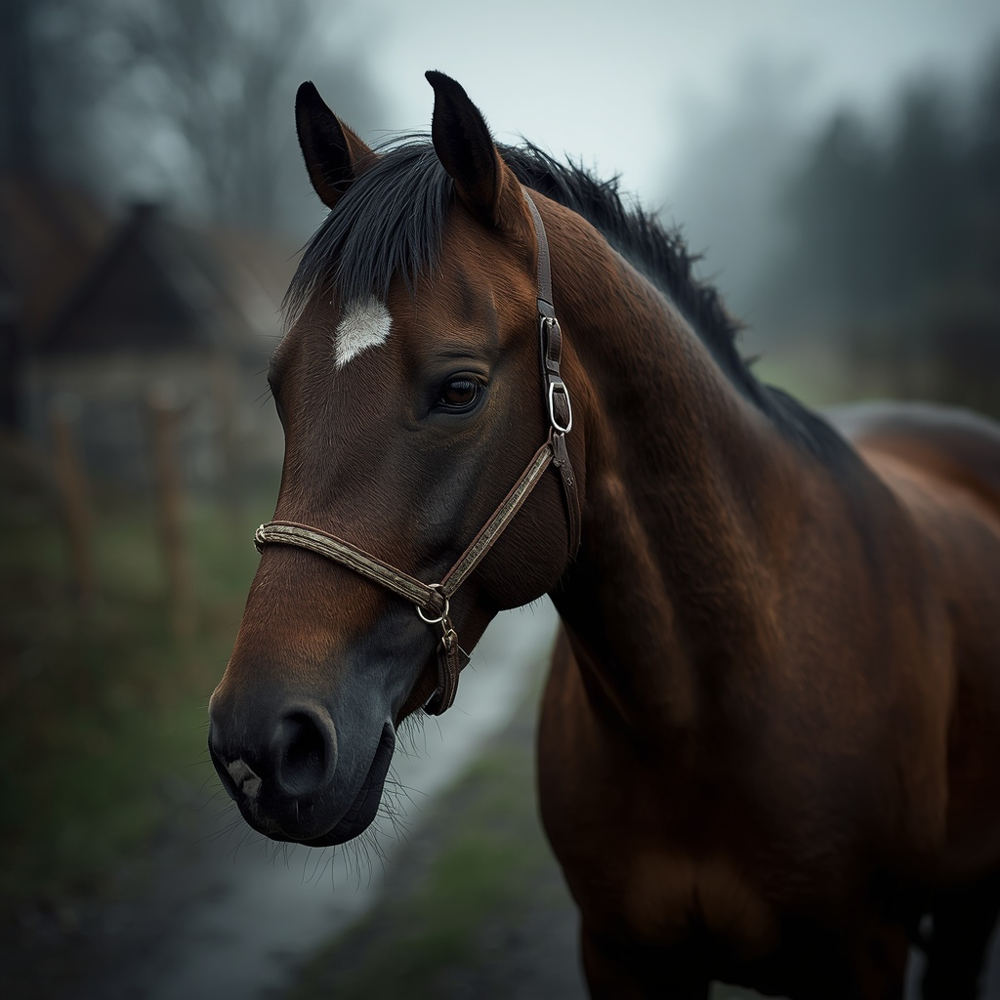
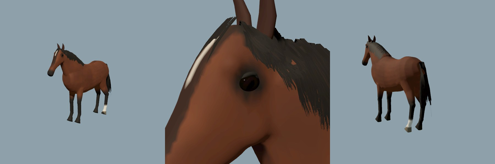

# Horse

> Bay cob of the Reval streets and carts.

| Field | Value |
|---|---|
| ID | `fauna.horse` |
| Latin | *Equus ferus caballus* |
| Class | mammal |
| Group | `ungulate` |
| Owner or habitat | urban (P2-024), foreland pasture |

## 3D model

| Item | Value |
|---|---|
| Status | Project-authored GLB |
| Runtime file | [`assets/storybook/horse/horse.glb`](../../assets/storybook/horse/horse.glb) |
| Source | `tools/assets/build_horse_source.py` |
| Author and licence | Project author, AGPL-3.0-or-later |
| Rig and clips | Shared mammal rig, six clips: Idle, Walk, Run, LookAround, Graze, Alert (measured limb chains). |

## Hair and eyes

- Mane, forelock and tail are hair cards: quad ribbons that sample one column of
  a strand atlas generated by `hair_atlas()` in the build script (1024 px,
  eight clumps of tapered strands with ragged roots and tips). The material
  clips alpha (glTF `MASK`, Godot alpha scissor) and is double-sided. The mane
  lies on the near side in three layers; locks gather at the crest and fan out.
- Eyes are glossy eyeballs (5 cm) placed from the welded head surface, with a
  horizontal pupil and dark-brown iris in vertex colour and an almond ring of
  dark bare skin for the lids. `import_realistic_mammals.py` keeps the
  authored roughness of `horse_eye` and `horse_hair`; other materials get 0.86.
- Review: `tools/godot_render.sh --script tools/capture_horse_review.gd` writes
  `docs/reports/images/fauna/horse_*.jpg` through the runtime loader.

## Code

- Catalogue: `scripts/map/view3d/map_view_mammal_species.gd`
- Mesh and loader: `scripts/map/view3d/map_view_mammal_meshes.gd + map_view_medieval_animal_models.gd`

## Notes

- Known limits: rigid cannon and pastern, no tack, one coat. Hair cards are skinned to the head, neck and tail bones but have no secondary motion. Alpha scissor thins the hair at long range.
