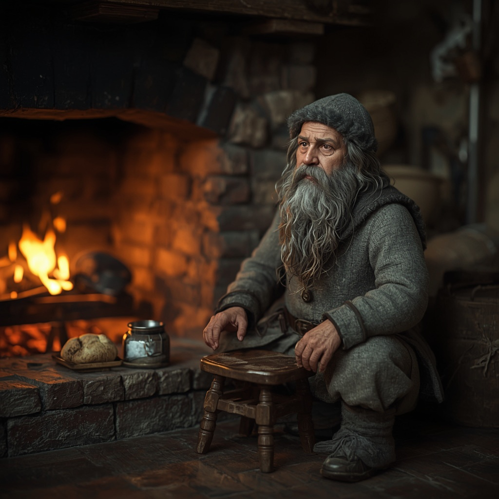

# Domovoy

> The Russian merchant yard's house spirit, who came with the traders and stayed when they left.

| Field | Value |
|---|---|
| ID | `bst.domovoi` |
| Layer | `spirit` |
| Tier | `backlog` |
| Confidence | `folklore` |
| Habitat | Russian merchant yard |
| Faction ties | pskov_novgorod |
| Archive reference images | none |

**Illustration:** Generated with Leonardo AI, Lucid Realism model. Photorealistic documentation concept art only; existing archive references are retained.

**Generation prompt:** Photorealistic cinematic still of a Domovoy, Pskov-side Slavic house-spirit variant kept as a regional visitor in Reval: a knee-high old household guardian with a broad weathered bearded face, rough grey homespun wool, fur-lined cap and ash-smudged hands, quietly watchful beside a bread oven in a 14th-century Russian merchant-yard storeroom. Protective and wary rather than monstrous; historically grounded Eastern Baltic / Rus domestic details, warm firelight, realistic skin, beard, wool and wood textures, muted ash-brown and russet palette, no text.

**Negative prompt:** illustration, painting, CGI, fantasy goblin, dragon, demon, horns, glowing eyes, magic, modern costume, text, watermark, oversized weapons

## At a glance
- Appears in the Russian yard's stable or stove.
- Pskov variant of the Estonian house spirit.
- Kept as a variant, not a separate creature.
- Fed with bread and salt.

## Folklore origin
Slavic house spirit; kept only as the Pskov variant of [majahaldjas](./majahaldjas.md), [estonian_folklore.md](../../lore/estonian_folklore.md) section 4a note. `folklore`.

## Appearance
- **Body:** Knee-high bearded elder.
- **Materials and colours:** Grey beard, felted wool, ash on hands.
- **What a model must get right:** Beard and felted coat; family resemblance to the head of the house.
- **Concept-art prompt:** Concept art of a domovoi, a small bearded elder house spirit in felted grey wool sitting on a bread-oven in a Russian merchant yard storeroom, beard like frayed rope, 14th century Baltic Hanseatic trading yard, grounded folklore realism, warm muted palette, neutral background, even lighting.
- **Model notes:** Small humanoid scaled 0.5; spirit-layer only.

## Motivation
To keep the house; it fears neglect. Bread and salt secure it.

## Manifestation
Russian merchant yard in Lower Town.

## Combat profile
Spirit duel ([ADR 0033](../../adr/0033-teen-protagonist-and-spirit-dialogue-combat.md)): turn-based exchange of statements and offerings, resolved by the apprentice's reading of the being; no hit points, a pressure meter instead. Topic: care and trade. Non-violent resolution: bread and salt. Destroying: 3 folk-debt.

## Voice
- "Who moved my stool?"

## Relationships and factions
Tied to [Pskov-Novgorod](../../CITIZENS/factions/pskov_novgorod.md). Related: [majahaldjas](./majahaldjas.md).

## Game hooks
Backlog seed: a missing shipment is the domovoi's offence. First meet: the Russian yard.
