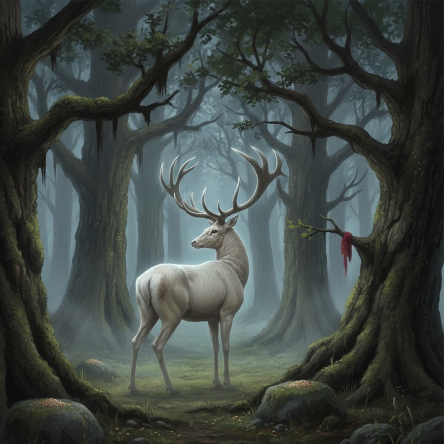

# Hiie hirv (the grove deer)

> The pale deer of the hiis that every hunter has tried to catch and no one has, because it was never running away: it was showing the way.

| Field | Value |
|---|---|
| ID | `bst.hiie_hirv` |
| Layer | `spirit` |
| Tier | `act1` |
| Confidence | `folklore` |
| Habitat | Harju hiis groves within a day's walk (Iru, Rebala-Saha band) |
| Faction ties | cult_metsik |
| Archive reference images | image-1 |

**Illustration:** Generated with Leonardo AI, Nano Banana (gemini-2.5-flash-image) model; cropped to remove a model-drawn signature. Documentation concept art only; the archive sprite image-1 is retained.

**Generation prompt:** Hiie hirv, the spirit deer of an Estonian sacred grove (hiis): a pale, almost white great red-deer stag with broad branching antlers standing still among ancient gnarled oaks, looking back over its shoulder as if inviting someone to follow. Low moss-covered offering stones with small heaps of grain and a scrap of red wool tied to a bough. Faint cool silver glow around the deer, evening mist between trunks. Baltic woodland of the 14th century, painterly grounded folklore concept art, muted moss green, oak brown, pale silver, no people, no text.

**Negative prompt:** text, watermark, fantasy armor, glowing runes, temple, statue, cartoon, reindeer harness, crown, gore, modern objects, multiple deer

## At a glance
- A pale stag between old oaks that stops, looks back, and walks on when the apprentice comes near.
- It cannot be caught. Every hunter in the songs breaks his skis or loses it in the hills.
- It guards whatever the grove holds: a spring, a grave, a gift-stone, a hidden thing.
- An axe in its grove turns it from guide into storm.
- Oddity: it leaves no tracks in snow, but the grain on the offering stones is always disturbed.

## Folklore origin
The card joins two traditions. Each is labelled separately, because the creature as written here is a game composite, not a recorded Estonian belief.

**Finnish and Karelian (the animal):** *Hiiden hirvi*, "Hiisi's elk" (Finnish *hirvi* is the elk, *Alces alces*), is a runosong figure: Hiisi makes an elk from wood, branches and grass and sends it running through a Sámi village, upsetting the cooking pots; a hunter (Lyylikki the ski-maker, Lemminkäinen, or "Lauri Lappalainen") chases it on skis. In many variants the ski breaks and the elk escapes; in some he catches it on the third push. The song records are 19th century (SKVR, collected 1819-1896), with one Ostrobothnian text from the 1700s; Lönnrot's *Kalevala* (1849, runo 13-14) is a literary edit in which Lemminkäinen catches it for Louhi. The ski-hunt of a cosmic elk is also told by Sámi, Khanty and Mansi (Siikala 2012, pp. 390-394, via the [Wikipedia summary](https://en.wikipedia.org/wiki/Hiiden_hirvi) and its SKVR links). `folklore`, Finnish/Karelian, not Estonian.

**Estonian (the place):** *hiis* is the sacred grove, stone or spring, see [estonian_folklore.md](../../lore/estonian_folklore.md) (sacred groves and offering-stones) and the [Harju hiis dossier](../../../history/dossiers/folklore/harju-hiis-sites-within-walk-1343.md). The core rule is the ban on damaging it: Henry of Livonia (HCL XXIII:9, events of 1220) has priests cut the "images" in a Virumaa grove and the natives wonder that no blood flows; Russow (1578) writes that whoever cuts a tree or bush in a sacred grove would die; Hupel (1774) reports landlords ordering peasants to fell grove trees, the peasants refusing, and gifts of wool, wax, yarn and bread left in tree hollows; Eisen (1920) sums up 19th-20th c. lore as bans on cutting, berry-picking and cursing there (all quoted in Jonuks 2009, [*Folklore* 42](https://www.folklore.ee/folklore/vol42/jonuks.pdf)). `attested` for the texts, `folklore` for the belief.

**What is not attested:** no Estonian record of a deer or elk *of the hiis* was found. *Hiie põder* / *hiie hirv* is the Estonian rendering of the Kalevala animal ([et.wikipedia](https://et.wikipedia.org/wiki/Hiie_p%C3%B5der)), not a native belief. Siikala names *Hiiehobune* ("the hiis horse") as the Estonian counterpart; this pass did not check that in a primary source. The game's name, the guarding role and the chase duel are `invented` on the two bases above. Estonian *hirv* means red deer, Finnish *hirvi* means elk: the card keeps the Estonian word and the archive sprite's red deer, with an elk's weight and stubbornness.

## Appearance
- **Body:** A great stag, 1.5 m at the shoulder, heavier through the chest than a real red deer; a slow walk that becomes a long, unhurried trot it never has to break into a run.
- **Materials and colours:** Pale grey-white coat, darker at the legs as if wet with dew; antlers bare and bone-grey like peeled willow; a faint cool silver glow in the spirit layer only; eyes dark, not glowing.
- **What a model must get right:** It looks back over its shoulder: the pose that says "follow", not "flee". Broad branching antlers that read like bare branches. It always stands among trunks, never in open ground.
- **Concept-art prompt:** Concept art of the hiie hirv, the spirit deer of an Estonian sacred grove, a pale grey-white great stag with broad bare branching antlers like peeled willow, standing between ancient oaks and looking back over its shoulder, low mossy offering stones with grain at its feet, a scrap of red wool tied to a bough, faint silver haze, 14th century Baltic woodland, grounded painterly realism, muted greens and greys, neutral misty background, even lighting.
- **Model notes:** Quadruped rig (shared with the planned deer and the [wolf](./wolf.md) class); a walk, trot, look-back and fade clip. Spirit material: soft rim glow and no footprints; in the physical layer it is simply not there.

## Motivation
It wants the grove kept whole and remembered. It fears the axe and the hand that grabs. Contradiction: a guardian that leads strangers straight to the thing it guards, because the only safe guest is one who has seen it and still took nothing. It is released, and rests, when someone follows it to the end, names what is there, and leaves a gift instead of taking one.

## Manifestation
Dusk or early morning at a Harju hiis candidate (Iru hill, the Rebala-Saha band; see the dossier for site confidence), when the apprentice comes looking for something lost or hidden, or right after a tree in the grove has been marked for felling. It never appears inside the walls.

## Combat profile
Spirit duel ([ADR 0033](../../adr/0033-teen-protagonist-and-spirit-dialogue-combat.md)): a turn-based exchange of statements and offerings, resolved by the apprentice's reading of the being; no hit points, a pressure meter instead. Here the duel is a **chase**: each exchange is a step deeper into the grove, and the pressure meter is the distance between the apprentice and the deer.

**The folk rule at the core:** take nothing from the hiis (Russow, Hupel, Eisen above). Every option that grabs, cuts, picks, traps or closes the distance by force is the wrong answer. In the songs the ski breaks; here the grove closes: the deer is gone, the path folds back to the edge, and what it guarded is lost for this visit.

- **Topic:** respect for what is not yours to take.
- **Elements:** earth and wood; light (it shows the way).
- **Temperament:** patient, wary, unhurried; wrathful only after felling.
- **Right moves:** match its pace, stop when it stops, answer its look-back, leave a gift (wool, wax, bread, a bit of iron is *not* a gift here), and at the end name what it guards without touching it.
- **Non-violent resolution:** follow it to the guarded place and leave it as found. The reward is knowledge (where the spring, grave or hidden thing is) and the grove's trust, not an item.
- **If the grove has been cut:** the duel starts angry: the deer comes toward the apprentice instead of away, and the first moves must be an admission of who cut and why, before any following is possible.
- **Destroying it:** possible only by killing it as an animal in the physical layer at the end of a failed chase. 4 folk-debt, permanent loss of [Metsik cult](../../CITIZENS/factions/cult_metsik.md) trust, and that grove never opens again.

## Voice
It does not speak. Its lines are sounds and what the apprentice reads in them.
- (a single hoof-strike on stone) - "Here. Look."
- (it turns its head and waits) - "You may come. Hands empty."
- (bark, branch-crack, distant axe) - "They are cutting. Who sent them?"
- (it is gone, the grain on the stone scattered) - "You reached for me."

## Relationships and factions
Revered by the [Metsik cult](../../CITIZENS/factions/cult_metsik.md), who leave the gifts it disturbs. Angered by anyone who clears or cuts its grove: Church priests (the HCL grove-cutting is the model) and the Order's loggers, and later manor lords. Kin in purpose to [Metsavana](./metsavana.md), the forest owner who wants to be asked; Metsavana is the owner, the deer is the grove's watchful eye. Related: [metsavana](./metsavana.md), [hiid](./hiid.md), [tulukesed](./tulukesed.md).

## Game hooks
- **Act 1 seed, "Follow, don't catch":** a Metsik elder's grandchild is missing near the Iru hill grove. Hunters want to take the pale deer for the Order's table; the apprentice sees it in the spirit layer and must choose between chasing (fail, the trail closes) and following (it leads to the child asleep beside the grove spring).
- **Felling conflict:** an Order or Church work party marks the grove oaks for timber. The deer turns hostile; the apprentice can talk the work party round, warn the cult, or tell the commander, each with ledger consequences.
- **Forge hook:** a commission for an axe "for clearing a grove" is the trigger; Kalev's reaction and whether the apprentice warns anyone ties the forge to the grove.
- **First meet:** the edge of a Harju hiis candidate at dusk, Act 1.
