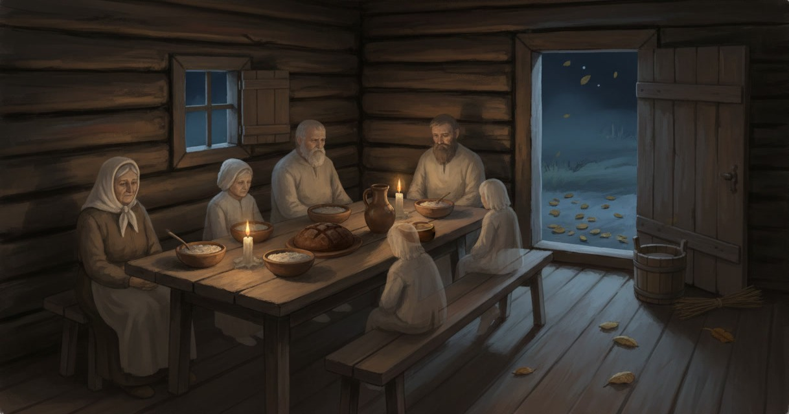

# Hinged

> The household's own dead, come home for the souls' season as a crowd of guests who must be fed, seated and seen off before they will leave the living alone.

| Field | Value |
|---|---|
| ID | `bst.hinged` |
| Layer | `spirit` |
| Tier | `act1` |
| Confidence | `folklore` |
| Habitat | farmsteads, the sauna and the smithy home in autumn |
| Faction ties | none |
| Archive reference images | none |

**Illustration:** Generated with Leonardo AI, Nano Banana (gemini-2.5-flash-image) model, white border cropped. Documentation concept art only. The glazed window is an anachronism for a 14th-century farmhouse (board shutters only); a model must not copy it.

**Generation prompt:** Hinged, Estonian ancestral souls visiting home in the autumn souls' season: interior of a dim smoke-blackened 14th-century Baltic peasant threshing-barn dwelling (rehielamu) at night, log walls, no glass windows, only a small wooden shutter and a low open door to a cold blue autumn night with fallen leaves. A rough plank table set for invisible guests with clay bowls of porridge, rye bread, a jug of ale, a few tallow lights, empty benches and a pail of warm water with a birch whisk by the door. Around the table sit faint semi-transparent ghostly ancestors, pale and see-through like mist, the log wall clearly visible through their bodies: old women in white linen headcloths and wool skirts, bearded farmers in coarse linen shirts, a small child. Many quiet presences, reverent and slightly uneasy. Painterly grounded folklore concept art, warm amber light against cold blue shadow, muted earth palette, no text.

**Negative prompt:** solid opaque people, glass windows, horror ghosts, skeletons, zombies, gore, glowing eyes, demon, modern furniture, Halloween, pumpkins, castle, armour, text, watermark, signature

## At a glance
- Not one ghost but the whole line of a family's dead: grandmothers, farmers, a child, all at once.
- Come home in late autumn, in fog and still air; a howling wind means they are unhappy.
- Want what a guest wants: a warm sauna, the house's own food, their names spoken, a proper farewell.
- Harmless when hosted well, a slow souring of luck, cattle and crop when not.
- Oddity: the dead who were buried in poor clothes whine about it on the way out.

## Folklore origin
Hingedeaeg (the souls' time, in north-coast Harju and Viru also *jaguaeg*) is the late-autumn season when the dead ancestors were believed to visit their former homes, [estonian_folklore.md](../../lore/estonian_folklore.md) section 4 (beings) and section 2 (sources). `folklore`.

- **Season.** Known across Estonia, with fuzzy limits set by the church feasts: usually one week after Michaelmas (29 IX) to one week before Martinmas (10 XI), elsewhere between Martinmas and St Catherine's (25 XI), or simply "in autumn". Mall Hiiemäe reads it as the pre-Christian year's end that later drifted toward All Souls (2 XI). Source: Hiiemäe, *Souls' visiting time in the Estonian folk calendar* (folklore.ee/rl/pubte/ee/usund/ingl/hiiemae.html); ERA *Eesti rahvakalender*, "Hingedeaeg" (folklore.ee/erk/exhibits/show/hingedeaeg). `folklore`.
- **Feeding.** Food was laid out once or several times, most often in the loft over the living room (tarepealne), earlier sources more often in the sauna. It had to be the household's own food, some of every dish; no symbolic or foraged food. Host and hostess called the dead by name, asked them to eat, apologised that there was nothing better, and at parting asked them to keep the field and herd and not to tread on the winter rye. Crop failure next year meant the souls had not been satisfied. Same sources. `folklore`.
- **Sauna.** Heating the sauna and warming wash-water before the meal is documented, but Hiiemäe notes it is stronger in Finnish and Karelian tradition; in Estonian records the sauna is mainly a place to set out food, or a whisk and soap are left with it. `folklore`.
- **Seating.** In the east-Estonian St Dmitri's version (midrusk, Saturday before 26 X), the family sat farther from the table until the souls had eaten enough. Record dated late 19th century. `folklore`.
- **Silence and work ban.** No spinning, sewing or wool work, especially in the evening when the souls arrive; noise risked thunder damage. `folklore`.
- **Send-off.** At the end the souls were seen off, a plate of fresh meat put in the loft and silence kept so they could leave; one Karksi record says the souls were driven out ("aeti engi välja") by a figure in a white sheet with a bundle of switches. Neglect was believed to "bring death to the house" or harm cattle and field. `folklore`.

**Dating of records.** Earliest written mentions are 17th-century: Göseken's grammar (Reval, 1660) and church visitation protocols name the souls' day as the time Estonians took food to the dead. Further printed notes: Helle/Gutsleff 1732, Hupel 1777, Wiedemann 1876, Loorits *Grundzüge* III (1950s synthesis). Most archive detail (ERA, RKM) is from the 1890s to 1970s, densest in Mulgimaa and south Estonia; the hingesandid mumming is judged a late custom (19th to early 20th century). Applying the custom to 1343 Harju is a projection backwards on the grounds that the core (season, feeding, address by name, send-off) is shared with Livonian and Latvian tradition and looks old. Treat it as `folklore` that fits the period, not as an attested 14th-century rite.

## Appearance
- **Body:** Ten to twenty figures at human scale, never more than half-solid; they sit, they do not walk in, they are simply there when the light shifts. Children among them.
- **Materials and colours:** Pale mist bodies in the family's dress of their own time: white linen headcloths, coarse linen shirts, wool skirts; a few in poor burial clothes. Grey-white against warm tallow light; the wall shows through them.
- **What a model must get right:** A crowd, not a monster; translucency you can read the room through; the set table and empty benches are half the creature.
- **Concept-art prompt:** Concept art of the hinged, Estonian ancestral souls at home in autumn, a dim log farmhouse at night with a plank table set with porridge, rye bread and ale, faint semi-transparent elders and a child in 14th century Baltic peasant linen seated around it, the log wall visible through their bodies, a pail and birch whisk by the open door, fog outside, grounded folklore realism, warm amber against cold blue, neutral background.
- **Model notes:** Not rigged individually: reuse MPFB humans (ADR 0022) in period dress with a shared spirit-layer translucency material and slow idle loops; spawn as a group on bench and doorway anchors. Physical layer shows only the set table and a draught.

## Motivation
They want to be remembered as family: named, warmed, fed from the household's own pot and asked for their blessing. They fear being forgotten and being sent off badly. Contradiction: they come as protectors of field and herd, but a host who fails them turns them into the cause of the next bad year. A correct send-off releases them until the next autumn.

## Manifestation
The souls' season, from the first fogs after Michaelmas to Martinmas, in the evening when work must stop. Triggered by a household that has neglected the rite: no food laid out, the dead not named, the family crowding the table, work and noise in the evening, or the season ending without a send-off. Then they stay: wind howls in calm weather, milk sours, the threshing goes badly, children wake to whispering in the loft.

## Combat profile
Spirit duel ([ADR 0033](../../adr/0033-teen-protagonist-and-spirit-dialogue-combat.md)): turn-based exchange of statements and offerings, resolved by the apprentice's reading of the being; no hit points, a pressure meter instead. This is a hospitality duel, not a fight: the apprentice faces many small voices at once, each a different ancestor with one complaint, and the pressure meter rises with every voice left unanswered.

**Folk rule (the core of the duel).** The rite must be done in order, and each step is a move:
1. Warm them: the sauna heated, water warmed, a whisk set out.
2. Feed them from the house: an offering must be the household's own food, some of every dish; foraged, bought or token food raises pressure.
3. Name them: address each voice by its name and kin; the apprentice's clairvoyance reads names the family has forgotten.
4. Seat them and keep back: the living do not sit at the table or eat until the souls have eaten; silence, no wool work.
5. Send them off: thank them, ask them to keep the field and herd and not to tread on the rye, leave the parting meat in the loft and let them go in silence.

Skipping or reversing a step lets the voices multiply. Temperament: plaintive, many-voiced, easily hurt, never violent. Non-violent resolution: complete the send-off; every satisfied voice falls silent and leaves. A shabbily buried ancestor can only be quieted by a promise to set it right (a later fetch quest). Driving them out by force (switches, iron, a priest's blessing alone) works but is a rupture with the family's own dead: 3 folk-debt and 1 christian guilt, and the household's crop and herd luck drop for the next act.

**Not Kodukäija.** [Kodukäija](./kodukaija.md) is one wrongful dead person who returns because something in his own death was left unfinished; he is laid to rest once. The Hinged are the household's collective, rightful dead, expected every year; they are not unfinished, only owed hospitality, and they come back next autumn whatever happens.

## Voice
- (a dozen whispers at once) "Is there salt? There used to be salt."
- "Say my name. Nobody says my name any more."
- "You sit where I sat."
- "I have a blue shirt on." (a shabbily buried soul, whining at the send-off)
- (send-off) "Keep the rye. Keep the cows. Next year, then."

## Relationships and factions
No faction. The Church tolerates feeding the dead on All Souls but frowns on the sauna and the loft offering; a priest may offer a mass instead, which does not count as a send-off. The Metsik cult treats the rite as a duty. Related: [kodukaija](./kodukaija.md), [majahaldjas](./majahaldjas.md), [marras](./marras.md).

## Game hooks
- Act 1, smithy home in autumn: Kalev, a town smith, has let the souls' time lapse; the forge loft whispers and Mart cannot sleep. The apprentice must learn whose names are owed and run the send-off ([majahaldjas](./majahaldjas.md) is the house's living guardian, the Hinged are its visitors).
- Harju farmstead commission: a farmer blames a neighbour's kratt for failed rye; the real cause is a send-off skipped last year.
- Season beat for [SEASONS.md](../../SYSTEMS/SEASONS.md): the souls' time between Michaelmas and Martinmas as a recurring autumn household check.
