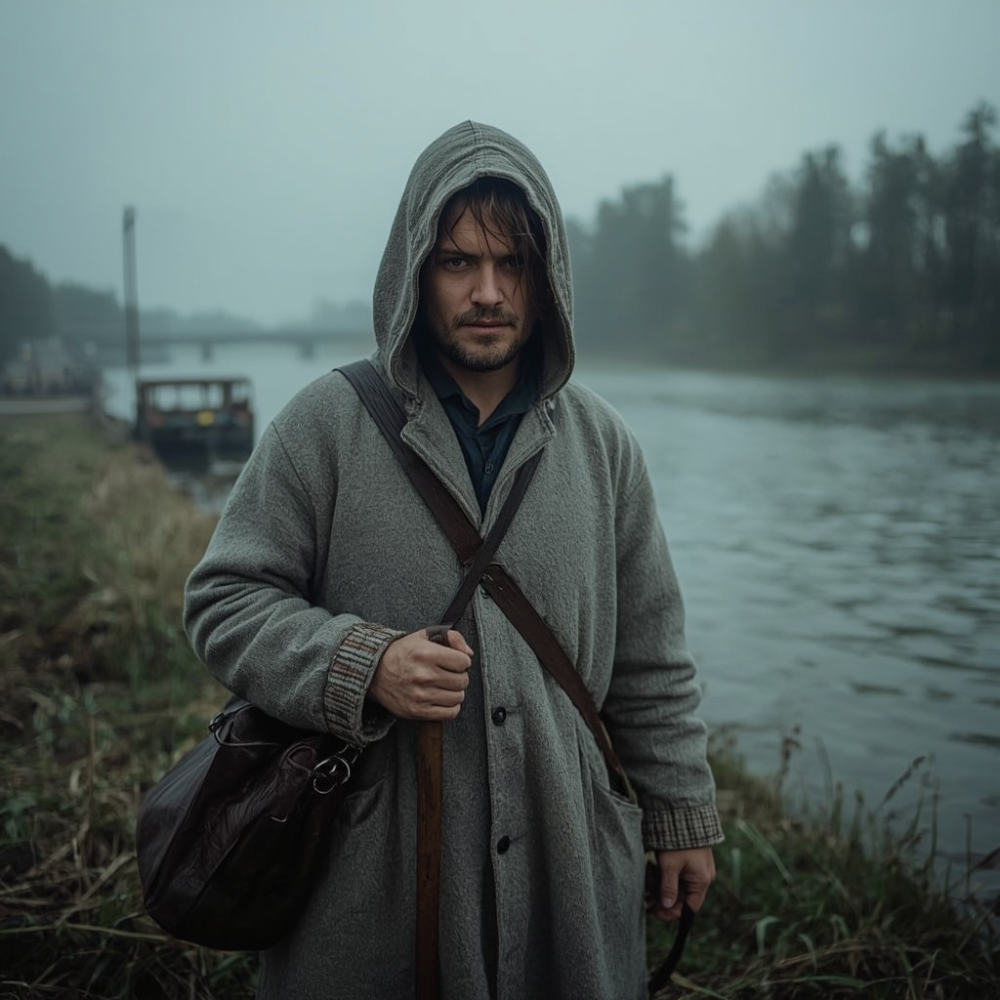

# Katk

> Plague walking the road as a polite stranger who asks only to be ferried across the river.

| Field | Value |
|---|---|
| ID | `bst.katk` |
| Layer | `spirit` |
| Tier | `act2` |
| Confidence | `folklore` |
| Habitat | roads, river crossings |
| Faction ties | none |
| Archive reference images | none |

**Illustration:** Generated with Leonardo AI, Lucid Realism model. Documentation concept art only; existing archive references are retained.

**Generation prompt:** Photorealistic, grounded historical depiction of Katk, Estonian folklore personification of plague as a traveller asking for passage: a solitary anonymous wayfarer at a rural ferry crossing in spring 1343, full figure, pale natural skin and clear blue eyes, calm courteous expression with unnerving stillness, plain weathered grey wool mantle, walking staff and small cloth bundle. Muddy riverbank, rough wooden landing, reeds, early-spring willow, cold slate-blue water and distant Baltic woodland. Two tiny rolling flames barely visible in reeds as a restrained folk omen. Overcast dusk, cold mist, desaturated slate and muted earth, realistic period materials and skin texture. Dangerous omen, not an active epidemic; no other people, no text.

**Negative prompt:** illustration, painting, stylized fantasy art, epidemic crowd, medical mask, sores, wounds, modern clothing, plague doctor beak mask, gore, text, watermark

## At a glance
- A blue-eyed stranger or two rolling flames at a river.
- Ask to be ferried; whoever helps dooms his people.
- Whoever tricks it is spared.
- A rumour and omen in 1343, not an outbreak.

## Folklore origin
Plague walks the roads as a traveller asking to be ferried or let in; whoever helps dooms his people, whoever tricks it is spared, [estonian_folklore.md](../../lore/estonian_folklore.md) section 4b. `folklore`.

## Appearance
- **Body:** Human height, travelling cloak, quiet.
- **Materials and colours:** Pale skin, blue eyes, grey cloak, faint smell of damp straw.
- **What a model must get right:** Blue eyes; an ordinary traveller's kit; politeness.
- **Concept-art prompt:** Concept art of Katk, plague personified as a polite traveller, pale skin, strikingly blue eyes, long grey travelling cloak and staff, standing at a river ferry landing at dusk with two small flames rolling in the reeds behind him, 14th century Baltic landscape, grounded dark-fantasy realism, muted palette, neutral grey background, even lighting.
- **Model notes:** MPFB human with a cloak; spirit-layer shows flames around the feet.

## Motivation
To cross and to be welcomed. It fears being tricked. Contradiction: courteous and lethal. Refusal by cunning rather than hostility saves the village.

## Manifestation
Roads and river crossings, rumoured before any outbreak.

## Combat profile
Spirit duel ([ADR 0033](../../adr/0033-teen-protagonist-and-spirit-dialogue-combat.md)): turn-based exchange of statements and offerings, resolved by the apprentice's reading of the being; no hit points, a pressure meter instead. Topic: hospitality and refusal. Non-violent resolution: a trick with a ferry and a stone, not an insult. Destroying it is impossible (omen).

## Voice
- "Only across. Only to the other side."
- "A kind ferryman remembers."

## Relationships and factions
Feared by every village. Related: [marras](./marras.md).

## Game hooks
Act 2 seed: a ferryman asks for advice. Forge hook: nothing; pure moral choice.
