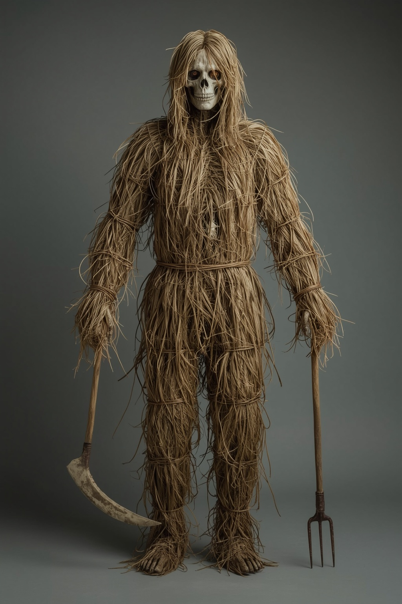

# Kratt

> A servant built from farm scrap and a bought soul, which will work its maker to death unless somebody gives it a task that cannot be finished.

| Field | Value |
|---|---|
| ID | `bst.kratt` |
| Layer | `hybrid` |
| Tier | `act1` |
| Confidence | `folklore` |
| Habitat | hinterland farmsteads, rebel caches |
| Faction ties | cult_metsik |
| Archive reference images | kratt.png |

*Generated with Leonardo AI, photorealism model (generation `060edb13-1c07-40a0-9cd8-a000a4702082`), 1024 x 1536. The legacy `kratt.png` archive reference remains unchanged.*

**Generation prompt:** Photorealistic cinematic full-body creature portrait, centered with generous margins, front three-quarter view, on a plain neutral charcoal-grey studio background. An Estonian folklore kratt, a human-sized lanky servant assembled from 14th-century Baltic farm scrap, brought to convincing photographic life. Its form is unmistakably handmade and asymmetrical: abundant thick, layered bundles of dry golden-brown straw make up most of its outer body, wrapping shoulders, chest, hips, thighs and forearms, with dozens of long ragged straw strips and wisps hanging from the silhouette. Straw covers roughly two-thirds of the visible body, with gaps clearly showing an irregular inner frame of weathered bleached animal bones and rust-black iron farm tools, bound together with old rope and crude iron hoops. Not a scarecrow on a pole. One arm ends in a curved weathered scythe blade; the other in a small pitchfork with distinct tines. Hollow head-frame with no face and no mouth, straw fringe around the skull, only two tiny faint amber lights deep inside the empty eye sockets. Dry straw fibers, worn porous bone, pitted oxidized iron, tactile real-world materials, anatomically coherent silhouette, stiff upright posture, restrained uncanny folklore mood. Shot like a high-end practical creature-effects photograph, realistic natural material response, soft directional studio lighting, crisp focus, subtle film grain, muted earthy palette. Entire figure and weapon tips fully visible. No text.

**Negative prompt:** painterly, illustration, concept art, digital painting, CGI, 3D render, stylized fantasy, scarecrow on a pole, burlap sack head, face, mouth, human skin, modern machinery, modern tools, polished armor, glowing body, wings, flames, blood, gore, extra limbs, bare skeletal frame, sparse straw, thin straw coverage, text, watermark, collage, cropped feet, cropped weapon tips.

## At a glance
- Straw, bone and rusted tools in a loose human shape; amber light in the eye sockets.
- Carries grain and silver to its maker at night.
- Must be kept busy: idle, it turns on the one who made it.
- Odd detail: it counts everything it carries, aloud, in a dry rustle.

## Folklore origin
Household junk animated by a soul bought from Vanapagan with three drops of blood; fetches grain and gold for its maker, must be kept busy, destroyed by an impossible task (Eisen), [estonian_folklore.md](../../lore/estonian_folklore.md) section 4a. The same wealth-bringer seen flying is the Tulihänd ([tulihand](./tulihand.md)). `folklore`.

## Appearance
- **Body:** Human-sized (1.7-1.9 m), lanky, spindly limbs, scythe-blade or fork-tine hands; moves in a stiff jerking walk and never sleeps.
- **Materials and colours:** Dried straw in tattered golden-brown strips, bleached bones, rust-black iron blades and hoop bands; faint amber glow in the eye sockets only.
- **What a model must get right:** Visibly assembled (straw over a bone and tool frame), not a scarecrow on a pole; hollow glowing eyes; blade hands. No face, no mouth.
- **Concept-art prompt:** Full-body concept of a folklore kratt, a human-sized servant assembled from dry golden straw, bleached animal bones and rusted farm tools, scythe blade for one hand and pitchfork tines for the other, hollow eye sockets glowing faint amber, ragged straw strips hanging from the frame, stiff upright stance, 14th century Baltic farmyard style, no modern materials, muted earth palette, plain neutral grey background, even lighting.
- **Model notes:** Bespoke prop rig on the shared humanoid skeleton; straw as alpha-cut cards; hybrid: solid in the physical layer, a bright bound soul-knot visible in the spirit layer.

## Motivation
To serve the soul-bond; it wants a task. Its fear is idleness (it kills the master then). The contradiction: a stolen soul that loves its work. An impossible task (carry water in a sieve, count the sand) releases it.

## Manifestation
Hidden cache farmsteads and rebel stores in the Harju hinterland, at night when its maker sleeps; in the spirit layer the apprentice sees the knotted soul in its chest.

## Combat profile
Hybrid. Physical: base `EnemyArchetype` `enemy.bandit` heavily tuned, slow telegraph 0.8 s, reach 60, slash damage 9, no flee, no surrender, takes extra damage from fire. Spirit duel topic: duty and ownership. Spirit duel ([ADR 0033](../../adr/0033-teen-protagonist-and-spirit-dialogue-combat.md)): turn-based exchange of statements and offerings, resolved by the apprentice's reading of the being; no hit points, a pressure meter instead. Non-violent resolution: give it an impossible task or name its maker and release the bond. Guilt: destroying it carries no guilt for civic or folk schools; christian school 1 (destroying a bound soul).

## Voice
- "Grain, one, two, three. Grain."
- "Give me work. Work. Work."
- (bound) "Master is asleep. I am awake."

## Relationships and factions
Built by whoever sold blood to Vanapagan; [Metsik cult](../../CITIZENS/factions/cult_metsik.md) revives the practice for rebel stores. The Church and the Order see it as an abomination. Related: [tulihand](./tulihand.md), [puuk](./puuk.md), [rehepapp](./rehepapp.md).

## Game hooks
Quest seed "The Stolen Soul": find the kratt guarding a grove cache, free the soul or bind it to the rebels. Reward seed: a scythe forged from its blade (forge commission). First meet: a farmstead cache in Act 1 hinterland.
