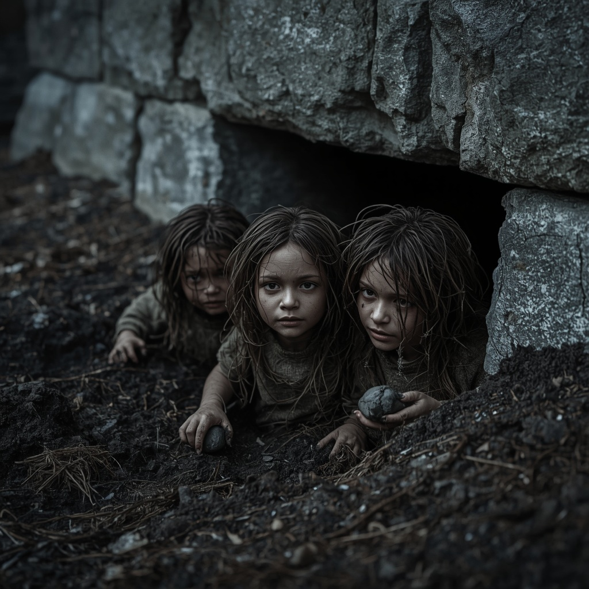

# Maa-alused

> The people under the ground, who ask only that nobody build on their hearth without a gift.

| Field | Value |
|---|---|
| ID | `bst.maa_alused` |
| Layer | `spirit` |
| Tier | `act2` |
| Confidence | `folklore` |
| Habitat | undisturbed ground, building plots, tunnels |
| Faction ties | none |
| Archive reference images | image-11 |

**Illustration:** Photorealistic image generated with Leonardo AI, Lucid Realism model. Documentation concept art only; existing archive references are retained.

**Generation prompt:** Photorealistic documentary-style cinematic still of a small close group of three knee-high stout subterranean people, the Maa-alused of Estonian belief, quietly emerging from freshly disturbed dark soil beside an old rough limestone foundation wall at a 14th-century Baltic building plot at dusk. Compact believable human proportions, earth-grey and clay-smudged skin, tangled root-like hair threaded with soil, worn rough wool and root-fiber wraps in muted clay brown and mineral grey, holding tiny stones, no tools. Pale eyes adapted to darkness, shy and wary, none looking at camera. Damp earth, fine roots, soil crumbs; realistic skin, fabric, limestone and soil textures; natural subdued dusk light, muted palette, subtle folkloric unease, photorealistic, no magical glow, no theatrical fantasy styling, no text.

**Negative prompt:** illustration, painting, concept art, CGI, 3D render, fantasy goblin, orc, dwarf, miner tools, cute cartoon, glowing eyes, oversaturated colors, modern clothing, modern cave, fantasy armor, exaggerated anatomy, huge heads, smiling at camera, looking directly at viewer, text, watermark, logo, blurry, low detail

## At a glance
- Small, grey, quiet folk who appear at the edge of freshly dug ground.
- Disturbing their ground causes sickness in the family.
- Offerings of milk and bread appease them.
- Quest hook: building works near the city walls.

## Folklore origin
Small subterranean people; illnesses (maa-alune) come from disturbing their ground; offerings appease them, [estonian_folklore.md](../../lore/estonian_folklore.md) section 4a. `folklore`.

## Appearance
- **Body:** Knee- to hip-high, stout, crouched walk.
- **Materials and colours:** Earth-brown and grey skin, root-like hair, clay-coloured clothes, faint mineral glitter.
- **What a model must get right:** Roots and clay in the hair and hands; very small; never looking directly at the apprentice.
- **Concept-art prompt:** Concept art of the Maa-alused, small underground folk of Estonian folklore, knee-high stout figures with clay-grey skin and root-like hair, wearing earth-coloured wrappings, emerging from a freshly dug trench beside a stone wall, 14th century Baltic construction site at dusk, grounded dark-fantasy realism, muted palette, neutral background, even lighting.
- **Model notes:** Bespoke small humanoid on the shared rig scaled 0.5; spirit-layer only.

## Motivation
To keep their hearth undisturbed; they fear iron plough and open fire. Contradiction: gentle folk that send illness. A gift of milk and a moved building line ends the sickness.

## Manifestation
Undisturbed ground, building plots, tunnels and cellars during works.

## Combat profile
Spirit duel ([ADR 0033](../../adr/0033-teen-protagonist-and-spirit-dialogue-combat.md)): turn-based exchange of statements and offerings, resolved by the apprentice's reading of the being; no hit points, a pressure meter instead. Topic: land and permission. Temperament: shy, group of three. Non-violent resolution: leave an offering and mark the ground. Destroying them: 4 folk-debt, illness spreads.

## Voice
- "This is our floor."
- "Why is the sky open here?"
- (thanked) "We forget slowly."

## Relationships and factions
Tied to farmsteads and builders. Related: [majahaldjas](./majahaldjas.md), [hiid](./hiid.md).

## Game hooks
Act 2 quest seed: a wall repair near the city makes the masons ill; the apprentice finds the cause. Forge hook: nails and iron commissions that need the ground.
