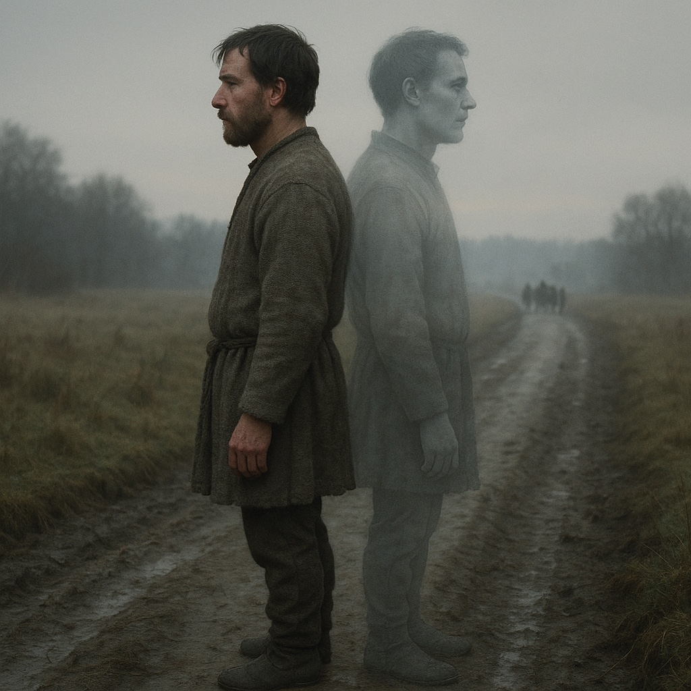

# Marras (omen-double)

> The funeral you see on the road a week before the real one.

| Field | Value |
|---|---|
| ID | `bst.marras` |
| Layer | `spirit` |
| Tier | `act2` |
| Confidence | `folklore` |
| Habitat | Sõjamäe, execution sites |
| Faction ties | harju_kings |
| Archive reference images | none |

**Illustration:** Generated with OpenAI Image Generation (`gpt-image-1`), 1024 x 1024. Documentation concept art only; existing archive references are retained.

**Generation prompt:** Photorealistic cinematic creature concept art, like a high-end practical-effects film still photographed on location. An Estonian death omen called Marras, an omen-double. Show two unmistakably matching full figures: an ordinary 14th-century Baltic man in a coarse grey-brown wool tunic standing in profile on a muddy rural road, and his exact pale translucent supernatural double one step behind him, matching his face, clothing, posture and silhouette perfectly. Paired silhouettes central and immediately readable. Subtle translucency, cold ash-grey edges and faint doubled shadow distinguish the double while keeping it recognizably human. A tiny, faint funeral procession far in the background serves only as premonition. Bare rural medieval Estonia, damp grass, overcast cold dawn, naturalistic skin and wool, physically plausible fog and lighting, realistic lens depth of field, subdued charcoal and earth palette, nuanced film grain, believable historical costume, documentary photographic realism, sparse uncluttered frame. No stylization, painterly brushwork, gore, attack, weapons, scythe, skeleton, reaper, monster features, extra people, modern objects, text or watermark.

## At a glance
- A person or a funeral procession seen before the real death.
- Seen only by those near the dying.
- Foreshadows the Four Kings.
- A quiet omen, not a fight.

## Folklore origin
A death-omen apparition: you see a person or a funeral shortly before the real death, [estonian_folklore.md](../../lore/estonian_folklore.md) section 4b. `folklore`.

## Appearance
- **Body:** Human height, faint double of a living person.
- **Materials and colours:** Grey-edged outline, faint doubled shadow.
- **What a model must get right:** A double of a person with the wrong shadow.
- **Concept-art prompt:** Concept art of a marras, an omen-double, a faint grey translucent copy of a living man standing a few steps behind him on a road, doubled shadow, funeral procession dimly visible far back, 14th century Baltic road at dusk, grounded dark-fantasy realism, muted grey palette, neutral background, even lighting.
- **Model notes:** Translucent clone of the target model; spirit-layer only.

## Motivation
To warn; it fears being seen. Seeing it cannot stop the death, only prepare for it.

## Manifestation
Near execution sites and Sõjamäe before the Four Kings' deaths.

## Combat profile
Spirit duel ([ADR 0033](../../adr/0033-teen-protagonist-and-spirit-dialogue-combat.md)): turn-based exchange of statements and offerings, resolved by the apprentice's reading of the being; no hit points, a pressure meter instead. Topic: foresight and acceptance. Non-violent resolution: accept the vision and act on it. Not destroyable.

## Voice
- (a faint hymn, wrong key)
- "You will know me when it is too late."

## Relationships and factions
Tied to the Harju kings' story. Related: [katk](./katk.md), [kodukaija](./kodukaija.md), [hinged](./hinged.md), [virmalised](./virmalised.md) (the dead of Sõjamäe after the battle).

## Game hooks
Act 2 seed: the apprentice sees a funeral for a living man. First meet: the road to Sõjamäe.
