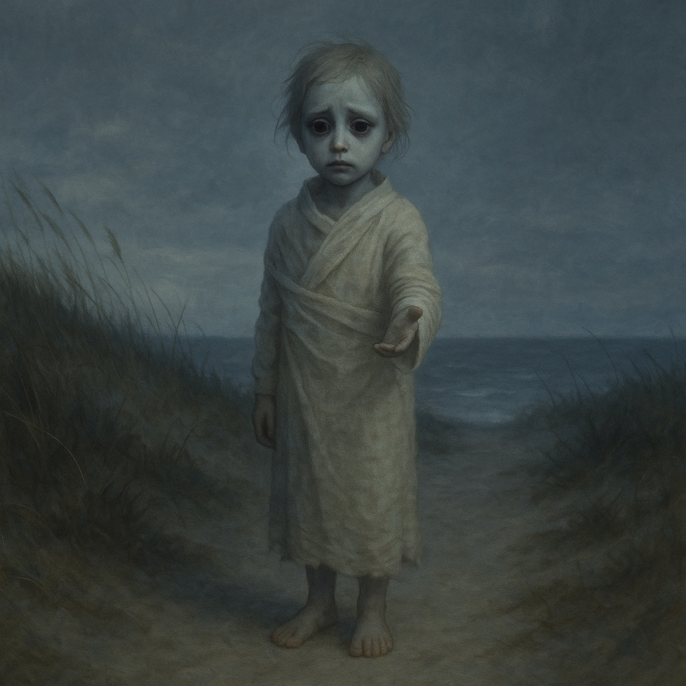

# Myling (Näkiline)

> The child who cries on the road to be carried to consecrated ground, and punishes the traveller who refuses.

| Field | Value |
|---|---|
| ID | `bst.myling` |
| Layer | `spirit` |
| Tier | `act2` |
| Confidence | `folklore` |
| Habitat | Ösel and Viru coast, Swedish settlers |
| Faction ties | none |
| Archive reference images | image-33 |

**Illustration:** Generated with OpenAI Images (gpt-image-1). Documentation concept art only; archive reference image-33 is retained separately.

**Generation prompt:** Myling, a Swedish coastal-settler name for the murdered-child ghost, Estonian equivalent Näkiline: infant-sized bundle swaddled in a simple old linen burial wrap, alone on a Baltic coastal track, quiet sorrow rather than menace, face not shown, no gore or corpse detail. Wind-bent dune grass and distant gray sea at overcast dusk; cinematic painterly realism, subtle supernatural translucence, textured linen, muted slate blue, gray and warm linen palette, readable silhouette, sparse uncluttered square composition, no text, border, weapon or modern objects.

**Negative prompt:** cute baby, visible face, doll, zombie, gore, exposed bones, weapon, modern objects, text, border, watermark, visible wings

## At a glance
- A faint crying on a coast road at night.
- Grows heavier the farther it is carried.
- Swedish name for the Estonian Näkiline.
- Single archive sketch.

## Folklore origin
Unbaptised murdered infant crying to be carried to consecrated ground, Scandinavian myling and Estonian Näkiline, [estonian_folklore.md](../../lore/estonian_folklore.md) section 4a. Kept because of the Swedish coastal settlers of Ösel and the Viru coast. `folklore`.

## Appearance
- **Body:** Infant-sized bundle that becomes heavier with each step.
- **Materials and colours:** Pale small hands, wet swaddling, faint blue light.
- **What a model must get right:** A swaddled bundle that is unnaturally heavy; the face is not shown.
- **Concept-art prompt:** Infant-sized bundle swaddled in a simple old linen burial wrap, alone on a Baltic coastal track at overcast dusk; sorrowful spirit, face not shown, no gore. Wind-bent dune grass and distant gray sea, cinematic painterly realism, subtle supernatural translucence, muted slate-blue, gray and linen palette, sparse composition.
- **Model notes:** Bundle prop with a weight animation; spirit-layer only.

## Motivation
To be buried properly. It fears nothing; it is only sorrow. Carrying it to the churchyard releases it.

## Manifestation
Coast roads on Ösel and the Viru coast at dusk, near unmarked burials.

## Combat profile
Spirit duel ([ADR 0033](../../adr/0033-teen-protagonist-and-spirit-dialogue-combat.md)): turn-based exchange of statements and offerings, resolved by the apprentice's reading of the being; no hit points, a pressure meter instead. Topic: grief and refusal. Non-violent resolution: carry it to consecrated ground (weight mechanic). Destroying it is not an option (tonal rule).

## Voice
- (a thin cry)
- "Carry me. Carry me."

## Relationships and factions
Tied to Swedish coastal settlers and the Church's burial rules. Related: [kulmking](./kulmking.md), [kodukaija](./kodukaija.md).

## Game hooks
Act 2 seed: a coastal village that ignores the child's grave. First meet: Viru coast road.
