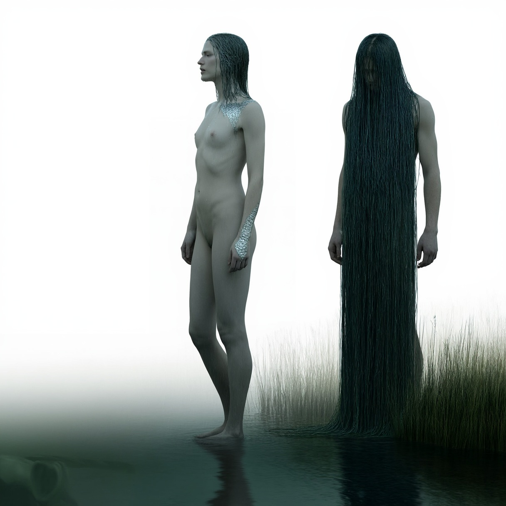

# Näkk

> A drowner who is pleased to sing, and whom a better song can send away empty-handed.

| Field | Value |
|---|---|
| ID | `bst.nakk` |
| Layer | `spirit` |
| Tier | `act1` |
| Confidence | `folklore` |
| Habitat | rivers, mill ponds, Ülemiste |
| Faction ties | none |
| Archive reference images | image-3, image-4, image-5, image-6 |

**Illustration:** Generated with ComfyUI Chroma. Documentation concept art only; existing archive references are retained.

**Generation prompt:** Photorealistic folklore concept art for Reval Rebel: Näkk, an adult Estonian water spirit in human singer guise beside a still mill pond in 14th-century medieval Estonia. Pale adult human figure with long water-dark river-weed hair, naturally standing ankle-deep at water's edge, artistic non-sexual nudity, discreetly obscured by long wet hair, reeds, mist, and water reflections. Calm mournful singing expression; dignified, not seductive. Wet skin with subtle silver fish-scale patches at neck and wrists, water droplets, soft translucent watery edges. Reflection subtly suggests a horse's head beneath the surface. Baltic dusk, river green and slate blue, grounded dark-fantasy realism, photorealistic cinematic natural light, realistic anatomy, clear silhouette, uncluttered composition, no text.

**Negative prompt:** mermaid tail, tropical sea, modern clothing, jewelry, erotic, sexualized, seductive pose, pornographic, explicit genital detail, gore, tentacles, extra limbs, deformed anatomy, cartoon, illustration, painterly, CGI, plastic skin, text, watermark, logo

## At a glance
- Shows up as a horse, a handsome man, a fish or a singer at the water's edge.
- Calls travellers to the river and holds them under.
- A victim can be freed by singing it down.
- Four archive sketches show its shapes: horse, man, singer, fish.

## Folklore origin
Shapeshifting water being (horse, man, fish, beautiful singer) that lures people to drown; singing it back can free a victim, [estonian_folklore.md](../../lore/estonian_folklore.md) section 4a. `folklore`.

## Appearance
- **Body:** Human-sized or horse-sized depending on the form; always wet, always barefoot or hoofless.
- **Materials and colours:** Pale skin, water-weed hair, silver scale patches at the neck and wrists, river-green eyes.
- **What a model must get right:** Always dripping; a form that is one thing at the head and another at the hooves or fins. Never fully solid.
- **Concept-art prompt:** Concept art of a Nakk, an Estonian river spirit appearing as a pale tall figure at a misty river bank, wet hair of river weed, silver fish-scale patches at the neck and wrists, wet clothes dripping, faint smile, a horse silhouette in the mist behind, 14th century Baltic landscape, grounded dark-fantasy realism, muted green-grey palette, neutral background, even lighting.
- **Model notes:** Bespoke shape-changing humanoid; spirit material: translucent water with drag trail; shared humanoid rig for the man form.

## Motivation
To draw the lonely to the water; it fears song and churchbells. Contradiction: it wants company and kills the company it finds. A sung verse or a bell frees the victim.

## Manifestation
Rivers, mill ponds and Ülemiste at dusk and on feast eves, when someone walks alone near water.

## Combat profile
Spirit duel ([ADR 0033](../../adr/0033-teen-protagonist-and-spirit-dialogue-combat.md)): turn-based exchange of statements and offerings, resolved by the apprentice's reading of the being; no hit points, a pressure meter instead. Topic: loneliness and song. Temperament: flattering, patient. Non-violent resolution: sing a verse (rhythm minigame in the duel). Destroying it: 2 folk-debt; the millpond then fouls.

## Voice
- "Come closer. The water is warm."
- "Your song is thin. Sing again."
- (defeated) "Let me keep one of them."

## Relationships and factions
Feared by millers and carters; respected by the fishers. Related: [vetevana](./vetevana.md), [vodyanoy](./vodyanoy.md).

## Game hooks
Quest seed: a drowned miller's boy at Ülemiste. First meet: the river road in Act 1, singing minigame as a duel tutorial.
