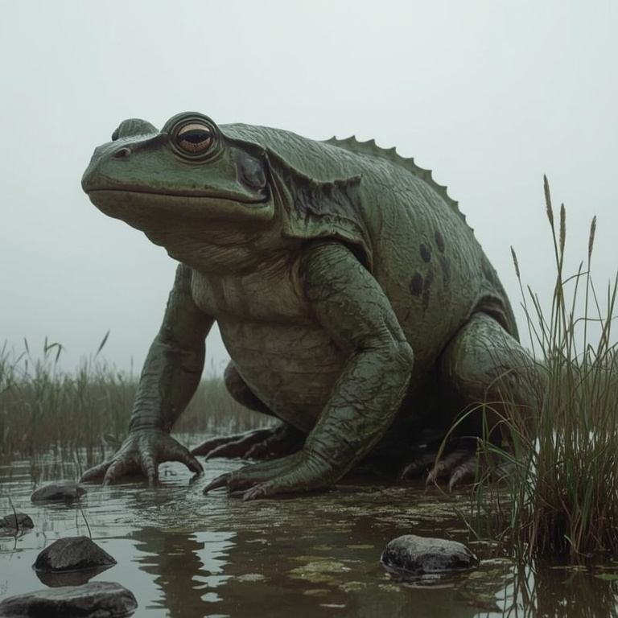

# Põhja Konn

> The frog of the north: a drowned-land guardian big enough to be mistaken for a hill until the hill croaks.

| Field | Value |
|---|---|
| ID | `bst.pohja_konn` |
| Layer | `spirit` |
| Tier | `act2` |
| Confidence | `folklore` |
| Habitat | Kanavere bog |
| Faction ties | none |
| Archive reference images | konn.png |

**Illustration:** Generated with Leonardo AI, Lucid Realism model. Documentation concept art only; existing archive references are retained.

**Generation prompt:** Põhja Konn, the Northern Frog of Kreutzwald's title tale: enormous ancient frog-dragon looming in a northern Estonian bog, broad amphibian head, heavy wet skin, powerful crouched limbs and an unmistakable frog silhouette, a hint of dragon-like scale only along the spine, no wings and no fire-breath. Scale suggested by tiny reeds and stones, folkloric boss presence, painterly grounded concept art, peat black, moss green and cold mist, neutral muted background, no text.

**Negative prompt:** cute frog, modern fantasy dragon, fire, armor, text, watermark, human-sized normal frog

## At a glance
- Armoured in grey-blue stone plates cracked with hissing acid veins.
- Surfaces only to patrol the bog; croaks at night warn trespassers.
- Soft belly exposed only after a ground slam.
- Boss-scale spirit duel; title tale of Kreutzwald.

## Folklore origin
Title tale of Kreutzwald's collection: a monstrous frog or dragon slain by a hero with a magic ring, [estonian_folklore.md](../../lore/estonian_folklore.md) section 6. The Kanavere bog is its habitat. `folklore`.

## Appearance
- **Body:** Roughly 8-10 m long, squat, with powerful hind legs; sits half-sunk in water and mud.
- **Materials and colours:** Weathered granite-grey hide in plate-like scales, blue-grey mossy highlights, glowing cracks that hiss acid; pale soft belly.
- **What a model must get right:** Reads as part boulder, part frog; stone plates; acid veins; a vulnerable pale belly. It is an animal-spirit, not a dragon with wings.
- **Concept-art prompt:** Concept art of a colossal folklore frog, ten metres long, back armoured in granite-like plates covered with lichen and moss, deep cracks leaking faint hissing acid, half sunk in a Baltic peat bog at dusk, pale soft belly, one yellow eye surfacing from dark water, 14th century wetland setting, grounded dark-fantasy realism, muted palette, neutral grey background, even lighting.
- **Model notes:** Bespoke quadruped, boss scale; spirit material: stone shell with luminous cracks; bog water shader interaction.

## Motivation
To protect its marsh from those who drain it; it fears being hunted for its plates. Contradiction: a destroyer of intruders that was once the marsh's gift. A reverent approach or an offering at the water's edge calms it.

## Manifestation
Kanavere bog, Act 2, during the war on the marsh edges; louder when peat is cut or the ground is drained.

## Combat profile
Spirit duel ([ADR 0033](../../adr/0033-teen-protagonist-and-spirit-dialogue-combat.md)): turn-based exchange of statements and offerings, resolved by the apprentice's reading of the being; no hit points, a pressure meter instead. Topic: the land and who owns it. Boss-scale: three phases (croak warning, ground slam that exposes the belly, acid veins). Non-violent resolution: carry the proper offering and name the debt of the drainers. Destroying it opens the marsh to the Order and costs 4 folk-debt.

## Voice
- (a low croak under the ground)
- "Whose feet. Whose feet in my water."
- "The marsh remembers every spade."

## Relationships and factions
Ally of the [Metsik cult](../../CITIZENS/factions/cult_metsik.md) when respected; enemy of the Order's draining crews. Related: [metsavana](./metsavana.md), [nakk](./nakk.md).

## Game hooks
Quest seeds: "Swamp's Guardian" (sabotage the Order's draining), "The Acidic Maw" (a stolen artifact in its bog), "Echoes of the Bog" (mercenaries hunting its plates). Forge hook: plates as a unique metal-working commission.
