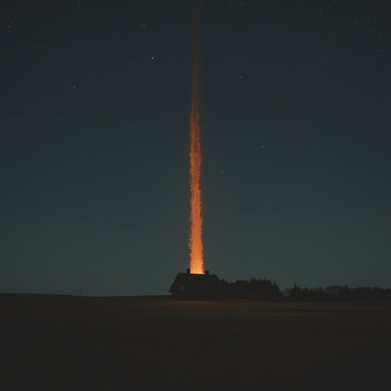

# Tulihänd

> A comet-tail over the farm roof, which the neighbours read as proof that somebody else has sold his soul.

| Field | Value |
|---|---|
| ID | `bst.tulihand` |
| Layer | `spirit` |
| Tier | `act1` |
| Confidence | `folklore` |
| Habitat | night sky over farms, Harju hinterland |
| Faction ties | none |
| Archive reference images | image-10 |

**Illustration:** Generated with Leonardo AI, Lucid Realism model. Documentation concept art only; existing archive references are retained.

**Generation prompt:** Tulihänd, Estonian fire-tail omen: a single long, tapering fiery trail moving across a dark Baltic night sky above a tiny distant farm roof, the phenomenon reads as a streaking tail not a creature or dragon, embers trailing behind a compact bright head, ominous restrained folklore, painterly concept art, deep indigo and restrained amber-orange, minimal composition on subdued neutral dusk background, no text.

**Negative prompt:** dragon, bird, fireball, modern sky, generic demon, text, watermark, crowded scene

## At a glance
- Seen as a fire-tailed streak that drops into a barn chimney.
- Carries grain or silver to its owner.
- Mostly a sign, not a fight.
- The same wealth-bringer as the kratt, seen flying.

## Folklore origin
The wealth-bringer seen flying as a fiery tail across the night sky; an omen that a neighbour is trafficking with the devil, [estonian_folklore.md](../../lore/estonian_folklore.md) section 4a. `folklore`.

## Appearance
- **Body:** Not a body: a streak of fire about three metres long with a faint dragon-head outline.
- **Materials and colours:** Orange-white flame, blue core, falling sparks, smoke tail.
- **What a model must get right:** A flying fire-tail with a trace of a head; no wings. It reads at distance.
- **Concept-art prompt:** Concept art of a tulihand, an Estonian fire omen, a long fiery tail streaking low over a thatched farm roof at night, faint dragon-head outline in the flame, falling sparks, 14th century Baltic farmstead, grounded dark-fantasy realism, deep night palette with orange fire, neutral dark background, even lighting.
- **Model notes:** VFX only: ribbon trail with a faint head sprite; spirit-layer enlarges the head.

## Motivation
To deliver stolen wealth to its owner; it fears iron over the chimney. Contradiction: a servant that exposes its master. Naming the owner or blocking the chimney sends it away.

## Manifestation
Night sky over Harju farms and hinterland roads.

## Combat profile
Spirit duel ([ADR 0033](../../adr/0033-teen-protagonist-and-spirit-dialogue-combat.md)): turn-based exchange of statements and offerings, resolved by the apprentice's reading of the being; no hit points, a pressure meter instead. Topic: suspicion and neighbours. Rarely fought: usually a signal that starts a quest. Non-violent resolution: block the chimney with iron and name the owner. Destroying it: none directly.

## Voice
- (a hiss like wet logs)
- "Home. Home. The master is waiting."

## Relationships and factions
Allied to whoever bought it; feared by neighbours. Related: [kratt](./kratt.md), [puuk](./puuk.md).

## Game hooks
Act 1 seed: a wealthy farmer is accused after a tulihänd sighting; the apprentice must decide whether to expose him. First meet: a night road in Harju.
