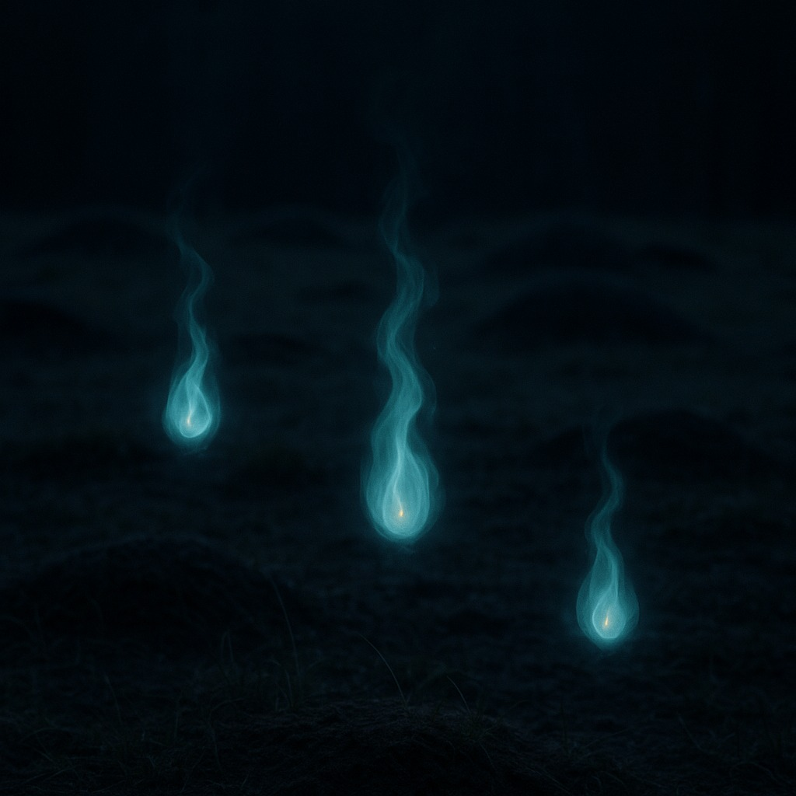

# Tulukesed (grave-lights)

> The little lights over old graves, which every grave-robber follows and no one finishes counting.

| Field | Value |
|---|---|
| ID | `bst.tulukesed` |
| Layer | `spirit` |
| Tier | `act1` |
| Confidence | `folklore` |
| Habitat | old graves, buried caches |
| Faction ties | black_cloaks |
| Archive reference images | none |

**Illustration:** Generated with OpenAI Images, `gpt-image-1`. Documentation concept art only; folklore reference, not a claim of historical documentation.

**Generation prompt:** Create a high-quality folkloric creature concept photograph / cinematic still for an Estonian spirit called Tulukesed, grave-lights that lure grave robbers toward buried treasure. A quiet, historically grounded old burial ground at night: uneven dark peat and grave earth, sparse native grass, a few indistinct low grave mounds. Above the earth float exactly three small separated, living fire-lights, each an unmistakably nonphysical spirit phenomenon: translucent flame-like wisps with cold blue-green luminous cores, faint restrained amber rims, delicate trailing vapor and subtle ghostly distortion, no visible source, casting tiny eerie pools of light. The lights should feel intelligent and beckoning, not like ordinary fire, candles, lanterns or will-o'-the-wisps from fantasy clichés. Grounded photographic realism in the environment, strong visual readability, moody quiet slate-grey-black night, natural cinematic low-light photography, detailed damp soil and grass, composition with lights centered in upper middle and substantial dark space around them. Spirit-layer identity is clear through translucence, impossible hovering, vapor trails and cool supernatural glow. No people, no bones, no monsters, no buildings, no text, no frame, no painterly brush strokes, no illustration look.
**Negative prompt:** fairies, firefly swarm, lantern, humanoid, cute, fantasy portal, text, watermark, neon

## At a glance
- Pale lights at night over buried treasure or old burials.
- Lure the greedy toward rebel caches.
- Fade when the right word is said.
- Money burns, the old saying goes.

## Folklore origin
Lights over old graves or buried treasure; money burns, [estonian_folklore.md](../../lore/estonian_folklore.md) section 4b. `folklore`.

## Appearance
- **Body:** Palm-sized lights hovering knee-high.
- **Materials and colours:** Cold blue and amber flames without heat.
- **What a model must get right:** Multiple small lights with faint trails; no body.
- **Concept-art prompt:** Concept art of tulukesed, small cold blue and amber lights hovering over an old grave mound in a moonlit Baltic field, faint trails drifting low, a rusted spade left in the grass, 14th century landscape, grounded dark-fantasy realism, dark palette, neutral background, even lighting.
- **Model notes:** VFX light sprites; spirit-layer enlarges and shows colour by intent.

## Motivation
To lead someone to what is buried; they fear a name said aloud. Contradiction: they mark both grave and cache. Following them blind brings loss; reading them leads to the cache.

## Manifestation
Old graves and buried caches at night.

## Combat profile
Spirit duel ([ADR 0033](../../adr/0033-teen-protagonist-and-spirit-dialogue-combat.md)): turn-based exchange of statements and offerings, resolved by the apprentice's reading of the being; no hit points, a pressure meter instead. Topic: greed and rest. Non-violent resolution: do not dig; leave an offering. Destroying: 1 folk-debt.

## Voice
- (a soft flicker, no sound)

## Relationships and factions
Used by [Black Cloaks](../../CITIZENS/factions/black_cloaks.md) as cache markers. Related: [kodukaija](./kodukaija.md), [kratt](./kratt.md), [virmalised](./virmalised.md) (the sky battle, split from the same 4b row).

## Game hooks
Act 1 seed: find the Black Cloaks' hidden cache by reading the lights. First meet: a village graveyard at night.
