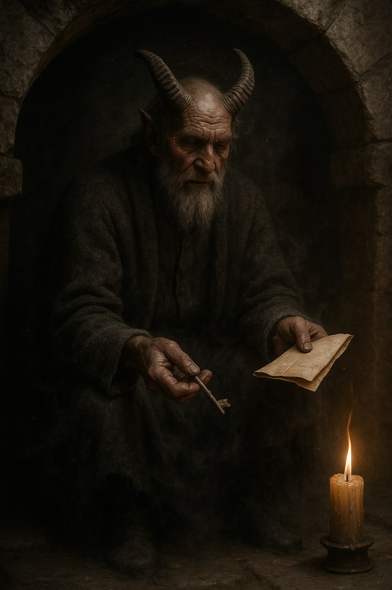

# Vanapagan

> The Old Devil of the Estonians, who bargains more than he threatens and is the true source of every trade in the dark.

| Field | Value |
|---|---|
| ID | `bst.vanapagan` |
| Layer | `spirit` |
| Tier | `act3` |
| Confidence | `folklore` |
| Habitat | under monasteries, cult rites |
| Faction ties | cult_metsik, church |
| Archive reference images | image-18 |

**Illustration:** Generated with OpenAI `gpt-image-1`. Photorealistic documentation concept art for a spirit-layer creature; existing archive references are retained.

**Generation prompt:** Photorealistic cinematic portrait of Vanapagan, the ancient Old Devil of Estonian folklore, not Christian Satan: an imposing, broad-shouldered Baltic peasant-like spirit with charcoal-black, naturally textured skin and a weathered human face, wearing coarse smoke-dark wool, stooped beneath a cramped 14th-century monastery cellar arch. Calm and wry, he offers a small iron key and folded parchment contract as if negotiating. Detailed pores, wrinkles, damp wool fibers, soot and aged stone; unmistakably supernatural, with his lower body and sleeve edges dissolving into dense charcoal smoke and drifting ash, subtle ember fissures beneath his blackened skin at hands and temples, and candle flames bending toward him. Restrained ember motes and cold mist, tactile photographic realism, historically grounded, full figure, cinematic candlelight, charcoal and earth tones with restrained warm embers. No horns, pitchfork, demonic cliché, text or watermark.

**Negative prompt:** Christian Satan, generic devil, horns, pitchfork, wings, red skin, modern objects or clothing, painterly illustration, anime, text, watermark, gore

## At a glance
- A tall, broad figure whose charcoal-black skin and smoke-dark robes blur at the edges; a horn-like shadow can gather behind his head, but he has no physical horns.
- Sells souls for work: kratt, tulihänd, pacts.
- Appears under monasteries and in the cult's rites.
- Boss of the spirit layer in Act 3.

## Folklore origin
The Old Devil, source of the cultists' bargains and of the kratt's soul, [estonian_folklore.md](../../lore/estonian_folklore.md) section 4a. `folklore`.

## Appearance
- **Body:** Human to giant scale depending on the bargain; ritual stillness.
- **Materials and colours:** Charcoal-black skin, horn-like shadow, ember eyes, a ledger in hand.
- **What a model must get right:** A bargain object in hand (ledger, knot, coin), ember eyes, a deliberate calm.
- **Concept-art prompt:** Concept art of Vanapagan, the Old Devil of Estonian folklore, a tall figure in charcoal-black robes with a horn-like shadow behind the head, ember eyes, holding an old ledger with a blood-red thread, standing in a monastery cellar lit by a few candles, 14th century Baltic setting, grounded dark-fantasy realism, deep palette, neutral dark background, even lighting.
- **Model notes:** Bespoke boss; spirit material: ember cracks over black; ledger as a held prop.

## Motivation
To buy and keep; he fears an unpayable bargain and a naming of his terms. Contradiction: a honest dealer in lies. Naming the true price or an impossible task breaks the pact.

## Manifestation
Under monasteries, cult rites and any time a person decides to sell something that should not be sold.

## Combat profile
Spirit duel ([ADR 0033](../../adr/0033-teen-protagonist-and-spirit-dialogue-combat.md)): turn-based exchange of statements and offerings, resolved by the apprentice's reading of the being; no hit points, a pressure meter instead. Topic: bargains and price. Temperament: courteous, patient. Act 3 boss, three phases (offer, contract, collection). Non-violent resolution: name the real price. Destroying: 5 christian guilt, 5 folk-debt.

## Voice
- "A small price for a large work."
- "Your blood is already on the page."
- (broken) "Impossible terms. How rude."

## Relationships and factions
Patron of the [Vanapagan cultists](./vanapagan_cultist.md) and rival of [metsavana](./metsavana.md); the Church claims to fight him and often profits.

## Game hooks
Act 3 seed: the cult's master pact. Forge hook: a commissioned blade carrying a pact clause.
