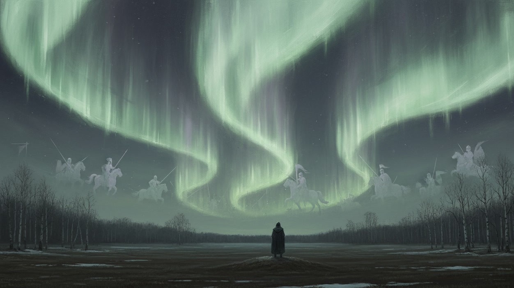

# Virmalised (the sky battle)

> The northern lights as a war that never ends, which the islanders say God keeps pulling apart - and after Sõjamäe every family in Harju has someone up there.

| Field | Value |
|---|---|
| ID | `bst.virmalised` |
| Layer | `spirit` |
| Tier | `act2` |
| Confidence | `folklore` |
| Habitat | open sky over the hinterland, Sõjamäe after 1343 |
| Faction ties | none |
| Archive reference images | none |

**Illustration:** Generated with Leonardo AI, Nano Banana (`gemini-2.5-flash-image`); cropped and recompressed. Documentation concept art only; folklore reference, not a claim of historical documentation.

**Generation prompt:** Painterly dark-fantasy concept art, grounded and historical: the northern lights over a flat dark early-spring field with low birch woods in 14th-century Harjumaa, Estonia. A tall curtain of cold green and pale violet aurora fills most of the sky. Woven inside the rippling folds of light are many very faint translucent silhouettes of a battle - peasant spearmen with axes, a few mounted knights with great helms and lances - only half visible, dissolving into vertical streaks of light, more suggestion than figure, like shapes seen in smoke, same colour as the aurora. On a low mound stands one tiny cloaked teenage figure looking up. Muted earth palette, restrained cold light, oil-painting brushwork, wide cinematic composition, quiet and ominous, no text.

**Negative prompt:** text, watermark, solid white figures, opaque figures, cartoon, anime, gore, modern elements, neon, wings, castle, rainbow

## At a glance
- A collective, not one creature: a whole battle fought in the northern lights.
- Peasants say "the sky is fighting" (*taevas tapleb*, *taevas vehkleb*) when the lights move.
- In the spirit layer the curtain of light is full of armed shapes, rebel and knight, that keep striking and never fall.
- The duel is not against the host but for one soul inside it.
- Oddity: in the island tale nobody ever wins the sky battle; it is always stopped.

## Folklore origin
Decision (task **R-1751**): [estonian_folklore.md](../../lore/estonian_folklore.md) section 4b groups Virmalised with the grave-lights. They are split here: [Tulukesed](./tulukesed.md) stays the small lights over graves and caches, and `bst.virmalised` is the sky battle as a collective host. The two beliefs share only the word "light".

What the sources say:

- **Estonian, "the sky fights".** Eisen's *Eesti mütoloogia* (1920), chapter "Virmalised, loksberi sõitjad ja maksamerelised", records the folk names *taevas tapleb* ("the sky brawls"), *taevas vehkleb* ("the sky fences"), *taevas lööb lõhki* ("the sky splits"). In the common mainland explanation witches fly up and fence with wooden swords; their burning torches are the lights. `folklore`.
- **Saaremaa, two armed men.** Eisen: the islanders leave witches out; the sky splits and two warriors with shining swords attack each other, and their sword-play is the light. Holmberg, *Finno-Ugric Mythology* (Mythology of All Races IV, 1927, "The Life Beyond", p. 81) gives the formula *"Virmalised taplevad"* and the Ösel variant: on the holy nights when heaven opens, two armed men are eager to fight, "but God will not allow it, and separates them". `folklore`.
- **Dialect records.** Estonian dialect material (summarised by M.-L. Kalvik, ERR *Keelesäuts. Põhjavalgus*, 2023) personifies the lights as *laplased* or *põhjalased* (Lapps, northerners); in Äksi the northerners are said to be at war, and elsewhere their fencing is a Lapp wedding. `folklore`.
- **Finnic parallel: the dead in battle.** Holmberg records that for the Finnish Sámi the aurora is "the dead in battle, who, as spirits, still continue battling with one another in the air", and for the Russian Sámi "the spirits of the murdered", whom people fear. Finnish *revontulet* ("fox fires") is a separate fox-tail explanation. `folklore`, Sámi and not Estonian.
- **Taboo checked, not adopted as Estonian.** Not whistling, waving or calling at the lights (or they come down and take you) is reported for the Sámi in popular aurora literature only. No Estonian record of it was found in Eisen, Holmberg or the dialect summary, so the card does not claim it as Estonian belief.

Game synthesis, labelled `invented`: the island warriors are read as souls of the dead of 1343, both sides, borrowing the Sámi "dead in battle" reading. Separating two fighters is the apprentice's version of the island tale, where God parts them. That the battle "comes down" when mishandled extends the Sámi fear of the lights. The Sõjamäe battle itself (14 May 1343) is `attested` in [CANON.md](../../CANON.md#timeline-aprilmay-1343); no named soul in the host is attested. Everything from Appearance onward (who sees the fighters, triggers, duel rules, voices, hooks) is game design on this basis and is `invented`.

## Appearance
- **Body:** No body. A curtain of light a few hundred metres up, spanning the northern sky. In the spirit layer dozens of translucent fighters, human-sized at a distance, are woven into the folds and dissolve into streaks when looked at directly.
- **Materials and colours:** Cold green, pale violet, rare blood-red edges on bad nights. Fighters are the same colour as the light, never white or solid.
- **What a model must get right:** It is a sky phenomenon first and a battle second. The figures must be half-visible: spears, axes, great helms, horses, never faces. One fighter, "theirs", is slightly steadier than the rest.
- **Concept-art prompt:** Concept art of the virmalised, Estonian northern lights as a sky battle, a tall cold green and violet aurora curtain over a dark spring field with birches, faint translucent silhouettes of peasant spearmen and mounted knights woven into the light and dissolving into streaks, no faces, a tiny cloaked figure on a mound below, 14th century Baltic landscape, grounded dark-fantasy realism, muted palette, neutral dark background, even lighting.
- **Model notes:** VFX only: an aurora shader curtain plus a spirit-layer overlay of faint shared-rig silhouettes sampled from the combat clips; no individual meshes.

## Motivation
The host wants the battle to go on, because ending it would mean being dead. Each soul in it fears being forgotten more than it fears the enemy. Contradiction: they fight because nobody on earth claims them, and they cannot hear the living over the battle. A soul is released only when someone who knew it names it and parts it from the soul it is fighting; the host as a whole is never destroyed, only thinned.

## Manifestation
Clear, cold nights in late spring and autumn over open ground: the Harju fields, the hinterland roads, above all Sõjamäe after 14 May 1343. Holy nights (the island tale's "when heaven opens") are stronger. It answers grief: it shows over a field where someone below is mourning a person killed in the rising, rebel or knight. Ordinary people see only the lights; the apprentice sees the fighters.

## Combat profile
Spirit duel ([ADR 0033](../../adr/0033-teen-protagonist-and-spirit-dialogue-combat.md)): turn-based exchange of statements and offerings, resolved by the apprentice's reading of the being; no hit points, a pressure meter instead. This duel is against a host. Topic: belonging and whose dead this is.

- **Find "theirs".** The petitioner's dead (a rebel son, or a knight a German widow mourns) is one fighter among many. The apprentice reads tells (a remembered song, a habit, a wound, a tool the forge made) and rejects false matches: other souls claim to be the one, because every soul wants to be named.
- **Part them, do not join.** The core rule follows the island tale: the fighters are separated, never helped to win. Once the right soul is found, the apprentice names it and the soul it is locked with, and parts the two. Taking a side, striking at the enemy soul, cheering, or calling the battle down to finish it raises pressure.
- **Mishandling.** At full pressure the battle comes down: the host falls on the field as cold wind, panicked horses and a spirit-layer melee around the apprentice, and nearby villagers see a red sky and take it as an omen of more war (Living City Fear).
- **Non-violent resolution:** name both souls and part them; the released soul goes quiet and the petitioner gets an ending. The enemy soul is released too, which is the cost some petitioners will not accept.
- **Destroying it:** not possible; scattering the lights with force only drops them to earth (the mishandling result) and costs 1 folk-debt.
- No guilt: spirit layer.

## Voice
- (a crackle like frost in wood, many voices under it)
- "Not yet. He is still standing."
- "Say my name and I will stop. Say it right."
- "Which one is yours? We are all somebody's."
- (when parted) "...Is the field quiet now?"

## Relationships and factions
No faction controls it. Rebels' families and Order widows both come to the apprentice for it, which makes it a both-sides ending for Act 2. Eisen's mainland belief makes the lights witches' work; in the game (`invented`) a parish priest uses that to warn the bereaved off looking for their dead in them. Related: [tulukesed](./tulukesed.md) (grave-lights, the other half of the old 4b row), [marras](./marras.md) (the omen before the death; virmalised is after), [kodukaija](./kodukaija.md) (one dead who comes home; here the dead stay up in the sky).

## Game hooks
- Act 2 seed: after Sõjamäe a mother asks the apprentice to "find my boy in the lights". Later a German widow asks the same for a knight; both souls may be locked together.
- Forge tie: the tell that identifies a soul can be a spearhead or axe Kalev made; the forge ledger is evidence.
- First meet: a clear night on the road past the Sõjamäe field, after the battle, from a low mound.
