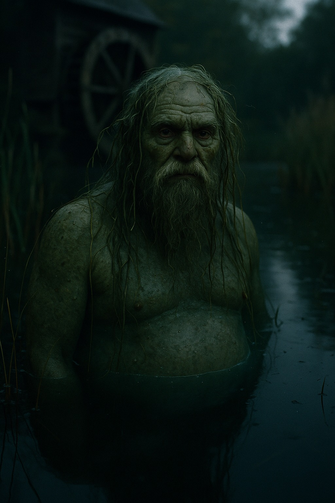

# Vodyanoy

> The Pskov water-father in a Reval millpond, a stranger with a very old name.

| Field | Value |
|---|---|
| ID | `bst.vodyanoy` |
| Layer | `spirit` |
| Tier | `backlog` |
| Confidence | `folklore` |
| Habitat | Pskov-side water, mill ponds |
| Faction ties | pskov_novgorod |
| Archive reference images | image-19 |

**Illustration:** Regenerated with OpenAI GPT Image (`gpt-image-1`). Photorealistic spirit concept art for documentation; archive references are retained.

**Generation prompt:** Create a photorealistic cinematic creature portrait for a grounded historical dark-fantasy bestiary: the Pskov-side vodyanoy, an ancient male water spirit who haunts a 14th-century Baltic millpond. Half-submerged, waist-up, imposing but not monstrous-grotesque: unmistakably humanoid elderly amphibian man, broad heavy swollen pale belly partly visible under water, wet mud-green frog-like skin with realistic pores and subtle warts, deep-set intelligent eyes, sparse grey-green hair tangled with reeds and pondweed, long damp beard. The spirit nature must be unmistakable and visually distinct from a living physical animal: his lower body dissolves into dark water and translucent mist, faint cold bioluminescent teal-green light beneath the skin and around his silhouette, water droplets and reeds subtly suspended in an unnatural stillness, a dim ghostly reflection that does not quite match him. Background: quiet old wooden mill wheel and reed-lined pond at dusk, restrained naturalistic Baltic setting. Photographic realism, detailed lifelike anatomy, believable wet skin, cinematic low-key natural light, muted pond green, brown and slate palette, fine film grain, no painterly illustration, no game UI. Strong readable silhouette, centered full upper body with space around the figure, no text, no letters, no watermark.

**Negative prompt:** cute frog, mermaid, tropical water, trident, modern fishing gear, painterly illustration, fantasy armor, text, letters, watermark, dragon

## At a glance
- A frog-like old man in water.
- Pskov variant of the water father.
- Kept as the variant only.
- One archive sketch (a frog in water).

## Folklore origin
Slavic water spirit; kept only as the Pskov variant of [vetevana](./vetevana.md) and [nakk](./nakk.md), [estonian_folklore.md](../../lore/estonian_folklore.md) section 4a note. `folklore`.

## Appearance
- **Body:** Large, bloated, amphibian old man.
- **Materials and colours:** Mud-green skin, weed hair, pale belly.
- **What a model must get right:** Frog-like skin; bloated belly; weed in hair.
- **Concept-art prompt:** Concept art of a vodyanoy, an old amphibian water spirit with mud-green skin, bloated pale belly and weed-draped hair, half-submerged in a mill pond with a wooden wheel behind, 14th century Baltic setting, grounded dark-fantasy realism, muted green palette, neutral background, even lighting.
- **Model notes:** Bespoke amphibian-humanoid; water shader; spirit-layer only.

## Motivation
To keep the pond; it fears the millwheel stopped. A sacrifice of the first bread keeps it calm.

## Manifestation
Pskov-side water and mill ponds.

## Combat profile
Spirit duel ([ADR 0033](../../adr/0033-teen-protagonist-and-spirit-dialogue-combat.md)): turn-based exchange of statements and offerings, resolved by the apprentice's reading of the being; no hit points, a pressure meter instead. Topic: tribute and change. Non-violent resolution: the first bread. Destroying: 3 folk-debt.

## Voice
- "Who lets the wheel stand?"

## Relationships and factions
Tied to Pskov traders. Related: [vetevana](./vetevana.md), [nakk](./nakk.md).

## Game hooks
Backlog seed: a miller who fed a vodyanoy asks for help.
