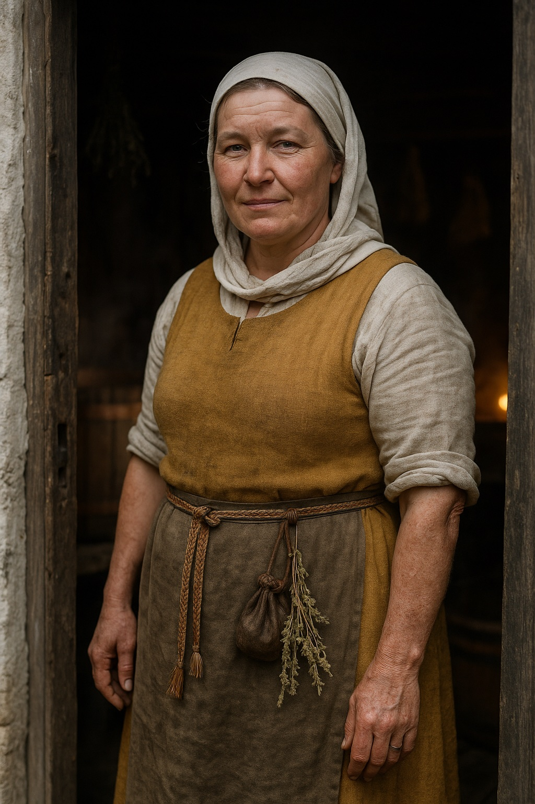

# Aita (The Alewife and Healer)

**Confidence label:** `invented` (historical context items carry their own labels below)
**Role:** Community perspective and moral challenger; Lower Town alewife, lay healer, Kalev's older sister
**Stable ID:** `char.aita`
**Campaign presence:** Vertical slice and all three acts

*Concept plate, reference only. The earlier painterly plate is [`aita.jpg`](./img/concept/aita.jpg); both are listed in [`img/README.md`](./img/README.md).*

## Visual Description
- **Clothes:** Widow's white linen headcloth wrapped over the hair and under the chin; undyed linen shift with the sleeves rolled to the elbow; hand-woven ochre wool kirtle; a worn olive-brown linen apron that is never fully dry; a narrow band-woven belt carrying a leather pouch of remedies and a bundle of dried bog myrtle and yarrow. Plain iron ring, nothing finer. No held objects in the base model.
- **Age:** About 41 in spring 1343, roughly six years older than Kalev.
- **Hair:** Dark blond, going grey at the temples, braided and hidden under the headcloth; a loose strand escapes when she works.
- **Physical Build:** Sturdy and broad-shouldered from lifting mash tubs and water yokes. Strong forearms, red work-roughened hands, an old burn scar on the back of the left hand from a boiling wort pan. Grey-green eyes that look tired and appraising at the same time. Stands with her weight back, like someone who expects to be asked for something.

## Motivations & Core
- **Want:** Keep the Lower Town fed and medically safe through the coming violence.
- **Fear:** That rulers and rebels will both sacrifice ordinary, innocent people for the sake of their grand political symbols.
- **Contradiction:** She performs Christian respectability publicly (Sunday mass, Easter confession, a candle for her dead at the Holy Spirit church) while preserving her mother's household rites and herbal remedies privately.
- **Secret or withheld fact:** She is hiding a wounded rural rebel in her brew-house cellar, knowing it puts her entire lane at risk of collective punishment.
- **Second, smaller secret:** It was Aita, not chance, who put the almshouse boy in front of Kalev. She had watched the apprentice for two winters on her almshouse rounds and decided he needed a trade and Kalev needed someone to protect. Neither of them knows she arranged it.

## History (Biography)

### Childhood (c. 1302-1318)
Aita was born in the Lower Town to an Estonian family that had come in from the Harju villages a generation earlier. Their father worked iron for wages; their mother was the lane's unofficial healer, the woman people fetched for fevers, burns, and difficult births before they fetched a priest. Aita was the eldest surviving child and her mother's helper from the age she could carry a basket. She learned which herbs grew on the limestone edge below Toompea, how to clean a wound with strong ale, and which household rites were spoken aloud and which were only done.

The hunger years of 1315-1317 shaped her for life. Crops failed across northern Europe, grain prices in the Baltic ports climbed out of reach of wage households, and fever followed the hunger. Aita, about thirteen, learned to stretch a pot of barley gruel across a lane of children and to recognise the faces of people who were about to stop eating. Her mother nursed the sick through the second winter and caught the fever herself. Aita has never said aloud what she thinks killed her mother; she believes it was the hunger, and the people who held grain back while it rose in price.

### Raising Kalev (c. 1318-1326)
Their father did not outlive their mother by many years, and Aita, still a girl, became the adult of the household. She kept Kalev fed, kept him in an apprenticeship with a smith instead of the harbour gangs, and fought every master who tried to cheat a boy without parents. This is the root of her authority over him: she is the one person who remembers Kalev before he had an anvil to stand behind. It is also the root of her impatience. She made sacrifices so that he could have a craft, and she does not accept that a craft is a reason to stop caring what it is used for. The parents' names and the exact manner of their deaths stay unresolved per [`kalev-family.md`](./kalev-family.md).

### Marriage and the brew-house (c. 1326-1338)
At about twenty-four, late for her time, Aita married **Laur**, an Estonian-born cooper and small brewer with a narrow timber-and-limestone house in the Lower Town and a right to brew for sale from it. It was a working marriage that grew into an affectionate one. Laur taught her the brewing side: malting, mashing, and bittering with bog myrtle and later with bought hops. She brought him her mother's remedies and a reputation that filled his ale bench. They buried two children in infancy. Aita does not talk about them, but she is the first to arrive when a lane child sickens, and she has never charged for it.

Laur died in the autumn of about 1338, crushed when a loaded cart slipped on the harbour road. As his widow Aita kept the house and continued the trade, which a craftsman's widow could usually do, though always with a guild or council officer watching for a reason to end it.

### The widow alewife (1338-1343)
In the five years since, Aita has become something the Lower Town has no official word for. Her brew-house is a tavern, a clinic, and a place where news changes hands. She brews small ale for daily drinking, stronger ale for feast days, and medicinal ales steeped with herbs. She takes payment in coin, firewood, eggs, or favours, and she keeps a mental ledger of who owes and who cannot pay. She brings broth and ale to the Holy Spirit almshouse on Saturdays, which is how she first noticed the silent, staring orphan who would become Kalev's apprentice.

Her water comes from the shared municipal line that serves her lane. When [Jürgen Witte](./jurgen.md) began buying up grain contracts and pressing for control of clean water supply, Aita became an obstacle: a small brewer who sells cheap ale to the poor is competition at the bottom of the market and a witness he cannot buy.

### Spring 1343
When the Harju villages rise on St George's Night, the town tightens around its people. A wounded rebel is brought to Aita's back door by [Kaja](./kaja.md)'s network because Aita is the healer who does not ask questions. She takes him in against her own judgement and hides him in the brew-house cellar under the malt sacks. At the same time the water on her lane turns bitter, people fall sick, and the Watch blames her ale. This is the opening of the **Bitter Brew** commission (`commission.bitter_brew`), where Kalev's work decides whether her brew-house survives.

## Ties & Relationships
- **Allies:** [Ellen Luik](./ellen.md) (remedies and old songs), the women of her lane, the Holy Spirit almshouse, the Lower Town poor who drink at her bench. Kaja's network uses her, which she tolerates rather than welcomes.
- **Enemies:** [Jürgen Witte](./jurgen.md) (grain and water profiteering), the Watch inspectors who would happily close her brew-house, and any priest who listens too closely to rumours of charms and herb-craft.
- **Initial View of the Main Player (the Apprentice):** Familiar and protective. She has seen him at the almshouse for two winters and is the first adult who treats his staring as ordinary. She does not ask what he sees; she asks whether he has eaten. (In the current Kalev prototype: loving, exasperated, and unimpressed by his excuses.)
- **Kalev:** Her younger brother. She raised him and still talks to him as if he were fourteen. She loves him and refuses to let him hide behind his anvil; every conversation eventually returns to who his work feeds and who it kills.
- **Mart:** Treats him like a nephew. She patches his scrapes and tries to keep him grounded. His disappearance frightens her more than she admits, because she recognises his anger: it is the anger she had at thirteen, before it turned into work.
- **Ellen Luik:** Her closest equal. They trade herbs and knowledge and argue about secrecy: Ellen hides names in songs to protect families, Aita thinks some things must be said openly before they fester.
- **Captain Henning:** He drinks her ale and she patches his men. Mutual, wary respect between two practical people. She knows he will close her if ordered, and he knows she is hiding something.
- **Jürgen Witte:** A business adversary. She hates his price-gouging on grain and clean water, and she remembers the hunger years when men like him got rich.
- **The rebel in the cellar:** A young Harju man with a spear wound in the thigh. She does not want his name and has not asked for it.

## Daily Routines
- **Dawn:** Up before the bells, fetches water from the lane well or the municipal line, stirs the fire under the wort pan.
- **Morning:** Brewing on brew days (mashing, boiling, cooling, barrelling), otherwise malt-turning, cleaning vats, and serving the morning small ale to workmen.
- **Midday to afternoon:** Healing rounds in the lane: fevers, burns, cuts, childbirth help alongside Ellen. Saturdays she carries broth and ale to the Holy Spirit almshouse.
- **Evening:** Runs the ale bench in her front room; listens more than she talks. Late at night she goes down to the cellar with a lamp, bandages, and gruel.
- **Sundays and feasts:** Mass at the Holy Spirit church, visibly and on time. Afterwards, privately, a bowl of ale set out at the threshold for the household dead.
- **Sleeps:** In the small room above the brew-house, next to the stair, where she can hear the cellar hatch.

## Voice
Practical, authoritative, warm but bone-tired. She speaks in terms of concrete needs (bread, bandages, firewood, clean water) and dismisses political rhetoric. She counts in mouths and days, not in principles. She uses short commands with her brother, softer questions with children, and dry humour with everyone else. She rarely raises her voice; she lowers it, and people lean in.

Sample lines (draft, to be authored as dialogue nodes):
- "Your banner does not boil water. Mine does. Sit down and eat."
- "I have buried a mother, a husband, and two children. Do not tell me what this town can afford to lose."
- "You make a good blade, Kalev. I just want to know whose belly it ends up in."
- (to the Apprentice) "Stare all you like. Just stare while you carry that bucket."
- "Ale is safer than the water. That is not a sin, that is arithmetic."
- (about the cellar, to anyone who asks) "Malt. Nothing down there but malt and rats."

## Possible Quest Lines & Outcomes
- **Quest Title:** *Bitter Brew* (implemented as content examples; see [`QUESTS.md`](../SYSTEMS/QUESTS.md)). The lane water turns bitter and the Watch blames Aita's ale.
  - **Objectives:** Inspect the brewery and the cistern; trace the taint to the municipal line; choose what to forge (honest reinforcing bands or a forged checkpoint seal).
  - **Outcomes:** Brewery exonerated, brewery confiscated, or brewery monopolised by Jürgen (`flag.bitter_brew_outcome_*`).
- **Quest Title:** *The Guest in the Cellar* (planned, needs a task). The Watch begins house searches in the lane; the wounded rebel must be moved, hidden better, or given up.
  - **Objectives:** Learn the secret (spirit sight or trust), find a hiding place or route out (Kalev's winch loft is one option), and decide who carries the risk.
  - **Rewards:** Aita's trust, Kaja's network standing, or Watch standing if the rebel is surrendered.
- **Quest Title:** *Bread Before Banners* (planned, needs a task). During the siege months grain runs short and Aita organises a lane kitchen. The player can supply it, protect it, or let Jürgen's prices break it.
- **Arc:** Private carer -> reluctant public voice -> community leader or martyr.
- **Endings:**
  - Becomes a vital community leader during the crisis, the person the Lower Town listens to when the council does not.
  - Arrested by the Watch for witchcraft or treason if the cellar secret or her household rites are exposed.
  - Killed in a food riot if the city starves.
  - Loses the brew-house to Jürgen and survives as a hired healer, bitter and diminished.

## Historical context and confidence
- **Great Famine of 1315-1317 across northern Europe** - `attested`. Its specific effect on Reval's Lower Town and grain prices in the Baltic ports is `plausible composite`.
- **A craftsman's widow continuing the husband's trade** - `plausible composite` for 14th-century Hanseatic towns; Reval-specific brewing rules for 1343 are `unknown`.
- **Bog myrtle (gale) as a bittering herb alongside hops** - `plausible composite` for the 14th-century Baltic; hop trade in the Hanseatic network is `attested` in the period.
- **Laur, the brew-house, the cellar rebel, the almshouse rounds** - `invented`.

## Implementation status
Dialogue for the Bitter Brew branches exists under `content/examples/valid/dialogue.bitter_brew.*`. No production model or in-game portrait yet; the concept plates above are reference only.
