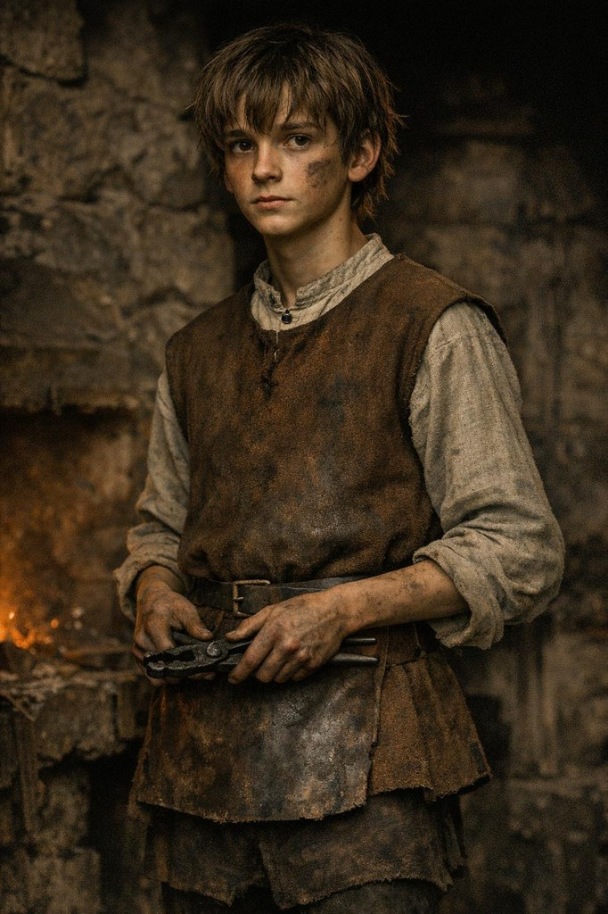

# The Apprentice (player character, working name)

**Confidence label:** `invented`
**Role:** Protagonist (per [ADR 0033](../adr/0033-teen-protagonist-and-spirit-dialogue-combat.md), age 18 per [ADR 0058](../adr/0058-protagonist-age-18.md)); healer's apprentice (per [ADR 0052](../adr/0052-healer-apprentice-and-family-cure-loop.md)). The New Game opening already plays him; commissions in the older quests still assume the forge.
**Name:** not yet chosen; `char.apprentice` is the stable ID and may stay as the internal ID after the name is decided. Maintainer decision pending.

<!-- character-images -->

Generated 2026-10-12 with Leonardo AI (`gpt-image-1.5`), cinematic low-key style of the other sheets, 682x1024; dialogue avatar `assets/characters/portraits/npc/apprentice.png` (candidate per ADR 0044). These references predate the age change and remain fully clothed; audit their apparent age before any asset replacement.

*Reference only. Image index: [`img/README.md`](./img/README.md).*

## Who he is
An 18-year-old orphan raised in the almshouse of the Holy Spirit parish, which takes in the sick and the poor (`attested`; an orphan house there is `plausible composite`). He is thin, watchful, and slow to speak. He grew up carrying bowls to the sick-room and sitting with the dying, and he always knew where it hurt before they said.

The opening night makes him a healer's apprentice. A wounded watchman is carried in with a spearhead in his side, and the matron sends for Kalev, the smith who can speak to iron. Kalev sees that the apprentice found the pain before anyone touched the man, and takes him in to the bed of the missing apprentice [Mart](./mart.md). From then on he learns from three teachers: Kalev's iron charms and folk cures, [Brother Tidemann](./brother_tidemann.md)'s herbs and Latin remedies at St Catherine's, and the almshouse, where the patients keep coming.

## Gift and burden
He sees a spirit world that other people do not: the quarrels, shames, debts, and fears behind what people say appear to him as duels and phantoms. A sickness shows him its cause in the household around the patient, which is why his cures go through families rather than through the body alone. In game terms this is clairvoyance. Others read it as oddness: he stares, he talks to himself. The game gives it no clinical name and does not call it an illness or a superpower; it is both a gift and a cost. Estonian folklore creatures appear to him only as phantoms of fear, never in the physical world. Magic exists only in the spirit world.

## Motivations & Core
- **Want:** A place to belong, to understand what the grown-ups are fighting about, and to make the hurting stop.
- **Fear:** That he is dangerous, and that what he sees is a sign something is wrong with him.
- **Contradiction:** He can read people better than anyone, yet cannot tell which side to trust. The knowledge that heals a family can just as easily break it, and he knows it.
- **Secret or withheld fact:** He knows what a person fears before they speak it, and has told no one.

## Relationships
- **Kalev:** Master smith, folk healer and mentor. The first adult who gives him a bed. Teaches him iron charms against spirits and the words for iron wounds. The mark on the opening night's spearhead is Kalev's, and neither of them talks about it.
- **[Brother Tidemann](./brother_tidemann.md):** Infirmarian of St Catherine's. Teaches him herbs, Latin remedies and the rites for the sick, in return for errands.
- **Mart:** The missing older apprentice whose place he fills. Finding Mart is the hook of the story.
- **Aita:** Kalev's sister, alewife and healer; the first person who treats his staring as ordinary.
- **Matron Gertrud:** Kept the house he grew up in; still sends him patients.
- **Captain Henning, Kaja, Jürgen Witte, Ellen Luik:** the adults whose conflicts he sees as duels; see their briefs.

## Voice
Few words, concrete, literal. Notices what is not said. Understands little German or Russian at first; comprehension grows (see [`SPIRIT_DIALOGUE.md`](../SYSTEMS/SPIRIT_DIALOGUE.md)).

## Mechanics hooks
- Guilt per school when he strikes: [`SPIRIT_DIALOGUE.md`](../SYSTEMS/SPIRIT_DIALOGUE.md#guilt-implemented-sd-03).
- Double-edged traits and talking to himself: planned (SD-09, SD-15).
- Household cures and the dark path (poison, division, sold secrets): planned, [`HOUSEHOLD_CURE.md`](../SYSTEMS/HOUSEHOLD_CURE.md).
- Model: `assets/characters/variants/apprentice.tscn` (implemented, SD-10; re-dressed as a healer's boy under ADR 0052). Portrait: [`img/sheets/apprentice.jpg`](./img/sheets/apprentice.jpg).

## Possible outcomes
- Learns to carry the gift without being consumed by guilt.
- Becomes a feared reader of people.
- Breaks under the weight of what he sees.
- Becomes the city's doctor of souls, or the one who knows everyone's wound and uses it.
- Leaves the forge and the city.
