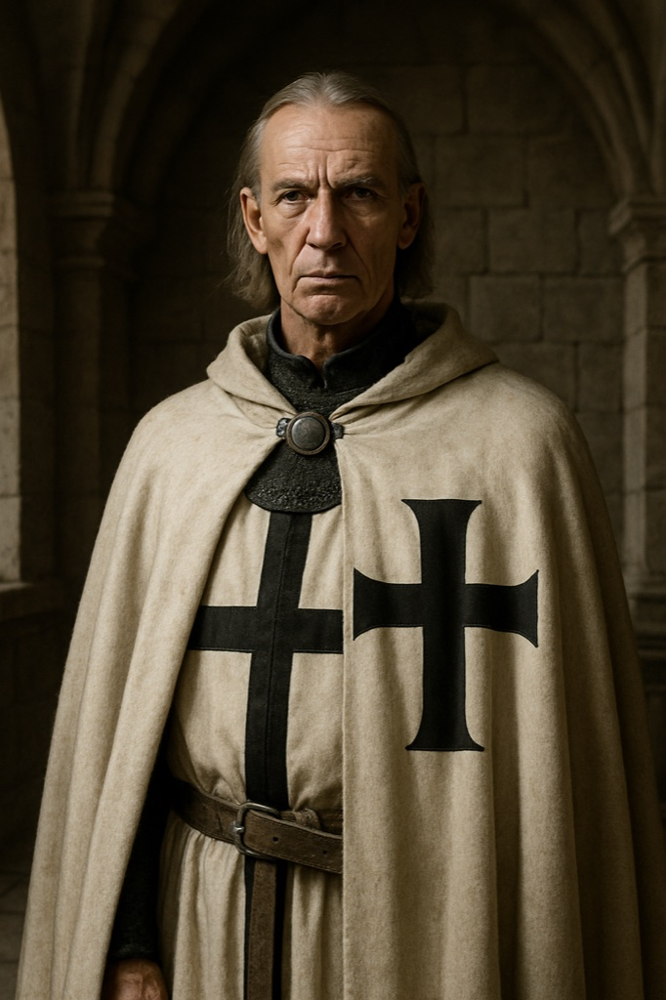

# Master Burchard von Dreileben

**Confidence label:** `attested` (person, office, May 1343 role) / `invented` (face, manner, private life, quest hooks)
**Role:** Master of the Livonian Order; decisive suppressor of the 1343 rising; Act 2-3 antagonist
**Promotion:** P7-009 Wave A (`char.burchard_dreileben`) · Act gate **A2-A3** · Art tier **1** · Legacy seed inspiration only
**Content ID:** `char.burchard_dreileben`

<!-- character-images -->

*Reference only. Image index: [`img/README.md`](./img/README.md).*

## Historical basis and confidence
[`docs/CANON.md`](../CANON.md) lists Burchard von Dreileben as **`attested`**: Master of the Livonian Order who defeated the rebels at Sõjamäe (14 May 1343) and, per the research timeline, lured the Four Kings to Paide under truce and took Danish castles in mid-May 1343. Everything below beyond those facts is **`invented`** colouring, labelled as such:
- Appearance, age (the seed says late fifties), voice, daily routine and the "iron ring" are invented. No portrait of him survives.
- The seed credits him with the reconquest of Saaremaa and the building of Maasi Castle. That is **unverified** here and must not appear in dialogue until the Researcher confirms it against `history/`.
- The player meets him through envoys, summons, and set-piece scenes more than constant presence (promotion plan: **adapt**).
- Open canon question (for the Canon Keeper, not decided here): the research notes also show Goswin von Herike styled Master in November 1346 while Burchard receives Estonia on 1 November 1346. Resolve the order of masters before any scene past 1343 names an office.

## Visual Description
- **Clothes:** The white Order mantle of heavy coarse wool, plain black cross on the left shoulder, hem and cuffs worn; dark simple tunic and leather belt. No jewellery beyond the iron ring of the Order.
- **Age:** Late fifties (seed; invented).
- **Hair:** Silver-grey, cut short, receding at the temples; clean-shaven.
- **Physical Build:** Tall, lean, powerful; long angular face, high cheekbones, square jaw, weathered skin, pale blue deep-set eyes, a mouth that rarely smiles.

## Motivations & Core
- **Want:** Crush the rising decisively as an example, secure the Order's borders, and bring the land fully under Church and Order rule.
- **Fear:** A united front of Danes, Hanse merchants and Rus powers against the Order, and any sign that its authority can be questioned.
- **Contradiction:** A pragmatist who deals with brutal force and political bargains, while presenting both as the Order's sacred purity.
- **Secret or withheld fact:** Truce terms are a tool to him; the Paide talks were never meant to hold (attested outcome, invented intent).

## History (Biography)
A lifelong Order officer who rose by campaigning, administration and a reputation for ruthlessness, then became Master. In spring 1343 he moved from the Pskov border toward Reval, invited the Four Kings to negotiate, and broke the rebel army at Sõjamäe.

## Ties & Relationships
- **Allies:** Loyal Order knights and commanders; a tense, pragmatic link with the Church and the Bishop of Reval. [Brother Goswin von Herike](./goswin_herike.md) sees him as mentor and model.
- **Enemies:** The Estonian rebels, whom he calls savages; he distrusts the Danish nobility and the Hanseatic merchants as rivals.
- **Initial View of the Main Player (Kalev):** Suspicion: an Estonian is a rebel in waiting, a foreigner a spy. Trust must be earned through usefulness to the Order.
- **[Brother Hermann](./brother_hermann.md):** The Master's reach into Reval; Hermann's pressure on the forge speaks with Burchard's authority.

## Daily Routines
Prayer, then commanders' reports, administration and logistics, personal inspection of recruits and fortifications, evenings with maps and military treatises. Registry anchor: `poi.guard.long_hill` (a field command post, not a residence in the city).

## Voice
Formal, measured, unhurried; speaks in orders and consequences. Quotes duty, rarely feeling.

## Possible Quest Lines & Outcomes
- **The Iron Fist:** Carry out his suppression commands (burn, execute, interrogate); confront the Order's methods.
- **A Web of Intrigue:** Act as his agent against plots among Danish nobles or Hanse merchants.
- **The Master's Trust:** Earn his confidence step by step and become a lieutenant.
- **Arc:** Suspect -> Instrument -> Accountable Actor.
- **Endings:** Victor of Sõjamäe and master of Reval's castles, or an adversary the player undermines through the forge and the ledger.

---

*Stub status:* quest hooks come from the legacy seed and are not scheduled content until their act design gate opens.
