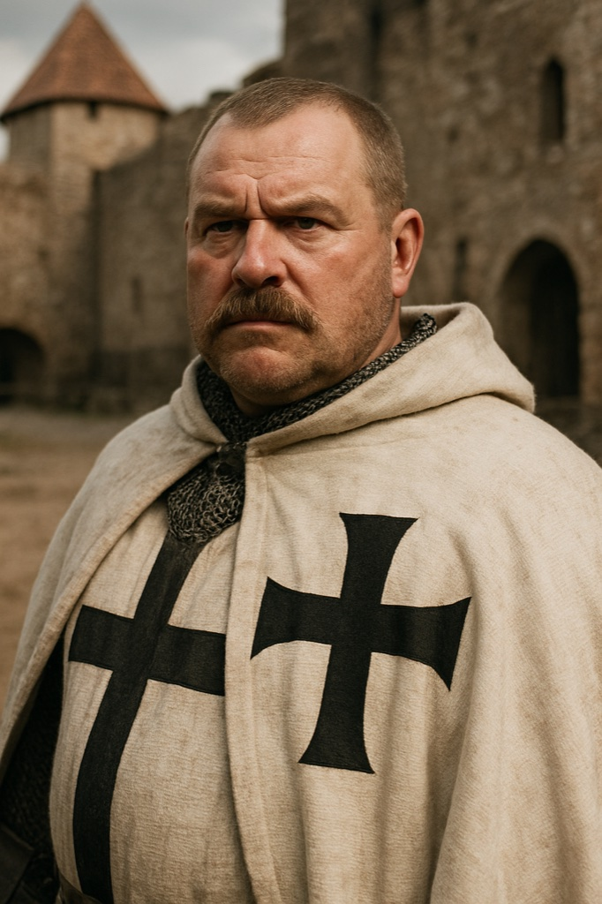

# Brother Goswin von Herike

**Confidence label:** `attested` (person, installation as Reval castle commander on 14 May 1343, later Master) / `invented` (face, family, manner, quest hooks)
**Role:** Order field commander under Burchard; castle commander of Reval from May 1343
**Promotion:** P7-009 Wave A (`char.goswin_herike`) · Act gate **A2** · Art tier **1** · Legacy seed inspiration only
**Content ID:** `char.goswin_herike`

<!-- character-images -->

*Reference only. Image index: [`img/README.md`](./img/README.md).*

## Historical basis and confidence
The research timeline (`history/`, summarised in [`docs/CANON.md`](../CANON.md) context) attests that **Goswin von Herike is installed as castle commander of Reval on 14 May 1343** and that he appears as Livonian Master in the privilege confirmations of **4 November 1346** at Weissenstein. No portrait survives. Labelled **`invented`**: his Westphalian family, age (seed: early forties), build, mustache, ambition to be Master, and his earlier post as Commander of Viljandi, which the seed states but the research notes do not support. Open canon question for the Canon Keeper: the order of Masters in 1343-1346 (see [Burchard von Dreileben](./burchard_dreileben.md)).

## Visual Description
- **Clothes:** Polished mail hauberk over linen, shorter white wool surcoat with the black Order cross, leather breeches, tall thick-soled boots, wide belt with an iron buckle and a sheathed longsword.
- **Age:** Early forties (seed; invented).
- **Hair:** Close-cropped light brown, thick well-groomed mustache.
- **Physical Build:** Robust and stocky; broad weathered face, square jaw, prominent brow, watchful brown eyes.

## Motivations & Core
- **Want:** Rise within the Order and leave a mark; use the rising as a chance to prove his leadership.
- **Fear:** Being outranked or blamed for a failed pacification before he is secure.
- **Contradiction:** More willing than Burchard to negotiate with Danes and Hanse merchants, yet harsh toward rebels when it serves him.
- **Secret or withheld fact:** He quietly measures every ally and subordinate as a rung or a risk.

## History (Biography)
A noble Westphalian family's son in the Order, administrator and commander, entrusted in May 1343 with Reval's castle after the Danish handover, and later Master.

## Ties & Relationships
- **Allies:** The knights and soldiers under his command; formally respectful of [Master Burchard von Dreileben](./burchard_dreileben.md), whom he treats as mentor and model.
- **Enemies:** The Estonian rebels; he sees the capture and public execution of seers like [Urmas Laar](./urmas_laar.md) as a priority. Danish nobles and Hanse merchants are rivals.
- **Initial View of the Main Player (Kalev):** Asset or threat. Skill and loyalty earn his patronage; suspected disloyalty is eliminated.
- **[Brother Hermann](./brother_hermann.md):** A handler who reports to the same chain; Goswin reads the Reval garrison through him.

## Daily Routines
Command and administration from the castle; he inspects garrisons and rides out on pacification missions. Registry anchor: `poi.guard.long_hill`.

## Voice
Measured, administrative, courteous with an edge; speaks in terms of arrangements, obligations and consequences.

## Possible Quest Lines & Outcomes
- **The Commander's Gambit:** Missions meant to undermine his rivals in the Order and strengthen his position.
- **The Pacification of the North:** Restore order in a rebellious region by force or by a harder, slower diplomatic road.
- **A Knight's Honor:** Uncover a conspiracy that threatens his reputation; expose it or become complicit.
- **Arc:** Patron -> Rival -> Accountable Actor.
- **Endings:** Rises to Master, or falls if the player exposes his scheming.

---

*Stub status:* quest hooks come from the legacy seed and are not scheduled content until their act design gate opens.
