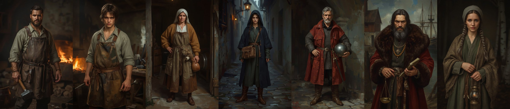

# Character images

All images of characters that have a card in [`docs/CHARACTERS/`](../README.md) live here, next to the card. Reference only: not runtime assets, not imported by Godot (`.gdignore`).

| Folder | Content |
|---|---|
| [`concept/`](concept/) | Concept plates of the core cast (below) |
| [`sheets/`](sheets/) | Painted reference sheets and legacy pixel sources moved from the `characters/` seeds when the character got a card. The `.jpg` sheets are also the source of the dialogue avatars (`tools/assets/import_npc_portraits.py`, rows in `assets/SOURCES.csv`). |

Characters without a card keep their seed sheet and images under [`characters/`](../../../characters/README.md) until they are promoted; promotion moves the images here.

## Core cast concept plates

No `assets/SOURCES.csv` rows. Generated with Leonardo AI (account default model) in the painterly Baltic direction of [`docs/ART_BIBLE.md`](../../ART_BIBLE.md), one full-body portrait per vertical-slice core character. Costume and role follow the briefs in [`docs/CHARACTERS/`](../README.md); faces and body types are invented, since the briefs carry no physical description. The legacy pixel sprites were used as mood inspiration only and are no longer shown in the root README.

| Character | Portrait | Costume notes |
|---|---|---|
| Kalev | [kalev.jpg](concept/kalev.jpg) | soot-stained linen, scorched leather apron, forging hammer |
| Mart | [mart.jpg](concept/mart.jpg) | lanky teenager, patched shirt, short apron, tongs |
| Aita | [aita.jpg](concept/aita.jpg), photorealistic [aita_photoreal.jpg](concept/aita_photoreal.jpg) (OpenAI gpt-image-1, 2026-10-12, after the expanded brief) | widow's linen headcloth, ochre wool kirtle, olive apron, band-woven belt with pouch and dried herbs |
| Kaja | [kaja.jpg](concept/kaja.jpg) (alternate, not canonical face) | indigo hooded cloak, courier satchel, cobbled alley |
| Captain Henning | [henning.jpg](concept/henning.jpg) | mail hauberk, red surcoat, steel kettle helm |
| Jürgen Witte | [jurgen.jpg](concept/jurgen.jpg) | fur-trimmed red gown, amber beads, ledger and scales |
| Ellen Luik | [ellen.jpg](concept/ellen.jpg) (alternate, not canonical face) | braids, wool shawl with bone and amber charms, lantern |

## Known deviations (review before using as costume reference)

- Kalev reads as a heavier build in the chosen plate; Kaja's cloak is indigo, matching the Black Cloaks palette rather than a courier disguise.
- Henning's helm is a rounded kettle shape that leans late-medieval; check against research before modelling.
- Jürgen's fur gown is richer than the plausible-composite brief needs; trim for the in-game tier.
- Raw generations (two per character, ids in `generated/leonardo/`) hold the unused alternates.

## Reference sheets

| Character | File | Moved from |
|---|---|---|
| Kaja (canonical face) | [kaja_lahekivi.jpg](sheets/kaja_lahekivi.jpg) | `characters/rebels/img/kaja_lahekivi.jpg` |
| Lembit Helme | [lembit_helme.jpg](sheets/lembit_helme.jpg) | `characters/rebels/img/lembit_helme.jpg` |
| Martin of the Cloaks | [martin.jpg](sheets/martin.jpg) | `characters/rebels/img/martin.jpg` |
| Old Toomas | [old_toomas.png](sheets/old_toomas.png) | `characters/forge_folk/old_toomas/img/old_toomas.png` |
| Old Toomas | [old_toomas.gif](sheets/old_toomas.gif) | `characters/forge_folk/old_toomas/old_toomas.gif` |
| Old Toomas | [old_toomas.aseprite](sheets/old_toomas.aseprite) | `characters/forge_folk/old_toomas/old_toomas.aseprite` |
| Ellen Luik (canonical face) | [ellen_luik.jpg](sheets/ellen_luik.jpg) | `characters/metsik_cult/img/ellen_luik.jpg` |
| Hinrik the Cartographer | [hinrik_the_cartographer.jpg](sheets/hinrik_the_cartographer.jpg) | `characters/blackhead/img/hinrik_the_cartographer.jpg` |
| Johann von Minden | [johann_von_minden.jpg](sheets/johann_von_minden.jpg) | `characters/blackhead/img/johann_von_minden.jpg` |
| Mart Weaver | [mart_the_weaver.jpg](sheets/mart_the_weaver.jpg) | `characters/blackhead/img/mart_the_weaver.jpg` |
| Viceroy Konrad Preen | [konrad_preen.jpg](sheets/konrad_preen.jpg) | `characters/denmark/img/konrad_preen.jpg` |
| Tomas Veld, Order Squire | [squire.jpg](sheets/squire.jpg) | `characters/order/img/squire.jpg` |
| Jüri Ratnik | [juri_ratnik.jpg](sheets/juri_ratnik.jpg) | `characters/rebels/img/juri_ratnik.jpg` |
| Urmas Laar | [urmas_laar.jpg](sheets/urmas_laar.jpg) | `characters/rebels/img/urmas_laar.jpg` |
| Town Guard Captain | [captain.jpg](sheets/captain.jpg) | `characters/denmark/town_guard/img/captain.jpg` |
| Master Burchard von Dreileben | [master_burchard_von_dreileben.jpg](sheets/master_burchard_von_dreileben.jpg) | `characters/order/img/master_burchard_von_dreileben.jpg` |
| Brother Goswin von Herike | [brother_goswin.jpg](sheets/brother_goswin.jpg) | `characters/order/img/brother_goswin.jpg` |
| Mikhail Kolovrat | [mihail_kolovrat.jpg](sheets/mihail_kolovrat.jpg) | `characters/pskov/img/mihail_kolovrat.jpg` |
| Jana Podajalnaja | [jana.jpg](sheets/jana.jpg) | `characters/novgorod/img/jana.jpg` |
| Nikolaus von Danzig | [nikolaus_von_danzig.jpg](sheets/nikolaus_von_danzig.jpg) | `characters/lizard_union/img/nikolaus_von_danzig.jpg` |

## Generated sheets (2026-10-12)

Cards that had no face got one sheet each, generated with Leonardo AI `gpt-image-1.5` in the cinematic low-key look of the reference sheets above and downscaled to 682x1024 (raw output in gitignored `generated/leonardo/`). Rows for the derived avatars are in `assets/SOURCES.csv` (candidate per ADR 0044).

| Character | File | Leonardo generation |
|---|---|---|
| The Apprentice | [apprentice.jpg](sheets/apprentice.jpg) | `1f1c66fa-423d-6fc0-9abb-4a2b4e43ae1c` |
| Brother Hermann | [brother_hermann.jpg](sheets/brother_hermann.jpg) | `1f1c66f7-05dc-68e0-8bb7-721ef8ef1079` |
| Anisia of Novgorod | [anisia_of_novgorod.jpg](sheets/anisia_of_novgorod.jpg) | `1f1c66f8-bb37-6720-a476-99046f7e0a9e` |
| Old Toomas | [old_toomas.jpg](sheets/old_toomas.jpg) | `1f1c66f5-348b-6760-ae4d-f608810deeb3` |

**Canonical faces:** each card embeds exactly one face. For Kaja and Ellen the sheet is canonical and the concept plate an alternate (provisional decision 2026-10-12, recorded in the cards).
