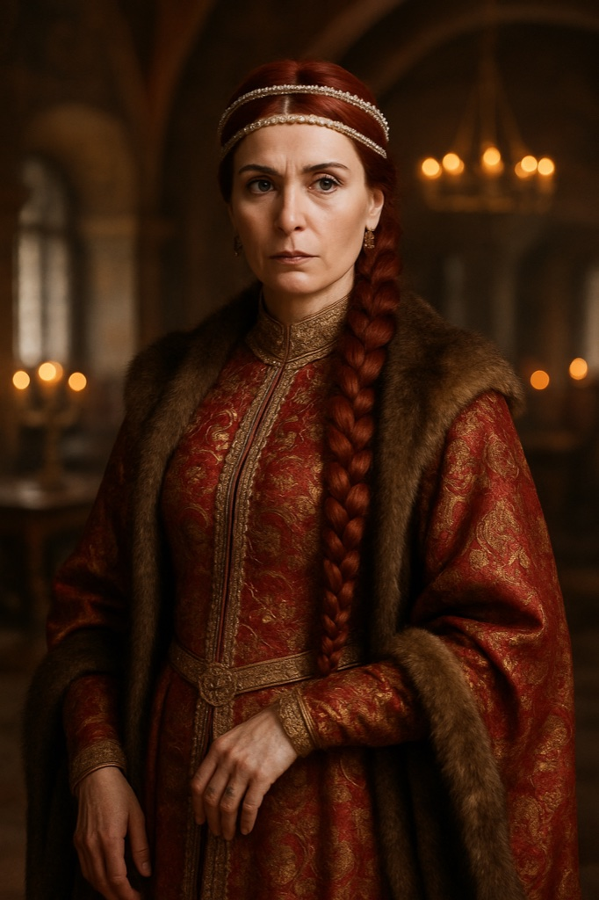

# Jana Podajalnaja

**Confidence label:** `plausible composite`
**Role:** Novgorod trade and intelligence voice in Reval; Novgorod seat of `faction.pskov_novgorod`
**Promotion:** P7-009 Wave B (`char.jana_podajalnaja`) · Act gate **A2** · Art tier **1** · Legacy seed inspiration only
**Content ID:** `char.jana_podajalnaja`

<!-- character-images -->

*Reference only. Image index: [`img/README.md`](./img/README.md).*

## Naming and faction boundary
[`docs/CANON.md`](../CANON.md) labels the Pskov/Novgorod emissary NPCs **`plausible composite`**; Jana is invented. The legacy seed was written in Cyrillic (Яна Подаяльная); "Podajalnaja" is the canon Latin form (older Latin-script transliteration) and a name she carries as a trade-house epithet. She is the Novgorod voice in the combined `faction.pskov_novgorod` seat, opposed to [Mikhail Kolovrat](./mikhail_kolovrat.md), the Pskov voice. The seed's links to Goytan, Prokhor, and Sergius of Radonezh (other legacy sheets, not promoted) are inspiration only; Sergius of Radonezh is out of period for this cast and must not be assumed.

## Visual Description
- **Clothes:** The finest Novgorodian fashion in deep blue and rich red: silk and velvet with silver embroidery and pearls (rank and wealth, not folk dress).
- **Age:** Early forties.
- **Hair:** Long, fiery red, worn in an intricate braid.
- **Physical Build:** Graceful and commanding; pale smooth complexion, piercing dark eyes that assess everything.

## Motivations & Core
- **Want:** Expand Novgorod's economic and political influence across the region and become one of the republic's most powerful figures.
- **Fear:** A wider war that cripples trade, and Pskov or Moscow slipping from Novgorod's grip.
- **Contradiction:** A believer in the republic who will bribe, forge and deceive for it, and who charms an ally while holding strings on every favour.
- **Secret or withheld fact:** Her operations profit whichever side wins; she backs the rising and the Order with equal coolness.

## History (Biography)
Born to a powerful Novgorod merchant house, trained early in diplomacy, economics and manoeuvre, rose in the trade delegation as a ruthless and brilliant negotiator, and secured several key agreements.

## Ties & Relationships
- **Allies:** Merchant guilds and the ruling council of Novgorod; a network of spies and agents in every regional city.
- **Enemies:** Anyone blocking Novgorod: the Livonian Order, the Danish Crown, and Pskov's independence movement.
- **Initial View of the Main Player (Kalev):** A pawn and a potentially valuable asset. Charming and generous, with strings on every offer.
- **[Mikhail Kolovrat](./mikhail_kolovrat.md):** Direct opposition over Pskov's independence; the Pskov Gambit hook.

## Daily Routines
Meetings, negotiations and information exchange from the Novgorod trade mission (her residence and base), evenings with influential guests. Registry anchors: `poi.forum` by day, `poi.brewery.vene` (the Rus quarter) as home base.

## Voice
Warm, precise, flattering; every kindness comes with an invoice. Speaks like a ledger that smiles.

## Possible Quest Lines & Outcomes
**Before the uprising (1342)**
- **The Grain Monopoly:** Gather evidence of Hanse grain price-fixing, by theft of ledgers or pressure on a clerk.
- **A Gift for the Viceroy:** Supply materials for a priceless icon destined for [Viceroy Konrad Preen](./konrad_preen.md) on Toompea.
- **Whispers from the West:** Scout Order fortification near the Pskov border for proof of a treaty breach.

**During the uprising (1343-1345)**
- **A Profitable Rebellion:** Secure abandoned manors in Harju with forged documents while evading both rebels and the Order.
- **The Pskov Gambit:** Intercept or bribe officials to delay Pskov aid for the rebels.
- **The Swedish Question** and **Siegebreaker:** Disinformation toward Swedish intervention; smuggle cargo and messages out of besieged Reval.
- Hooks set outside the Reval hinterland (Pskov, a sea voyage to intercept a fleet) follow the explicit-journey rule for distant regions; they are not seamless maps.
- **Arc:** Patron -> Handler -> Accountable Actor.
- **Endings:** Her network profits from the outcome, or the player breaks it.

## Political views (from the seed, compact)
- **Moscow:** a threat to republican tradition, undermined through trade and espionage.
- **Pskov:** a foolish younger brother to bring back by manipulation, not war.
- **Golden Horde:** a necessary evil, bought off and played against Moscow.
- **Livonian Order:** a dangerous religious and military rival on the western border.
- **Hanseatic League:** partner and rival, to be outmanoeuvred in every negotiation.
- **Denmark:** a paper tiger; the sale of Estonia is desperation and an opening.

---

*Stub status:* quest hooks come from the legacy seed and are not scheduled content until their act design gate opens.
