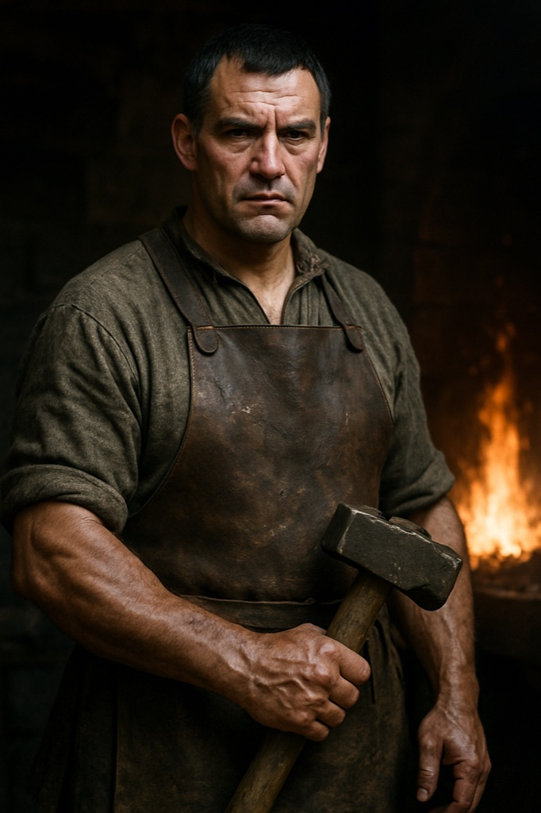

# Jüri Ratnik (Iron Hand)

**Confidence label:** `plausible composite`
**Role:** Harju Kings field captain; blacksmith turned war leader
**Promotion:** P7-009 Wave B (`char.juri_ratnik`) · Act gate **A2** · Art tier **1** · Legacy seed inspiration only
**Content ID:** `char.juri_ratnik`

<!-- character-images -->

*Reference only. Image index: [`img/README.md`](./img/README.md).*

## Naming and faction boundary
One of the four Harju Kings (`faction.harju_kings`). The 1343 rising attests four elected kings, but their personal names are not recorded, so this name and biography are an invented composite in the same way as [Lembit Helme](./lembit.md). "Iron Hand" is the Order's nickname for him, not a title he uses. He is a smith by trade: he is a foil to the protagonist's forge, never a second player smith.

## Visual Description
- **Clothes:** Dark wool under a hardened leather jerkin, with crude iron plates riveted over shoulders and forearms; soot-stained, chosen for battle rather than comfort.
- **Age:** Forties.
- **Hair:** Short black, flecked grey at the temples.
- **Physical Build:** Tall, broad-shouldered, corded smith's arms; large calloused hands permanently grey with soot; square jaw, a perpetually grim face, dark watchful eyes.

## Motivations & Core
- **Want:** Vengeance on the foreign lords and a rising won by strength; he believes the Order understands only the sword and the hammer.
- **Fear:** That patience and council talk waste the one winter the rebels have, and that his brother's death is forgotten.
- **Contradiction:** A craftsman who made ploughshares and now makes war hammers, he distrusts politics yet depends on Lembit's council to feed his men.
- **Secret or withheld fact:** The manor lord he killed was drunk and unguarded; the legend of a stormed hall is larger than the night itself.

## History (Biography)
Once smith to a manor in Läänemaa, content with his forge and family. When the lord had Jüri's younger brother flogged to death for a minor offence, Jüri forged a massive war hammer, killed the lord and his guards, and fled to the forest. Desperate men gathered to him, and his personal vengeance merged into the larger rising.

## Ties & Relationships
- **Allies:** Fellow Harju King; commands the most aggressive, battle-hardened warriors. Respects [Lembit Helme](./lembit.md) but clashes with him over caution versus direct action.
- **Enemies:** The Livonian Order, whose knights call him "Iron Hand" and treat him as a priority target.
- **Initial View of the Main Player (Kalev):** Sceptical. Another smith, but does Kalev have the killer instinct? He will test strength and courage in battle and judges deeds, not names.
- **[Urmas Laar](./urmas_laar.md):** Tolerates the seer's prophecies as long as they steady the men.

## Daily Routines
Master of the rebel training ground, a muddy field where he drills warriors, inspects weapons, and plans raids. Few words, blunt orders, always takes the most dangerous place in a fight. Registry anchors: home and mill at Karja (`poi.mill.karja`), guard rounds at `poi.guard.karja`.

## Voice
Short, flat sentences, smith's metaphors (heat, quench, temper). No ornament; contempt for speeches.

## Possible Quest Lines & Outcomes
- **Anvil and Hammer:** Raid an Order convoy for iron ore so his elite warriors can be armed.
- **The Iron Hand's Justice:** A village collaborated with the Order; Jüri wants an example, Lembit fears the people will turn. Back his justice or find a gentler path.
- **A Challenge of Champions:** An Order knight mocks the rebels' courage; Jüri asks the player to be champion after a brutal test.
- **Forging a Legend:** Retrieve a meteorite from a dangerous ancient site to forge a symbol of the rising.
- **Arc:** Sceptic -> Tester -> Comrade or Rival.
- **Endings:** Falls at the Sõjamäe defeat, escapes to the forest, or is turned toward restraint by the player's choices.

---

*Stub status:* quest hooks come from the legacy seed and are not scheduled content until their act design gate opens.
