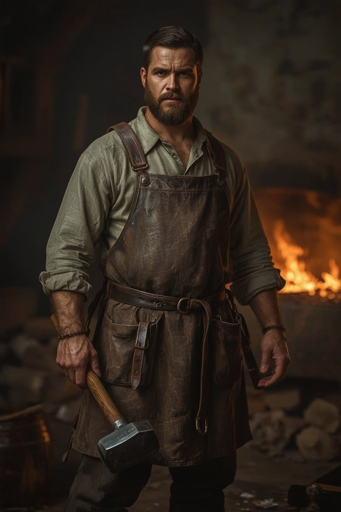

# Kalev (The Smith)

**Confidence label:** `invented`
**Role:** Master smith, folk healer of iron wounds, and the apprentice's mentor ([ADR 0033](../adr/0033-teen-protagonist-and-spirit-dialogue-combat.md), [ADR 0052](../adr/0052-healer-apprentice-and-family-cure-loop.md)); protagonist in older prototype content

> **ADR 0052:** most of Kalev's work is everyday iron (nails, hinges, tools, horseshoes), and the Lower Town also comes to him to pull teeth, set bones and speak the *origin of iron* charm over iron wounds. That is how he meets the apprentice: the almshouse sends for him when a watchman is carried in with a spearhead in his side, and the mark on it is his own. Iron at thresholds and forged amulets against spirits are his folk craft (`folklore`; Kalev as healer is `plausible composite`).

> **Planned change (ADR 0033):** the player character becomes an 18-year-old orphan taken in as the forge's new apprentice (age amended by ADR 0058). Kalev stays the adult smith, with his model, portrait, forge, and ledger, but becomes a mentor NPC. The profile below describes him as the protagonist until the new hero is implemented. Until then, the playable prototype still controls Kalev.

<!-- character-images -->

*Reference only. Image index: [`img/README.md`](./img/README.md).*

## Motivations & Core
- **Want:** Keep his forge, protect Mart, and remain useful enough that every side leaves him alone.
- **Fear:** That his strict neutrality is actually cowardice, and that the few weapons he has made will kill someone he loves (like Mart or Aita). The opening night's spearhead tells him it has already started.
- **Contradiction:** He condemns violence but takes profound pride in his craftsmanship when powerful people depend on his weapons.
- **Secret or withheld fact:** He silently knows that Mart is stealing materials for the rebellion, but he alters his ledger to cover for the boy rather than confront him, making himself complicit.

## Relationships
- **Mart:** His 16-year-old apprentice. Fiercely protective of him, acts as a father-figure but insists on strict professional boundaries.
- **Aita:** His older sister. His moral anchor who constantly challenges his excuses for neutrality.
- **Captain Henning:** A dangerous customer. Kalev respects his pragmatic approach to order but fears his authority.
- **Kaja:** A tempting but dangerous contact who pushes Kalev to take a political stance.
- **Jürgen Witte:** An economic threat and opportunity; Kalev despises his exploitation but relies on his raw iron.

## Voice
Pragmatic, cynical, and observant. Uses short, precise sentences focused on material reality (iron, heat, leverage, rust) rather than abstract ideals. Grunts more often than he argues.

## Possible outcomes
- **Arc:** Observer -> Accomplice -> Accountable Actor.
- **Endings:** Destroys his forge to save lives (Break), arms the rebellion (Open), or fortifies the rulers (Seal).
