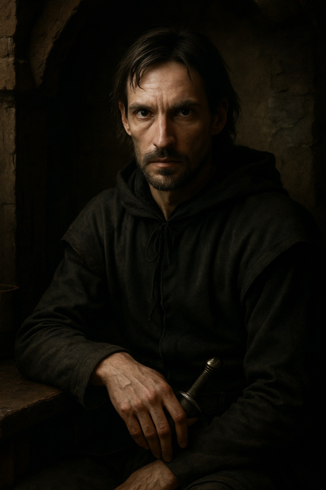

# Nikolaus von Danzig

**Confidence label:** `invented`
**Role:** Spymaster of the Lizard Union intrigue cell (not a ninth launch faction)
**Promotion:** P7-009 Wave B (`char.nikolaus_danzig`) · Act gate **A2-A3** · Art tier **1** · Legacy seed inspiration only
**Content ID:** `char.nikolaus_danzig`

<!-- character-images -->

*Reference only. Image index: [`img/README.md`](./img/README.md).*

## Naming and faction boundary
`faction` is intentionally null in the registry. The Lizard Union is a clandestine cell, not a ninth launch faction ([`docs/CANON.md`](../CANON.md) defers it, [`cast_faction_promotion.md`](../cast_faction_promotion.md)); it uses existing Order and Hanseatic ledger pressure. A ninth faction needs a later ADR. His face is a Hanseatic merchant who was once an Order knight, so his pressure reads through the ledger rather than a new system.

## Visual Description
- **Clothes:** Expensive but understated Hanseatic merchant dress: high-collared doublet of deep forest-green wool with polished silver buttons, a sleeveless charcoal-grey houppelande of fine Flemish cloth lined with dark fur at collar and armholes, matching grey wool hose, sturdy well-oiled black boots. Note: the houppelande is a late-14th-century cut, so under the period rule for 1343 use a simpler fur-lined overgown.
- **Age:** Late thirties.
- **Hair:** Dark brown, practical medium length; neatly trimmed beard.
- **Physical Build:** Lean and wiry; sharp intelligent face, piercing grey eyes; calloused hands and economical movement betray his knightly past.

## Motivations & Core
- **Want:** See the Livonian Order humbled, and carve out a new powerful state for himself and his allies.
- **Fear:** Being exposed as the architect of the Union's web before it is ready.
- **Contradiction:** He despises the Order's blind dogma and brute force, but runs his own network on obedience and sacrifice of pawns.
- **Secret or withheld fact:** He knows the Order's command habits from the inside, and is planning with exactly that knowledge.

## History (Biography)
Once a promising Teutonic Order knight, he broke with his superiors over rigid dogma and hypocrisy, rebuilt himself as a Reval merchant, and became the architect of the Union's strategy and a web of informants.

## Ties & Relationships
- **Allies:** Other members of the Lizard Union; informants and agents throughout Reval.
- **Enemies:** The Livonian Order, especially his former commander [Brother Goswin von Herike](./goswin_herike.md); everyone else is a pawn or an obstacle.
- **Initial View of the Main Player (Kalev):** A powerful, unrefined weapon to aim at the Union's enemies; he recruits with wealth, power and a chance to strike back.
- **[Johann von Minden](./johann_von_minden.md):** A Blackheads merchant contact whose network overlaps his cover trade.

## Daily Routines
A respectable merchant in the markets and guild halls by day; clandestine meetings, reports and orders by night. Registry anchor: `poi.bath.nunne`.

## Voice
Charming, patient, exact; speaks in terms of positions and moves, never raises his voice.

## Possible Quest Lines & Outcomes
- **The Serpent's Kiss:** Poison a high-ranking Order member; choose whether to do it and how to face the consequences.
- **A Web of Lies:** Spread disinformation to turn the ruling and rebel factions against each other.
- **The Price of Ambition:** Climb the Union through increasingly ruthless acts and decide where to stop.
- **Arc:** Recruiter -> Spymaster -> Accountable Actor.
- **Endings:** Exposed, turned, or the Union's plot succeeds; consequences run through existing Order and Hanse ledger pressure only.

---

*Stub status:* quest hooks come from the legacy seed and are not scheduled content until their act design gate opens.
