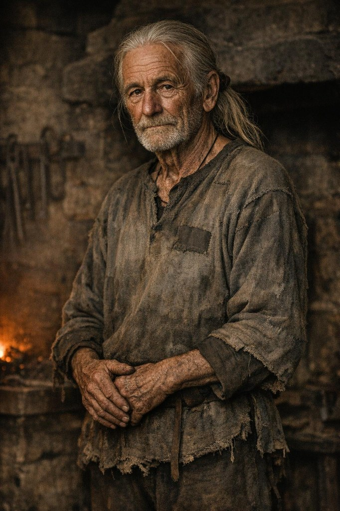

# Old Toomas

**Confidence label:** `invented`  
**Role:** Retired Lower Town smith; quiet Black Cloaks supporter; forge mentor  
**Promotion:** P7-009 Wave A (`char.old_toomas`) · Art tier **1** · Legacy seed inspiration only

<!-- character-images -->

Generated 2026-10-12 with Leonardo AI (`gpt-image-1.5`), cinematic low-key style of the other sheets, 682x1024; dialogue avatar `assets/characters/portraits/npc/old_toomas.png` (candidate per ADR 0044). Legacy pixel sources, not a face reference: [`old_toomas.png`](./img/sheets/old_toomas.png), [`old_toomas.gif`](./img/sheets/old_toomas.gif), [`old_toomas.aseprite`](./img/sheets/old_toomas.aseprite).

*Reference only. Image index: [`img/README.md`](./img/README.md).*

## Visual Description
- **Clothes:** Patched grey linen tunic, dark wool trousers, clean but coarse cloth; no apron at rest.
- **Age:** Late sixties.
- **Hair:** Long silver-white, often tied with a leather cord.
- **Physical Build:** Thin, stooped from decades at the anvil; steady gnarled hands.

## Motivations & Core
- **Want:** Keep Estonian speech, forge lore, and neighbour care alive in a Germanising Lower Town.
- **Fear:** That the young will forget the old ways and walk into Henning's rope for nothing.
- **Contradiction:** He urges caution while slipping the Cloaks a safe corner and a whispered name.
- **Secret or withheld fact:** He knows which back forges have been filing spearheads after dark.

## History (Biography)
A lifetime Lower Town smith who stepped back from the anvil as Kalev's generation took the work. He remains a neighbour, story-keeper, and occasional helper when a job needs an old hand that will not gossip to the Watch.

## Ties & Relationships
- **Allies:** Kalev (hopeful mentee), Black Cloaks couriers, Aita's circle when illness hits the lane.
- **Enemies:** Livonian Order patrols; predatory Hanseatic creditors who buy silence with debt.
- **Initial View of Kalev:** Sees the old fire in him; offers counsel, not orders.
- **Martin of the Cloaks:** Treats the younger cell smith as a reckless nephew who still needs the trade taught properly.

## Daily Routines
Mornings on a stool near a warm hearth or Kalev's yard; midday errands for neighbours; evenings listening more than speaking in trusted kitchens.

## Voice
Soft Low German in the street, Estonian with those he trusts. Short sentences, forge metaphors, almost never raises his voice.

## Possible Quest Lines & Outcomes
- **Quiet Corner:** Shelter a Cloaks courier without leaving evidence Henning can swear to.
- **Old Iron:** Identify a batch of seized spearheads by forge marks only Toomas still reads.
- **Endings:** Respected elder; broken by a raid; or silent exile after naming one name too many.
