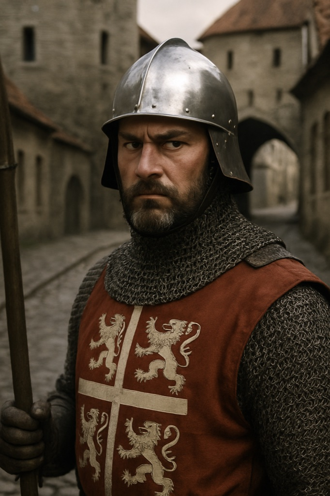

# Town Guard Captain (Danish Crown garrison)

**Confidence label:** `invented`
**Role:** Captain of the Danish Crown guard on Toompea; the Crown's armed hand, distinct from the city's Viru Watch
**Promotion:** Roster entry (`char.town_guard_captain`) · Act gate **A1** · Art tier **extra** · Legacy seed inspiration only
**Content ID:** `char.town_guard_captain`

<!-- character-images -->

*Reference only. Image index: [`img/README.md`](./img/README.md).*

## Decision: not Captain Henning
**Decided:** the Town Guard Captain is a different person from [Captain Henning](./henning.md). Reasons:
- Henning commands the **Viru Watch**, the city watch the player meets in Lower Town, and his arc (exposure, atrocity, handover to the Order) is a core-cast arc that a roster extra must not dilute.
- The Town Guard Captain belongs to `faction.danish_crown`, sleeps in the castle barracks (`poi.barracks.castle`), and patrols the town hall and the coastal guard. He answers to [Viceroy Konrad Preen](./konrad_preen.md), not to the watch chain.
- The legacy seed sheet names neither man, so no canon is overturned. Players must not meet the same face under two titles.
- Keep dialogue separate: Henning handles street order and the Watch's corruption; the Captain handles Crown garrison duty and treats the Watch as a rival jurisdiction.

## Visual Description
- **Clothes:** Polished steel helmet and chainmail shirt over a plain surcoat in Crown colours; no held objects in the sheet.
- **Age:** Late thirties.
- **Hair:** Hidden by the helmet; neatly trimmed beard.
- **Physical Build:** Stern and well built, with a suspicious gaze.

## Motivations & Core
- **Want:** Keep the garrison paid, fed, and obeyed while Copenhagen's authority fades.
- **Fear:** Being left to hold Toompea when the Crown sells or abandons Estonia.
- **Contradiction:** Loyal to a distant king who has stopped sending money, and short of it he leans on the city.
- **Secret or withheld fact:** Part of the garrison payroll is already months in arrears.

## History (Biography)
A Danish-service career soldier, rotated to Reval; knows the guard roster and the castle gates better than any councillor. The seed gives no further biography.

## Ties & Relationships
- **Allies:** [Viceroy Konrad Preen](./konrad_preen.md), the Danish Crown.
- **Enemies:** Rebel networks and, in quiet jurisdiction disputes, the Viru Watch.
- **Initial View of the Main Player (Kalev):** A craftsman to be watched when armour or weapons change hands.
- **[Captain Henning](./henning.md):** Courteous rival; cooperates only when the Crown's name is at stake.

## Daily Routines
From the registry schedule: sleeps in the castle barracks, 07:00-14:00 at the town-hall watch post (`poi.watch.town_hall`), a short break, 14:30-20:00 on the coastal guard (`poi.guard.coastal`), then home.

## Voice
Clipped, procedural, suspicious; asks for names and papers before anything else.

## Possible Quest Lines & Outcomes
- None scheduled. Use as a checkpoint and garrison-pressure face for Act 1 commissions that cross jurisdictions.
- **Arc:** Gatekeeper -> Inconvenient witness.
- **Endings:** Stays loyal to the Crown, or steps aside when the garrison breaks.
