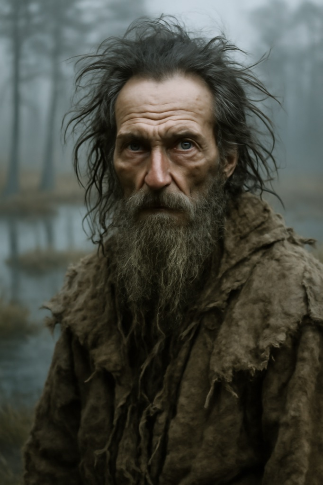

# Urmas Laar (The Seer)

**Confidence label:** `plausible composite`
**Role:** Harju Kings spiritual guide and village muster face
**Promotion:** P7-009 Wave B (`char.urmas_laar`) · Act gate **A2** · Art tier **1** · Legacy seed inspiration only
**Content ID:** `char.urmas_laar`

<!-- character-images -->

*Reference only. Image index: [`img/README.md`](./img/README.md).*

## Naming and faction boundary
One of the four Harju Kings (`faction.harju_kings`); see the naming note on [Jüri Ratnik](./juri_ratnik.md) (the attested kings are unnamed, so this is an invented composite). He is the spiritual rather than the military king. His old-faith practice is period-plausible folk religion and links to the Metsik material, not a new magic system: any spirit-world contact follows [ADR 0033](../adr/0033-teen-protagonist-and-spirit-dialogue-combat.md) and [ADR 0041](../adr/0041-spirit-sight-auras-and-soul-lights.md).

## Visual Description
- **Clothes:** Wolf, bear, and deer skins over a plain dark linen tunic, hung with bone, feather, and carved-wood talismans.
- **Age:** Indeterminate; looks both ancient and timeless.
- **Hair:** Long, wild, grey-streaked black, with a matted beard.
- **Physical Build:** Gaunt and wiry, sinewy limbs, sharp cheekbones; pale, almost translucent grey eyes with a fervent look.

## Motivations & Core
- **Want:** Purge the Christian faith that he sees as a blight silencing the old spirits; to him the rising is a holy war.
- **Fear:** That the spirits stop answering and the groves are cut down for good.
- **Contradiction:** He demands a cleansing but his visions are riddles, so others carry the risk of acting on them.
- **Secret or withheld fact:** He does not fully understand his own visions and fills the gaps with certainty.

## History (Biography)
Born in the remote eastern marshes where old custom held. Marked early by visions, apprenticed to the village shaman, learned the rites and songs. As sacred groves fell, he began preaching resistance, mixing anti-crusader rhetoric with prophecy, and emerged from the marshes with his followers when the rising began.

## Ties & Relationships
- **Allies:** Harju King; revered and feared by rural rebels; close to the Cult of Metsik, whom he sees as the purest adherents. [Ellen Luik](./ellen.md) keeps songs he claims as his own.
- **Enemies:** The Order and Church see a pagan sorcerer. Brother Goswin von Herike would count his capture and public execution a paramount objective.
- **Initial View of the Main Player (Kalev):** Reads him through prophecy, as the reincarnated giant-king. His guidance is cryptic; he is frustrated if the player resists.
- **[Jüri Ratnik](./juri_ratnik.md):** Fellow king; Jüri uses the blessing and ignores the riddles.

## Daily Routines
Tends a sacred fire in a secluded part of the camp, chants, reads omens from birds and smoke, blesses weapons before battle. Registry anchors: home at Karja (`poi.mill.karja`), daytime at `poi.slaughter.karja`.

## Voice
Cryptic, rhythmic, image-heavy; half-sentences and omens, never a straight answer to a direct question.

## Possible Quest Lines & Outcomes
- **The Sacred Grove:** Reclaim and reconsecrate a grove desecrated by the Order.
- **A Vision of Blood:** Follow cryptic instructions that expose a weakness in an Order plan.
- **The Spirit of the Wolf:** Spirit quest to hunt a legendary wolf and bring back its pelt as an offering.
- **Whispers from the Other Side:** Fetch a hallucinogenic swamp mushroom to speak with fallen kings.
- **Arc:** Prophet -> Guide -> Burden or Martyr.
- **Endings:** Captured by Goswin, dies with the rising, or retreats to the marshes with the old songs.

---

*Stub status:* quest hooks come from the legacy seed and are not scheduled content until their act design gate opens.
