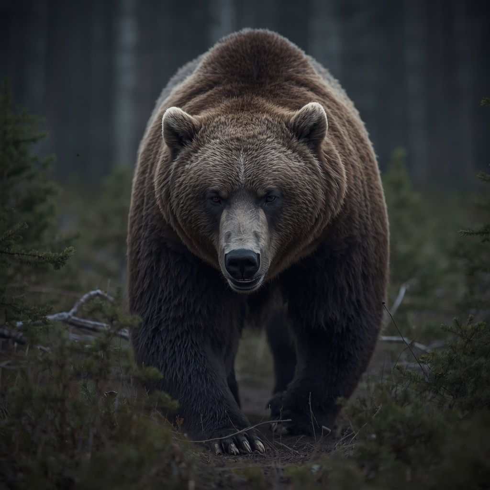

# Brown bear

> A real predator of the deep forest; rare and not scheduled for the slice.

| Field | Value |
|---|---|
| ID | `fauna.brown_bear` |
| Latin | *Ursus arctos* |
| Class | mammal |
| Group | `bear` |
| Owner or habitat | wild margin, deep forest |
| Encounter ID | `bst.bear` |

## 3D model

| Item | Value |
|---|---|
| Status | Procedural only, no 3D model |
| Runtime file | none (procedural mesh in code) |
| Source | none (project-built or procedural) |
| Author and licence | - |
| Rig and clips | - |
| Find a model | [Sketchfab search: brown bear rigged](https://sketchfab.com/search?q=brown+bear+rigged&type=models) (filter CC BY or CC0 by hand; not yet verified) |

## Code

- Catalogue: `scripts/map/view3d/map_view_mammal_species.gd`
- Mesh and loader: `scripts/map/view3d/map_view_mammal_meshes.gd + map_view_medieval_animal_models.gd`

## Encounter design

### At a glance
- A lone animal, met rarely and far from the roads; a spring bear woken early and starving is the dangerous one.
- Charges in short bursts, then rears and swipes; it breaks off if the fight goes badly.
- Slow to start, deadly if let close: it punishes a player who treats it like a wolf.
- Odd detail: the Metsik hunters give it a kinship name and never say "bear" in the grove.

### Ecological basis
The brown bear lived across medieval Livonia and Estonia (`attested`); this card makes no folklore claim. The bear's taboo name and its place in hunters' belief are noted in [estonian_folklore.md](../../lore/estonian_folklore.md) only as general context.

### Appearance
- **Body:** about 1.0 m at the shoulder on all fours, 2.0 m when reared, 150-250 kg; heavy shoulder hump, shambling walk, sudden sprint over short ground.
- **Materials and colours:** thick brown coat, darker legs, paler muzzle, small eyes; palette of umber, dark brown, dull gold at the shoulders.
- **What a model must get right:** the shoulder hump, broad head with a short muzzle, long front claws and a flat-footed stride; not a dog and not a monster.
- **Concept-art prompt:** Full-body concept of an adult brown bear in thick spring coat, shoulder hump, broad head and long front claws, lean after winter, standing on all fours with head lowered, Baltic forest floor with last snow suggested, plain neutral grey background, even lighting, realistic painted style.
- **Model notes:** Quadruped on the shared mammal rig; no bear GLB exists yet (the runtime uses the procedural mammal mesh, see the procedural model status above); scale 1.0, larger than the wolf by a wide margin.

### Motivation
Food and a quiet den. Fears fire, loud noise and a clear retreat path for itself. No contradiction: it is an animal. Released by fire, dropped food, or space to leave.

### Manifestation
Deep forest off the road in early spring and late autumn, near a kill or a bee tree. It attacks when surprised at close range or when it guards food, not as a hunter of travellers.

### Combat profile
base `EnemyArchetype` `enemy.bandit` (`scripts/combat/enemy_archetype.gd`) retuned to a single heavy animal: swipe replaces slash (`attack_damage_type` `slash`), 16 damage, reach 55, telegraph 0.70 s, slow turning. Moves: charge, rear and swipe, bite when grappled. Retreats at 40 percent health; no surrender; loot: pelt, claws, meat. Fire or a held spear line drives it off.

Guilt per school (christian / folk blood-debt / civic), deterministic: a bear killed in self-defence carries 0 / 0 / 0; killing a bear that is already fleeing carries 0 / 1 / 0 because Metsik belief holds the animal kin; a bear is not a person in any school.

### Voice
Barks: a huff, a low rumbling growl, a roar when reared.

### Relationships and factions
No faction. The [Metsik cult](../../CITIZENS/factions/cult_metsik.md) treats it with taboo respect. Royal and noble hunting rights over it are a later question and not modelled here.

### Game hooks
Not scheduled. If used, a single optional deep-forest encounter that teaches reading a telegraph and retreating; a pelt or claws as a forge or trade commission. A spirit bear, if ever wanted, belongs to the spirit layer and needs its own entry.
