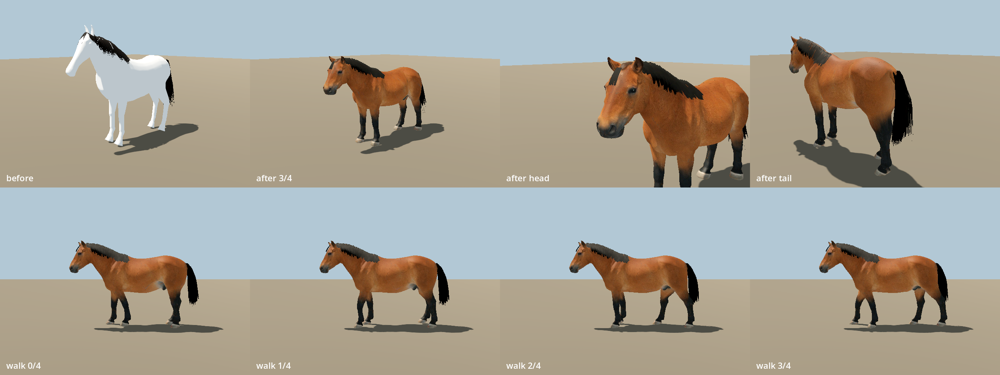

# Horse

> Bay cob of the Reval streets and carts.


| Field | Value |
|---|---|
| ID | `fauna.horse` |
| Latin | *Equus ferus caballus* |
| Class | mammal |
| Group | `ungulate` |
| Owner or habitat | urban (P2-024), foreland pasture |

## 3D model

| Item | Value |
|---|---|
| Status | Meshy image-to-3D body, project rig and hair (R-1173 HORSE-3) |
| Runtime file | [`assets/animals/horse/horse.glb`](../../../assets/animals/horse/horse.glb) (LOD0) |
| LODs | `horse.glb` 30k body + 3.4k hair tris, 2048 px maps; `horse_lod1.glb` 10k + 3.4k, 1024 px; `horse_lod2.glb` 3k + 1.2k (every third card), 512 px. LOD1/LOD2 are not wired yet (HORSE-5). |
| Source | Reference OpenAI gpt-image-1.5 `51bef764-...-1`; Meshy task `01a14bbf-8905-71a9-a340-f28cf12319ba` (bare body, watertight, one component) |
| Build | `tools/assets/meshy_animal/rig_meshy_quadruped.py` with `tools/assets/meshy_animal/horse_landmarks.json`; report `generated/blender/horse_v2/report.json` |
| Author and licence | Project author, AGPL-3.0-or-later |
| Size | Withers 1.43 world units (1.30 m), 1.70 units to the ears, 2.45 units nose to tail |
| Rig and clips | Shared mammal rig built like `import_realistic_mammals.create_rig()`; six clips (Idle, Walk, Run, LookAround, Graze, Alert) from its `animate()`, so the hooves stay planted on the new legs. Gait extras: walk 0.54, run 0.62 units/s reference speed. |

## Build steps

`rig_meshy_quadruped.py` (Blender, headless) grounds the hooves and scales the
withers to the target height, straightens the scan's turned head onto x=0, thins
the coat-coloured dock stump, decimates the LODs, places joints from the
landmark file (scan space) and skins with analytic weights: each leg quadrant
owns its four-bone chain below the trunk, Head rises along the withers-to-poll
line, Tail covers the dock. The coat keeps the Meshy albedo, normal and
roughness maps; the metal channel is dropped (metallicFactor 0).

```
blender -b --factory-startup --python tools/assets/meshy_animal/rig_meshy_quadruped.py -- \
  --meshy build/horse_meshy/bare/01a14bbf-8905-71a9-a340-f28cf12319ba.glb \
  --landmarks tools/assets/meshy_animal/horse_landmarks.json \
  --out assets/animals/horse/horse.glb \
  --lod1 assets/animals/horse/horse_lod1.glb --lod2 assets/animals/horse/horse_lod2.glb \
  --report generated/blender/horse_v2/report.json
```

## Hair and eyes

- Mane, forelock and tail are hair cards from `hair()` and `hair_atlas()` in
  `tools/assets/build_horse_source.py` (1024 px strand atlas, alpha clipped,
  double-sided), re-rooted on this body: the crest is ray-cast, the forelock
  frame follows the ray-cast face profile, the plume roots on the dock.
- Six mane locks (`Mane.0`-`Mane.5`, two bones each, parented to Body or Head)
  and the tail plume (`TailHair.0`-`TailHair.3` under Tail) carry the cards. A
  spring simulation (inertia from the clip, gravity on head pitch, periodic
  wind) is baked into every clip as seamless loops, so the hair swings with
  the gait and the wind without runtime code.
- Eyes are the scan's painted eyes; a separate wet-eye material is not done.
- Review: `tools/godot_render.sh --script tools/capture_horse_v2.gd -- --before <old glb>`
  writes `docs/reports/images/horse_v2/horse_v2_plate.png` (noon, real Godot materials).



## Code

- Catalogue: `scripts/map/view3d/map_view_mammal_species.gd`
- Mesh and loader: `scripts/map/view3d/map_view_mammal_meshes.gd + map_view_medieval_animal_models.gd`

## Notes

- Known limits: one bay coat (no chestnut/dun/grey variants or mud/sweat mask yet), no tack (HORSE-6), the scan stands with the far hind leg forward so the rest pose is staggered, Graze is a short head nod (shared clip), the off-side mane shows card ends along the crest at close range, and alpha scissor thins the hair at long range.
