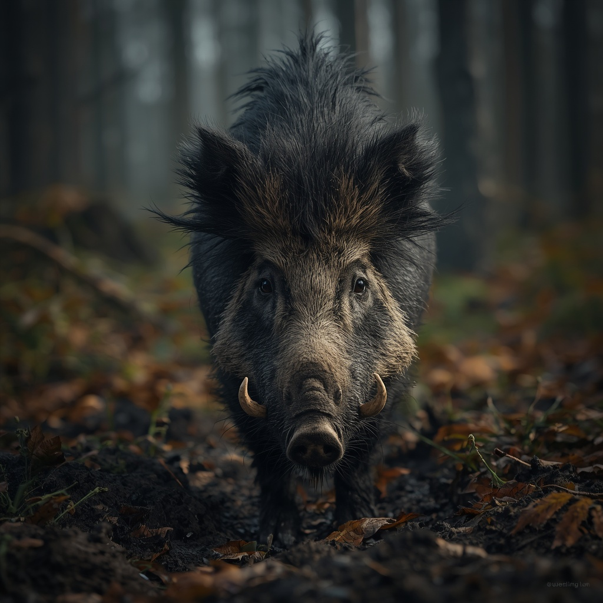

# Wild boar

> Bristled forest pig that charges when cornered; a hunting animal.

| Field | Value |
|---|---|
| ID | `fauna.wild_boar` |
| Latin | *Sus scrofa* |
| Class | mammal |
| Group | `ungulate` |
| Owner or habitat | wild margin, hinterland woods |
| Encounter ID | `bst.boar` |

## 3D model

| Item | Value |
|---|---|
| Status | Authored GLB (third-party, CC BY 4.0) |
| Runtime file | [`assets/storybook/boar/boar.glb`](../../../assets/storybook/boar/boar.glb) |
| Source page | [Sketchfab page](https://sketchfab.com/3d-models/bristled-wild-boar-3d-model-free-1c243598b9e54606a0bf1d8f5bf0a8b1) |
| Author and licence | iRahulRajput (rt699448), CC BY 4.0 |
| Rig and clips | Shared mammal rig, six clips: Idle, Walk, Run, LookAround, Graze, Alert (measured limb chains). |

## Code

- Catalogue: `scripts/map/view3d/map_view_mammal_species.gd`
- Mesh and loader: `scripts/map/view3d/map_view_mammal_meshes.gd + map_view_medieval_animal_models.gd`

## Encounter design

### At a glance
- A lone boar or a sow with piglets; the sow is the more dangerous.
- Charges low in a straight line and slashes upward with its tusks.
- Hard to turn once it commits, so a sidestep punishes it.
- Odd detail: peasants prize the meat and hate the boar for what it does to their rye.

### Ecological basis
Wild boar lived in the oak and mixed woods of medieval Estonia and Livonia and was a standard hunting animal (`attested`); this card makes no folklore claim.

### Appearance
- **Body:** about 0.9 m at the shoulder, 80-150 kg, heavy front, short legs; fast over short ground, poor at turning.
- **Materials and colours:** bristled grey-brown to black coat, a ridge of stiff hair along the spine, pale tusks; palette of charcoal, brown, bone.
- **What a model must get right:** the heavy wedge-shaped front, bristled back ridge, upward tusks and the low head.
- **Concept-art prompt:** Full-body concept of an adult wild boar in dark bristled winter coat, heavy wedge body, spine ridge of stiff hair, upturned tusks, head lowered ready to charge, damp Baltic woodland floor suggested, plain neutral grey background, even lighting, realistic painted style.
- **Model notes:** Quadruped on the shared mammal rig; an authored GLB already exists at `assets/storybook/boar/boar.glb` (CC BY 4.0, attribution above); scale 1.0.

### Motivation
Food, mud and protecting its young. Fears fire and dogs less than it should. No contradiction: it is an animal. Released by a thrown loaf, open ground to flee over, or the end of the danger to its young.

### Manifestation
Hinterland woods and rye-field edges at dusk and dawn, more often in autumn. It attacks when cornered, surprised close, or with piglets in sight.

### Combat profile
base `EnemyArchetype` `enemy.bandit` (`scripts/combat/enemy_archetype.gd`) retuned to a charging animal: tusk upswing replaces slash (`attack_damage_type` `pierce`), 9 damage, reach 40, telegraph 0.55 s, a long straight charge with a recovery gap. Moves: charge, tusk flick, retreat-and-recharge. Retreats at 35 percent health; no surrender; loot: pelt, meat, tusks. A sidestep during the charge leaves it exposed.

Guilt per school (christian / folk blood-debt / civic), deterministic: boar kills carry 0 / 0 / 0 in all schools. Poaching on a lord's preserve is a separate civic matter and is not modelled here.

### Voice
Barks: a grunt, a squeal, a snort before the charge.

### Relationships and factions
No faction. The woods around Harju manors are lordly hunting ground in practice, which belongs to a later poaching quest and not to this entry.

### Game hooks
Not scheduled. If used, an optional hinterland encounter on a farm-guard errand, with meat as a village reward and tusks as a trade item. Fits the wolf as a second animal fight type with a different rhythm (charge and sidestep).
