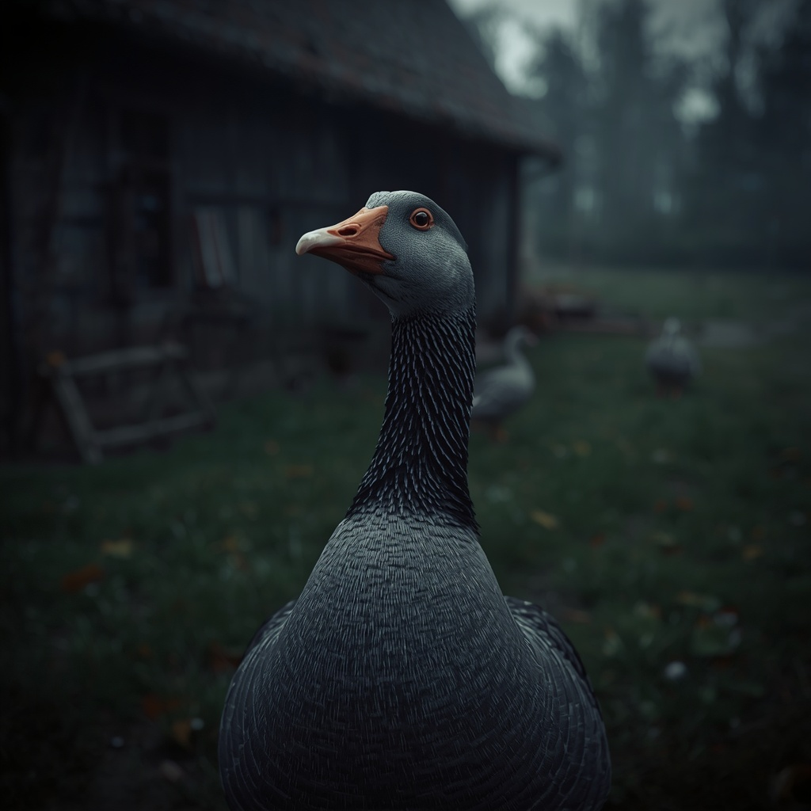

# Domestic goose

> Yard geese; loud and quick to hiss at strangers.

| Field | Value |
|---|---|
| ID | `fauna.goose` |
| Latin | *Anser anser domesticus* |
| Class | domestic bird (listed in the mammal catalogue) |
| Group | `fowl` |
| Owner or habitat | Lower Town and foreland pens (P0-106) |

## 3D model

| Item | Value |
|---|---|
| Status | Meshy scan rigged on the duck StorybookRig (R-2297, 2026-10-18) |
| Runtime file | [`assets/animals/goose/goose.glb`](../../../assets/animals/goose/goose.glb) |
| Source | Leonardo Nano Banana 2.1 reference -> Meshy image-to-3D task `01a14bee-6699-75fc-aa38-b69e4701103e` |
| Author and licence | Project author (`tools/assets/meshy_animal/rig_meshy_bird.py` + `goose_landmarks.json`), AGPL-3.0-or-later |
| Rig and clips | Nine-bone StorybookRig from `assets/birds/duck/duck.glb`: Idle, Walk, Hop, Peck, TakeOff, Fly, Glide, Land. The runtime plays Idle, Walk and Peck. Wings are scanned folded and carry no weights, so the flight clips leave them closed. |

## Code

- Catalogue: `scripts/map/view3d/map_view_mammal_species.gd`
- Mesh and loader: `scripts/map/view3d/map_view_mammal_meshes.gd + map_view_medieval_animal_models.gd`

## Notes

- Replaces the procedural `tools/assets/build_bird_gaits.py` goose (sphere head, cylinder neck), which read as unrealistic in villages.
- Imports through `tools/assets/bird_model_import.gd` (bird plumage shader, embedded textures). Yaw `PI` like the duck.
- Proof plate (before, after, beside a hen, Walk, Peck): [`goose_v2_plate.png`](../../reports/images/goose_v2/goose_v2_plate.png), `tools/capture_goose_v2.gd`.
- Distinct from the wild `bird.greylag_goose`, which has no GLB.
