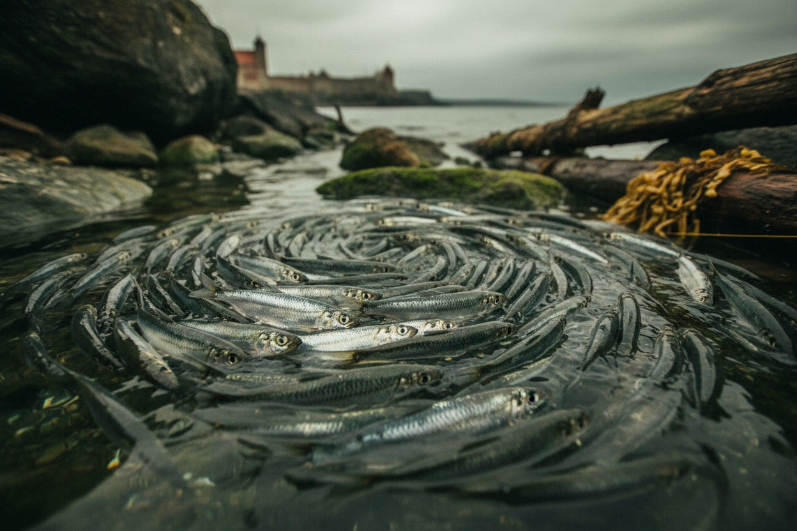
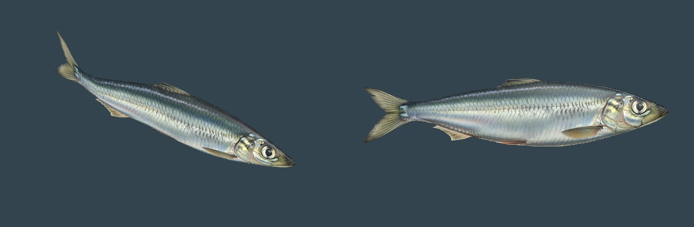

# Baltic herring

> The silver shoal of the Kalamaja shore; the cheapest fish in Reval.

| Field | Value |
|---|---|
| ID | `fish.herring` (card ID; the runtime species key is `herring`) |
| Latin | *Clupea harengus membras* |
| Class | fish |
| Group | `schooling fish` |
| Owner or habitat | clear shallows (0.35 to 1.1 m of water) off the Kalamaja fishing shore |

## 3D model

*Render of the in-game model with the runtime shader: `tools/godot_render.sh --script tools/capture_fish_cards.gd`.*

| Item | Value |
|---|---|
| Status | Project-built textured model (generated, task **R-1761**) |
| Runtime file | [`assets/animals/fish/herring/herring.gltf`](../../../assets/animals/fish/herring/herring.gltf) (+ `herring.bin`), texture [`herring_albedo.png`](../../../assets/animals/fish/herring/herring_albedo.png) |
| Source | Leonardo AI (Nano Banana) side-view illustration [`reference/herring_leonardo.jpg`](../../../assets/animals/fish/reference/herring_leonardo.jpg), cut to texture and body outline by [`prepare_fish_textures.py`](../../../tools/assets/fish/prepare_fish_textures.py), lofted in Blender by [`build_fish_models.py`](../../../tools/assets/fish/build_fish_models.py) |
| Author and licence | Project maintainer with Leonardo AI, AGPL-3.0-or-later |
| Geometry | Lofted body following the fin-free outline (40 rings x 20 sides) plus a flat midplane fin card cut by the texture alpha; one mesh, one material |
| Rig and clips | None. The tail swings in `scripts/city/city_fish.gdshader` from the shared ocean clock. |

## Code

- School placement and model loading: [`scripts/city/city_fish.gd`](../../../scripts/city/city_fish.gd) (`CityFish.species_mesh`)
- Textured look and tail swing: [`scripts/city/city_fish.gdshader`](../../../scripts/city/city_fish.gdshader)
- System page: [`CITY_SEA.md`](../../SYSTEMS/CITY_SEA.md) ("Fish")

## Notes

- Default species of a school: 82 percent of the seven schools, 11 fish each, about 0.33 m long in game. Dark blue-green back, silver flanks with a metallic sheen, brassy gill cover, deeply forked tail.
- Canon: the 1340s diet leaned heavily on Baltic herring ([`CANON.md`](../../CANON.md)); the shore lives off the spring run ([Kalamaja fishing shore](../../../history/dossiers/topography/kalamaja-fishing-shore-1343.md)).
- Visual only: nothing is caught, hit or saved.
- Related objects (not creatures): [`obj.herring_fresh`](../../../content/objects/food/obj.herring_fresh.json), [`obj.herring_filleted`](../../../content/objects/food/obj.herring_filleted.json), [`obj.cargo_herring_barrels`](../../../content/objects/trade_good/obj.cargo_herring_barrels.json).