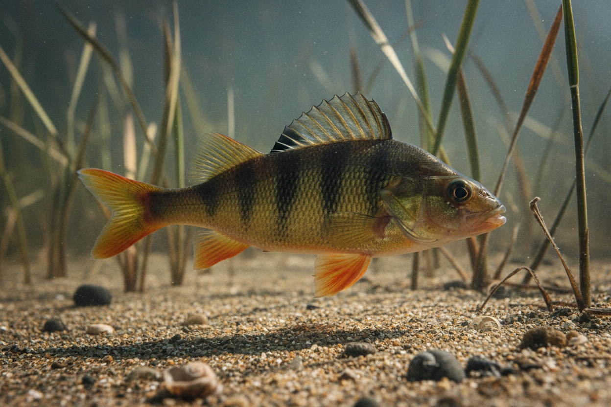
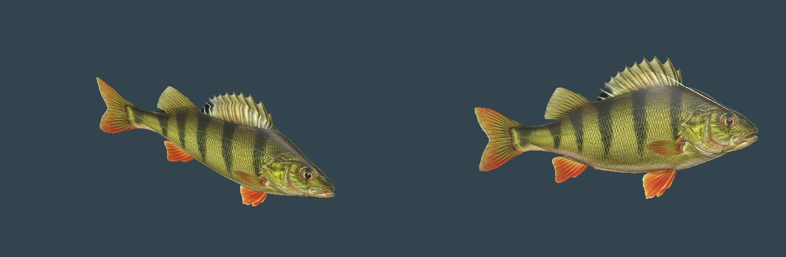

# European perch

> The striped lurker of the shallows, the odd one among the herring.

| Field | Value |
|---|---|
| ID | `fish.perch` (card ID; the runtime species key is `perch`) |
| Latin | *Perca fluviatilis* |
| Class | fish |
| Group | `freshwater and brackish predator` |
| Owner or habitat | clear shallows (0.35 to 1.1 m of water) near the shore and river mouths |

## 3D model

*Render of the in-game model with the runtime shader: `tools/godot_render.sh --script tools/capture_fish_cards.gd`.*

| Item | Value |
|---|---|
| Status | Project-built textured model (generated, task **R-1761**) |
| Runtime file | [`assets/animals/fish/perch/perch.gltf`](../../../assets/animals/fish/perch/perch.gltf) (+ `perch.bin`), texture [`perch_albedo.png`](../../../assets/animals/fish/perch/perch_albedo.png) |
| Source | Leonardo AI (Nano Banana) side-view illustration [`reference/perch_leonardo.jpg`](../../../assets/animals/fish/reference/perch_leonardo.jpg), cut to texture and body outline by [`prepare_fish_textures.py`](../../../tools/assets/fish/prepare_fish_textures.py), lofted in Blender by [`build_fish_models.py`](../../../tools/assets/fish/build_fish_models.py) |
| Author and licence | Project maintainer with Leonardo AI, AGPL-3.0-or-later |
| Geometry | Lofted body following the fin-free outline (40 rings x 20 sides) plus a flat midplane fin card cut by the texture alpha; one mesh, one material |
| Rig and clips | None. The tail swings in `scripts/city/city_fish.gdshader` from the shared ocean clock. |

## Code

- School placement and model loading: [`scripts/city/city_fish.gd`](../../../scripts/city/city_fish.gd) (`CityFish.species_mesh`)
- Textured look and tail swing: [`scripts/city/city_fish.gdshader`](../../../scripts/city/city_fish.gdshader)
- System page: [`CITY_SEA.md`](../../SYSTEMS/CITY_SEA.md) ("Fish")

## Notes

- Appears in 18 percent of schools, 5 fish each, about 0.32 m long in game. Humped back, olive body with dark saddle bars, orange pelvic, anal and tail fins, black spot on the spiny first dorsal.
- Perch is a brackish-water fish of the Gulf of Finland; its place in 1343 Reval is an ecological inference (`plausible composite`), not a documented catch.
- Visual only: nothing is caught, hit or saved.
- No object item exists for perch yet.