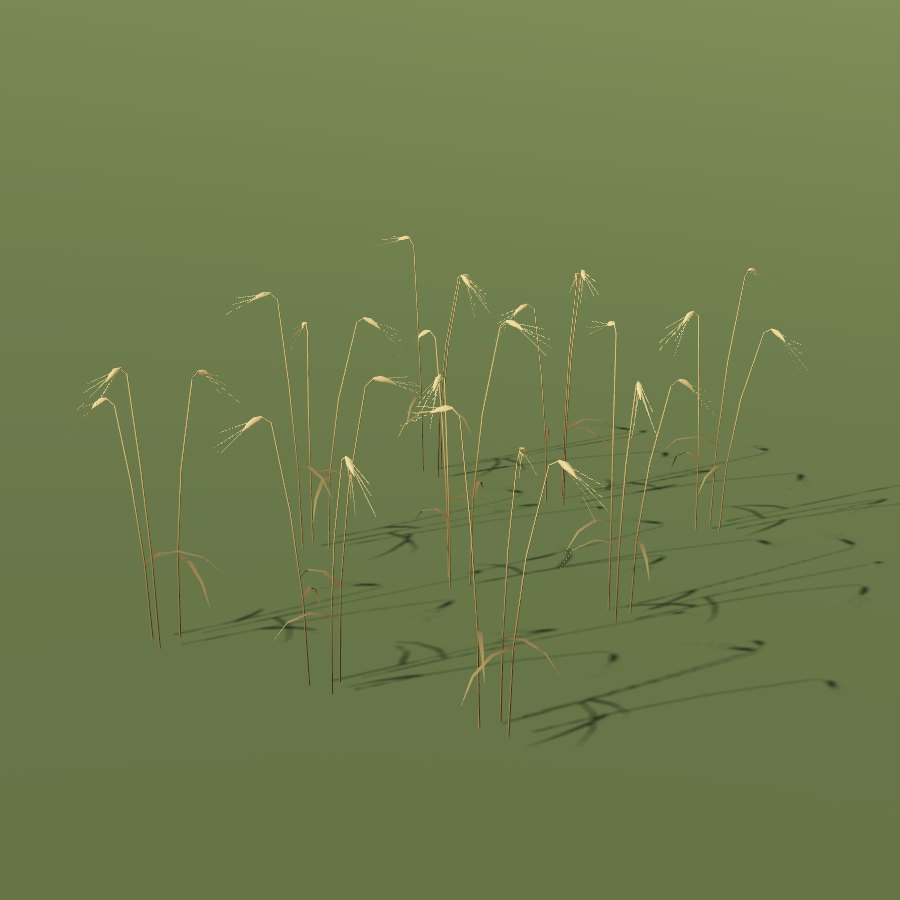

# Barley

| Field | Value |
|---|---|
| Latin | *Hordeum vulgare* |
| Estonian | oder |
| Runtime ID | `crop.barley` |
| Period (1343) | high |
| Model | District maps: primitive model (`MapViewPlantMeshes`). Seamless city: procedural stalk-and-ear clumps (`CityGrainMeshes`, **R-2112**) in leafy, headed, ripe and stubble stages, drawn by [Farmland](../../SYSTEMS/FARMLAND.md#grain-clumps) |

## Use

Porridge, beer.

## Notes

- City model: shortest (about 0.85 m), a short six-row ear with a long brush of awns; the head hangs over on an arched neck when ripe.
- The blueprint `field` primitive for district maps is planned (**R-1325**); it will reuse the city clumps.
