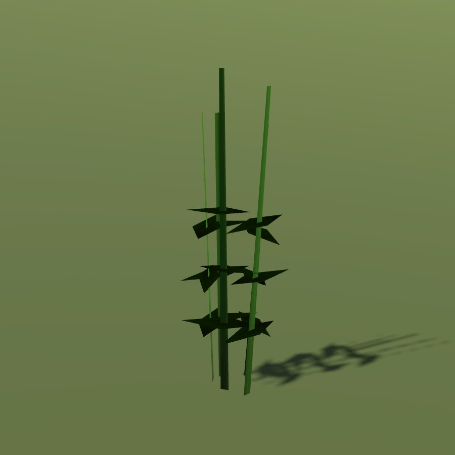

# Broad bean

| Field | Value |
|---|---|
| Latin | *Vicia faba* |
| Estonian | põlduba |
| Runtime ID | `crop.broad_bean` |
| Period (1343) | high |
| Model | Primitive district model (`MapViewPlantMeshes`); seamless-city fields are drawn by [Farmland](../../SYSTEMS/FARMLAND.md) |

## Use

Field pulse.

## Notes

- Grain fields with growth by date are planned (**R-1325**).
