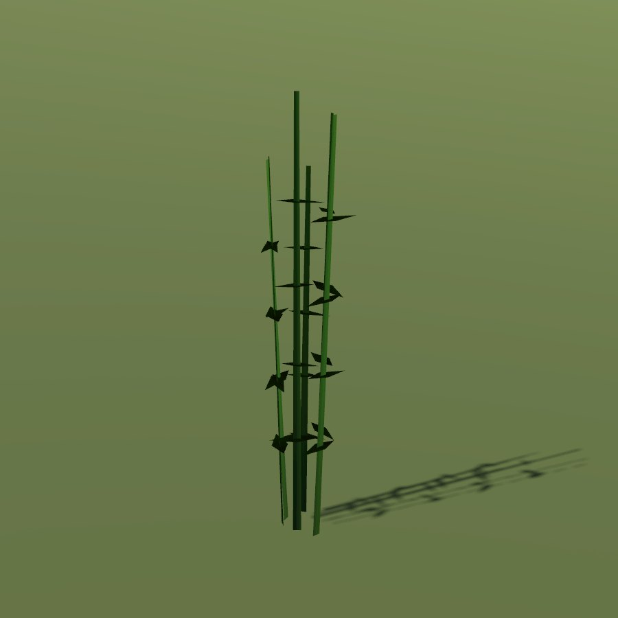

# Hemp

| Field | Value |
|---|---|
| Latin | *Cannabis sativa* |
| Estonian | kanep |
| Runtime ID | `crop.hemp` |
| Period (1343) | high |
| Model | Primitive district model (`MapViewPlantMeshes`); seamless-city fields are drawn by [Farmland](../../SYSTEMS/FARMLAND.md) |

## Use

Rope, sailcloth, seed oil.

## Notes

- Grain fields with growth by date are planned (**R-1325**).
