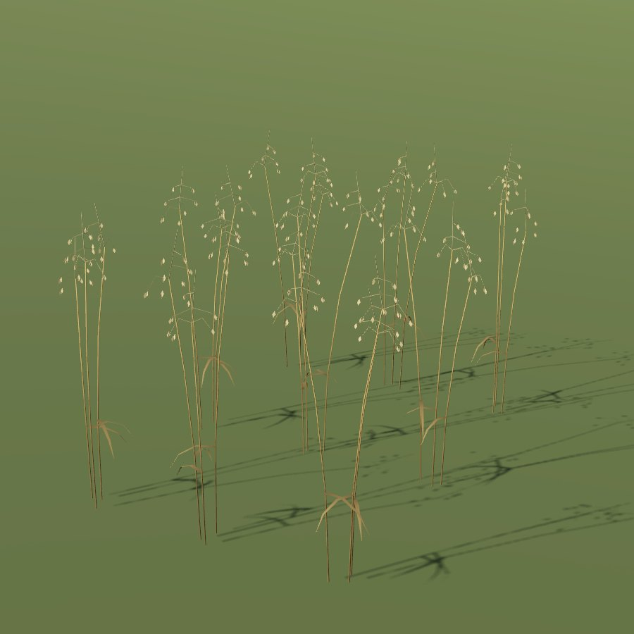

# Oat

| Field | Value |
|---|---|
| Latin | *Avena sativa* |
| Estonian | kaer |
| Runtime ID | `crop.oat` |
| Period (1343) | high |
| Model | District maps: primitive model (`MapViewPlantMeshes`). Seamless city: procedural stalk-and-ear clumps (`CityGrainMeshes`, **R-2112**) in leafy, headed, ripe and stubble stages, drawn by [Farmland](../../SYSTEMS/FARMLAND.md#grain-clumps) |

## Use

Fodder and porridge.

## Notes

- City model: about 1.05 m, an open panicle of slender branches hanging pairs of lantern-shaped spikelets.
- The blueprint `field` primitive for district maps is planned (**R-1325**); it will reuse the city clumps.
