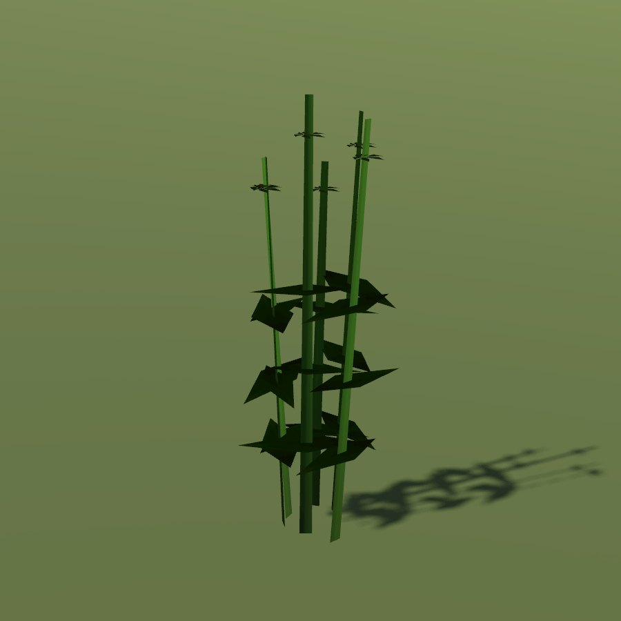

# Pea

| Field | Value |
|---|---|
| Latin | *Pisum sativum* |
| Estonian | hernes |
| Runtime ID | `crop.pea` |
| Period (1343) | high |
| Model | Primitive district model (`MapViewPlantMeshes`); seamless-city fields are drawn by [Farmland](../../SYSTEMS/FARMLAND.md) |

## Use

Field and garden pulse.

## Notes

- Grain fields with growth by date are planned (**R-1325**).
