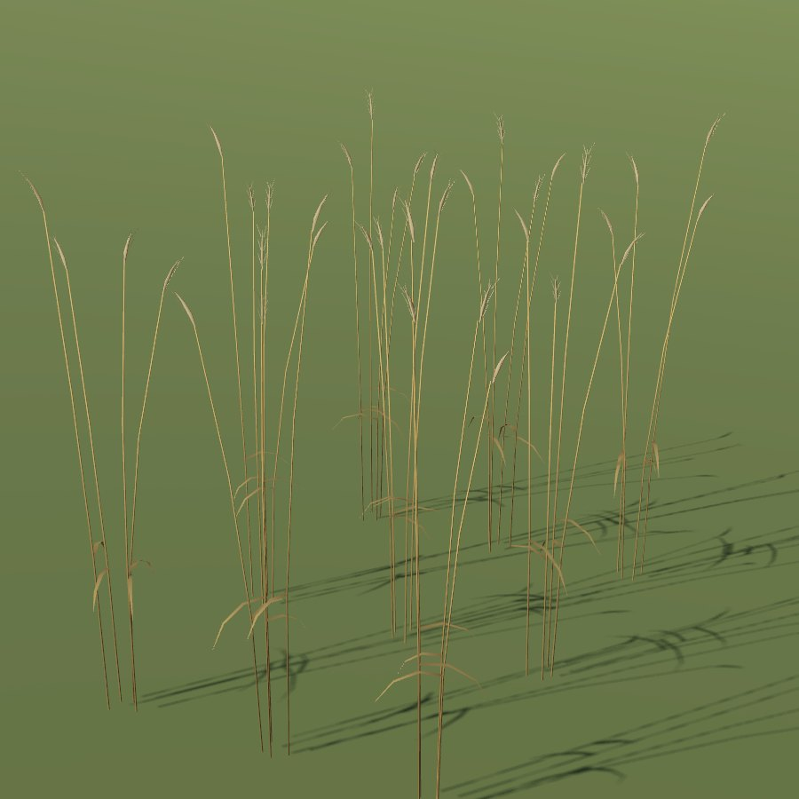

# Rye

| Field | Value |
|---|---|
| Latin | *Secale cereale* |
| Estonian | rukis |
| Runtime ID | `crop.rye` |
| Period (1343) | high |
| Model | District maps: primitive model (`MapViewPlantMeshes`). Seamless city: procedural stalk-and-ear clumps (`CityGrainMeshes`, **R-2112**) in leafy, headed, ripe and stubble stages, drawn by [Farmland](../../SYSTEMS/FARMLAND.md#grain-clumps) |

## Use

The main bread grain of 1343 Estonia.

## Notes

- City model: tallest (about 1.55 m ripe), a slim two-row spike with short awns that nods a little at harvest; blue-green leaves.
- The blueprint `field` primitive for district maps is planned (**R-1325**); it will reuse the city clumps.
