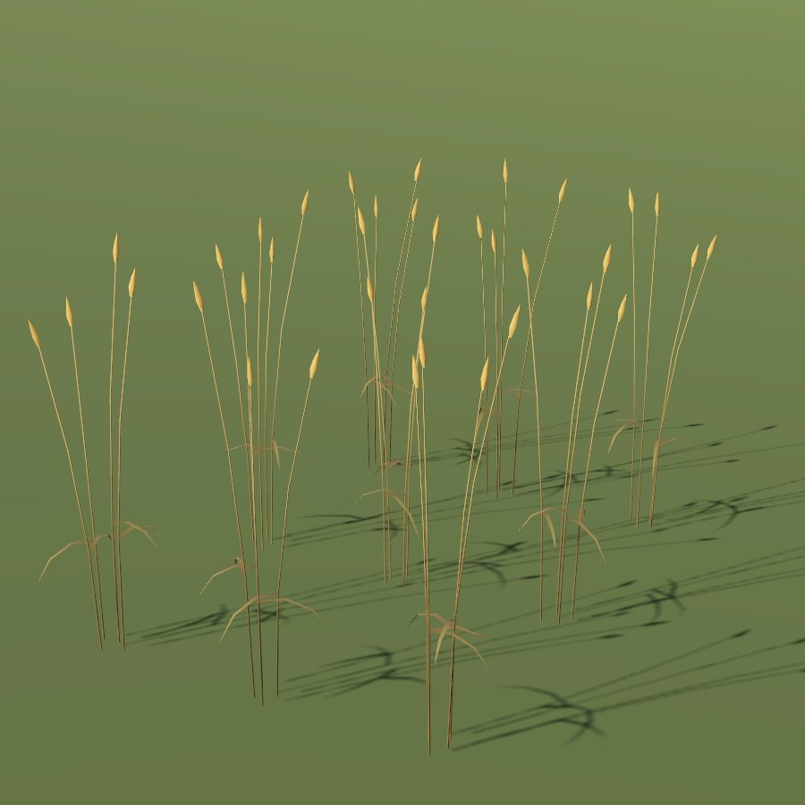

# Wheat

| Field | Value |
|---|---|
| Latin | *Triticum aestivum* |
| Estonian | nisu |
| Runtime ID | `crop.wheat` |
| Period (1343) | high |
| Model | District maps: primitive model (`MapViewPlantMeshes`). Seamless city: procedural stalk-and-ear clumps (`CityGrainMeshes`, **R-2112**) in leafy, headed, ripe and stubble stages, drawn by [Farmland](../../SYSTEMS/FARMLAND.md#grain-clumps) |

## Use

Rare; manor and town bread.

## Notes

- City model: about 1.15 m, a plump beardless ear held upright.
- The blueprint `field` primitive for district maps is planned (**R-1325**); it will reuse the city clumps.
