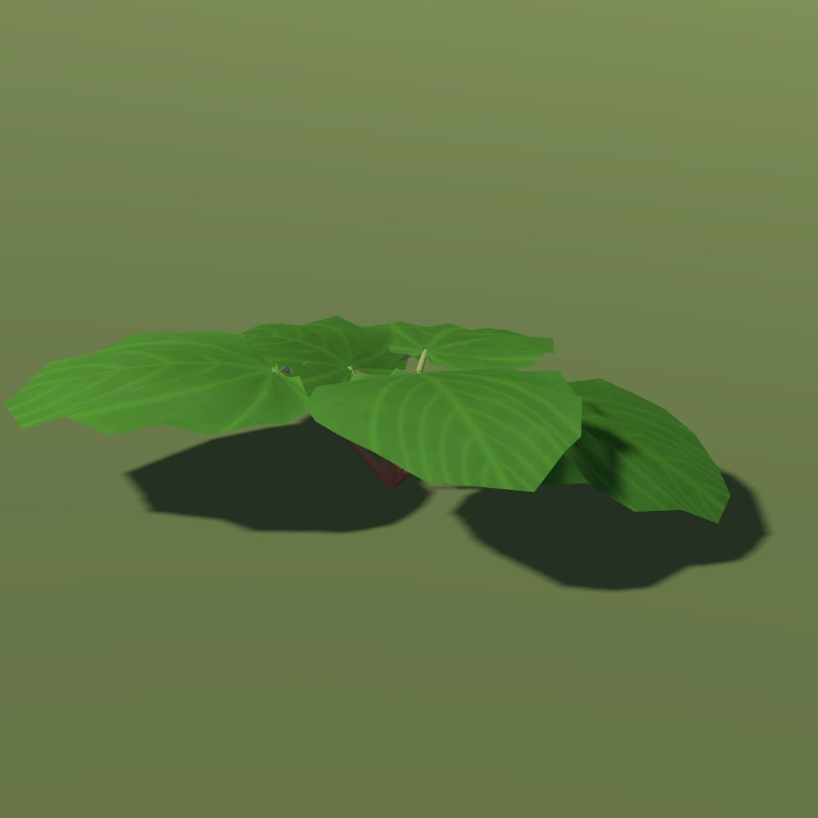
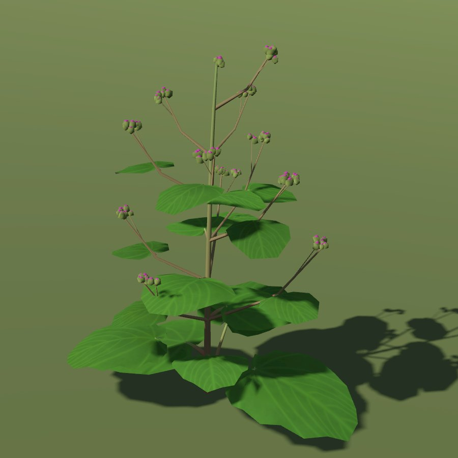
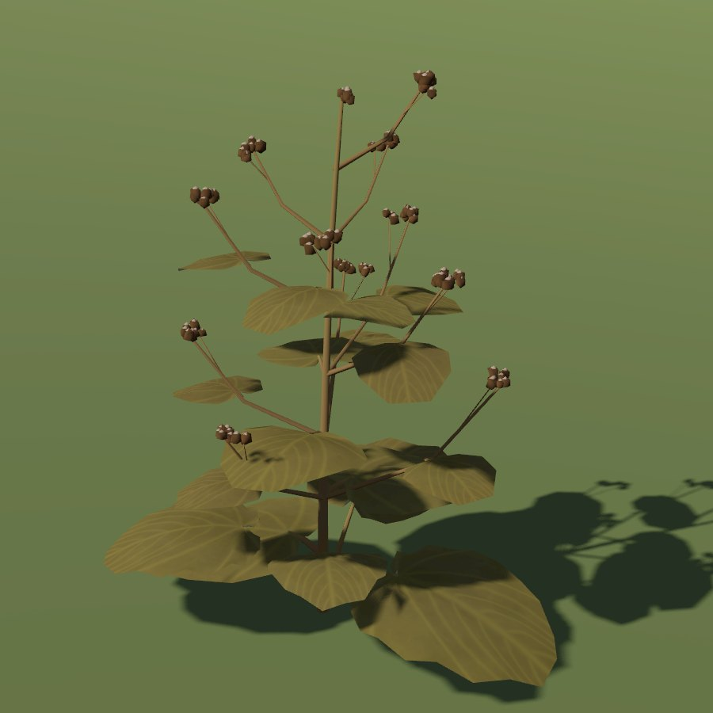

# Burdock

| burdock | burdock flowering | burdock dry |
|---|---|---|
|  |  |  |

| Field | Value |
|---|---|
| Latin | *Arctium lappa / A. minus* |
| Estonian | takjas |
| Runtime ID | city `burdock`, `burdock_flowering`, `burdock_dry`; district `plant.burdock` |
| Habitat group | verges, yards and wall feet |
| Period (1343) | high |
| Model | Detailed city wild-plant model (`CityForbMeshes`), near and far variants; blueprint maps reuse it ([wild plants](../../SYSTEMS/LIVING_VEGETATION.md#wild-plants-forbs)) |

## Where it grows in game

Ruderal: the unmown strip at a wall foot and road edges.

## Seasons

Green burrs July-August, dry brown burrs September-October.

## Folk use and herbalism (planned)

Root oil for hair and skin; leaves on swellings. No gathering system exists yet; see [herbalism readiness](../README.md#herbalism-readiness).

## Notes

- Seasons switch the model through `VegetationPhenology.forb_phase`; placement is `CityForbs.suitability`.
