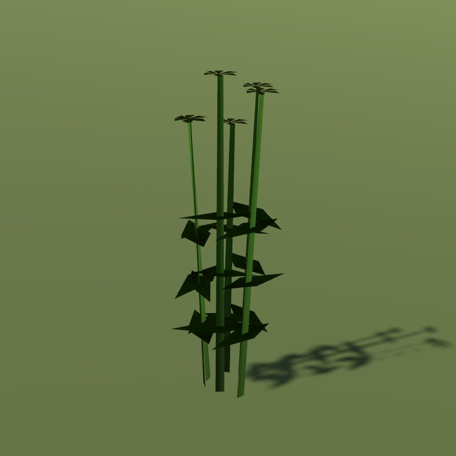

# Caraway

| Field | Value |
|---|---|
| Latin | *Carum carvi* |
| Estonian | harilik köömen |
| Runtime ID | district `plant.caraway` |
| Habitat group | meadow and pasture |
| Period (1343) | high |
| Model | Primitive district model (`MapViewPlantMeshes`, one of the generic growth archetypes); not in the seamless city |

## Where it grows in game

Hay meadows and pastures.

## Seasons

Flowers June; seeds July-August.

## Folk use and herbalism (planned)

Seeds for bread, cheese and stomach tea. No gathering system exists yet; see [herbalism readiness](../README.md#herbalism-readiness).

## Notes

- **Needs a detailed model.** The district archetype reads as a generic green bunch up close. A detailed `CityForbMeshes` model would also bring it into the seamless city.
