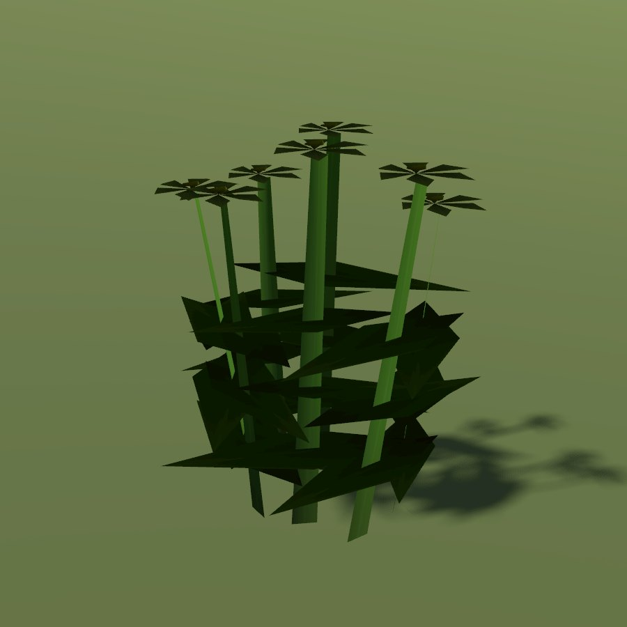

# Chamomile

| Field | Value |
|---|---|
| Latin | *Matricaria chamomilla* |
| Estonian | kummel |
| Runtime ID | district `plant.chamomile` |
| Habitat group | gardens and field edges |
| Period (1343) | medium (archaeophyte weed of fields and yards; cultivated in monastery gardens) |
| Model | Primitive district model (`MapViewPlantMeshes`, one of the generic growth archetypes); not in the seamless city |

## Where it grows in game

Garden and field-edge herb; primitive flowering-herb model on blueprint maps only.

## Seasons

Flowers June-August.

## Folk use and herbalism (planned)

Flower tea for the stomach, washes for wounds and eyes. The small apothecary "ромашка". No gathering system exists yet; see [herbalism readiness](../README.md#herbalism-readiness).

## Notes

- **Needs a detailed model.** The district archetype reads as a generic green bunch up close. A detailed `CityForbMeshes` model would also bring it into the seamless city.
