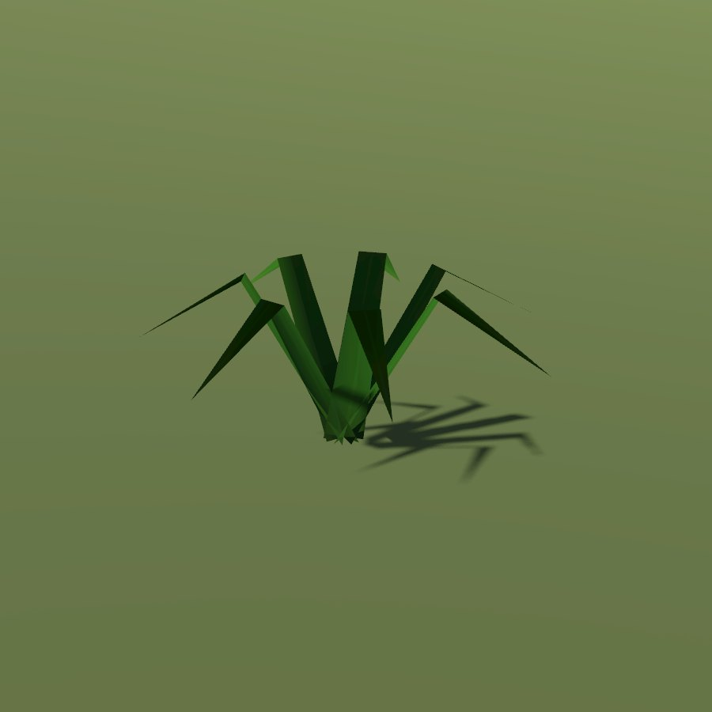

# Bracken / male fern

| Field | Value |
|---|---|
| Latin | *Pteridium aquilinum / Dryopteris filix-mas* |
| Estonian | kilpjalg / sõnajalg |
| Runtime ID | district `plant.fern` |
| Habitat group | woods and shade |
| Period (1343) | high |
| Model | Primitive district model (`MapViewPlantMeshes`, one of the generic growth archetypes); not in the seamless city |

## Where it grows in game

Shade under conifers.

## Seasons

Fronds May-October.

## Folk use and herbalism (planned)

Root against worms; the fern flower of St John's Eve folklore. No gathering system exists yet; see [herbalism readiness](../README.md#herbalism-readiness).

## Notes

- **Needs a detailed model.** The district archetype reads as a generic green bunch up close. A detailed `CityForbMeshes` model would also bring it into the seamless city.
