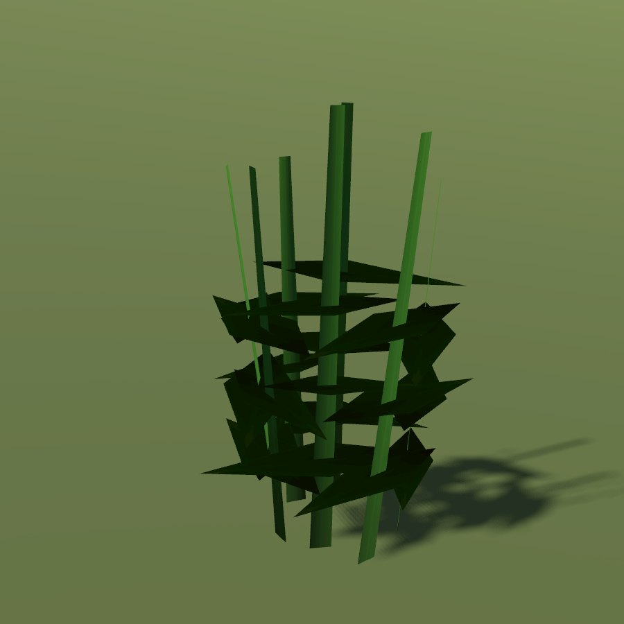

# Mint

| Field | Value |
|---|---|
| Latin | *Mentha arvensis / garden mints* |
| Estonian | põldmünt |
| Runtime ID | district `plant.mint` |
| Habitat group | gardens and field edges |
| Period (1343) | medium (wild field mint high; garden mints medium) |
| Model | Primitive district model (`MapViewPlantMeshes`, one of the generic growth archetypes); not in the seamless city |

## Where it grows in game

Damp ground; garden beds on blueprint maps.

## Seasons

Flowers July-September.

## Folk use and herbalism (planned)

Tea for the stomach. No gathering system exists yet; see [herbalism readiness](../README.md#herbalism-readiness).

## Notes

- **Needs a detailed model.** The district archetype reads as a generic green bunch up close. A detailed `CityForbMeshes` model would also bring it into the seamless city.
