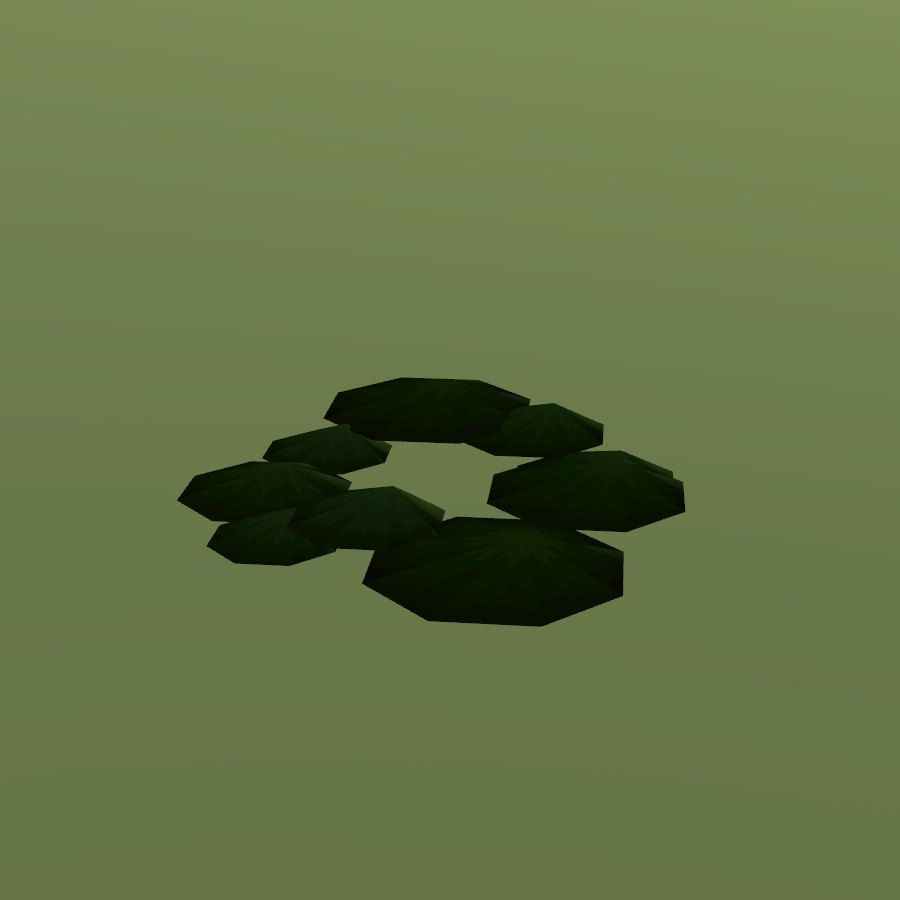

# Sphagnum moss

| Field | Value |
|---|---|
| Latin | *Sphagnum spp.* |
| Estonian | turbasammal |
| Runtime ID | district `plant.moss` |
| Habitat group | woods and shade |
| Period (1343) | high |
| Model | Primitive district model (`MapViewPlantMeshes`, one of the generic growth archetypes); not in the seamless city |

## Where it grows in game

Bogs and shaded ground. City moss on walls, roofs and trunks is a material, see [moss](../../SYSTEMS/LIVING_VEGETATION.md#moss-lichen-and-the-forest-floor-r-1661).

## Seasons

Evergreen.

## Folk use and herbalism (planned)

Wound dressing, caulking for log walls. No gathering system exists yet; see [herbalism readiness](../README.md#herbalism-readiness).

## Notes

- **Needs a detailed model.** The district archetype reads as a generic green bunch up close. A detailed `CityForbMeshes` model would also bring it into the seamless city.
