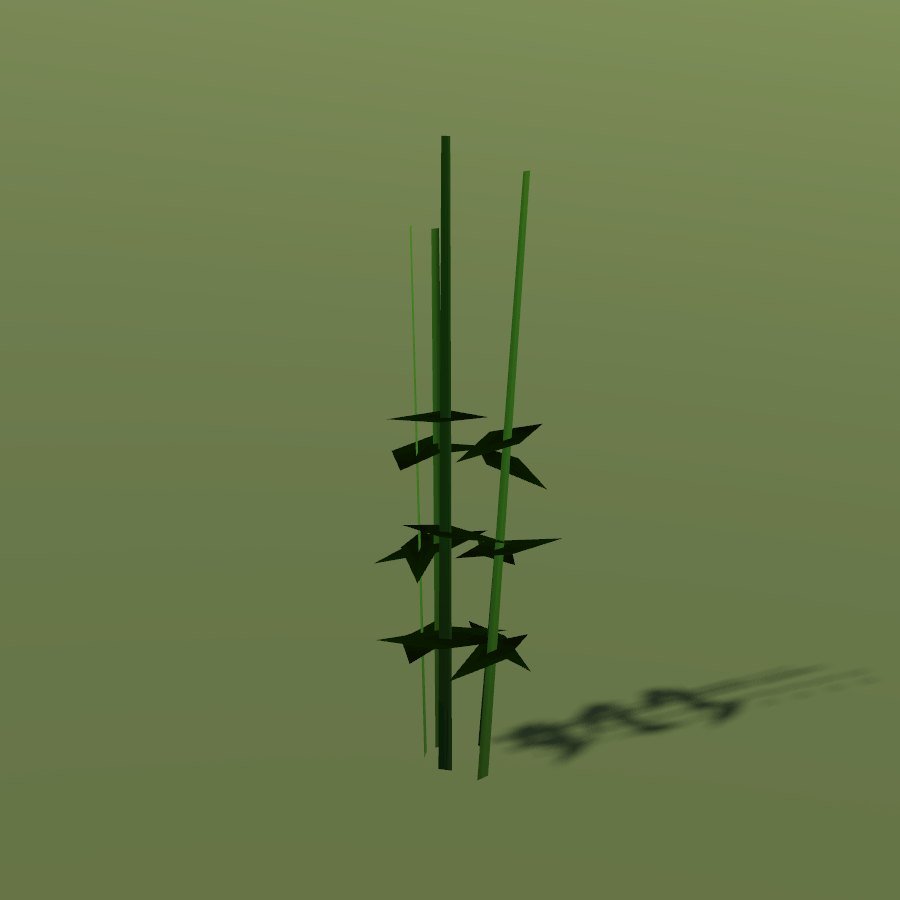

# Stinging nettle

| Field | Value |
|---|---|
| Latin | *Urtica dioica* |
| Estonian | kõrvenõges |
| Runtime ID | district `plant.nettle` |
| Habitat group | verges, yards and wall feet |
| Period (1343) | high |
| Model | Primitive district model (`MapViewPlantMeshes`, one of the generic growth archetypes); not in the seamless city |

## Where it grows in game

Wall feet, damp rich ground, middens.

## Seasons

Young shoots April-May; flowers July-September.

## Folk use and herbalism (planned)

Spring soup, fibre, hair wash. No gathering system exists yet; see [herbalism readiness](../README.md#herbalism-readiness).

## Notes

- **Needs a detailed model.** The district archetype reads as a generic green bunch up close. A detailed `CityForbMeshes` model would also bring it into the seamless city.
