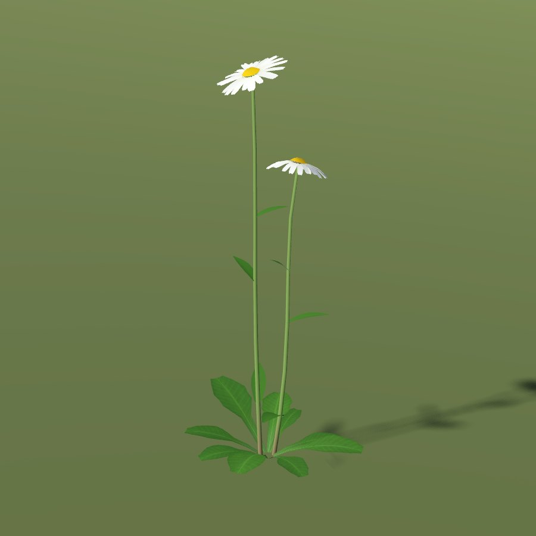
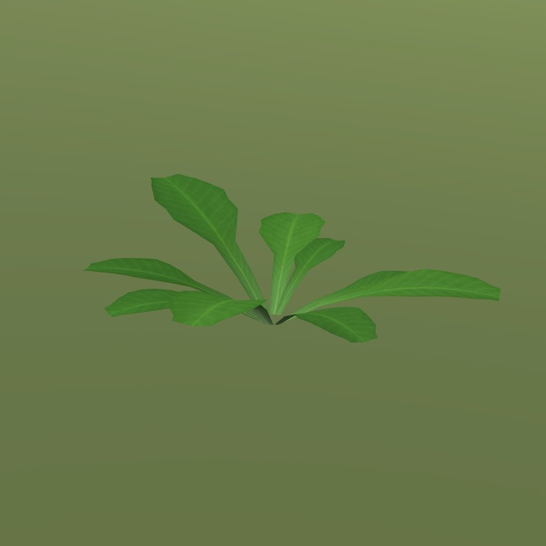
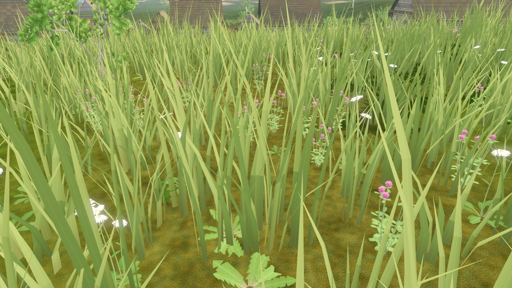

# Oxeye daisy

| oxeye daisy | oxeye daisy leaves | oxeye daisy closeup | oxeye daisy meadow |
|---|---|---|---|
|  |  |  |  |

| Field | Value |
|---|---|
| Latin | *Leucanthemum vulgare* |
| Estonian | härjasilm (нивяник) |
| Runtime ID | city `oxeye_daisy`, `oxeye_daisy_leaves` |
| Habitat group | meadow and pasture |
| Period (1343) | high (native meadow plant) |
| Model | Detailed city wild-plant model (`CityForbMeshes`), near and far variants; blueprint maps reuse it ([wild plants](../../SYSTEMS/LIVING_VEGETATION.md#wild-plants-forbs)) |

## Where it grows in game

Clumped patches in open, uncut meadow at least a few metres off the road; 30-46 cm stems, white heads with a golden disc.

## Seasons

Rosette from 15 April; flowers 1 June - 31 July; rosette again until 15 November.

## Folk use and herbalism (planned)

Flower and herb tea against cough; the big "ромашка" of Estonian hay meadows, picked for Jaanipäev wreaths. No gathering system exists yet; see [herbalism readiness](../README.md#herbalism-readiness).

## Notes

- Seasons switch the model through `VegetationPhenology.forb_phase`; placement is `CityForbs.suitability`.
